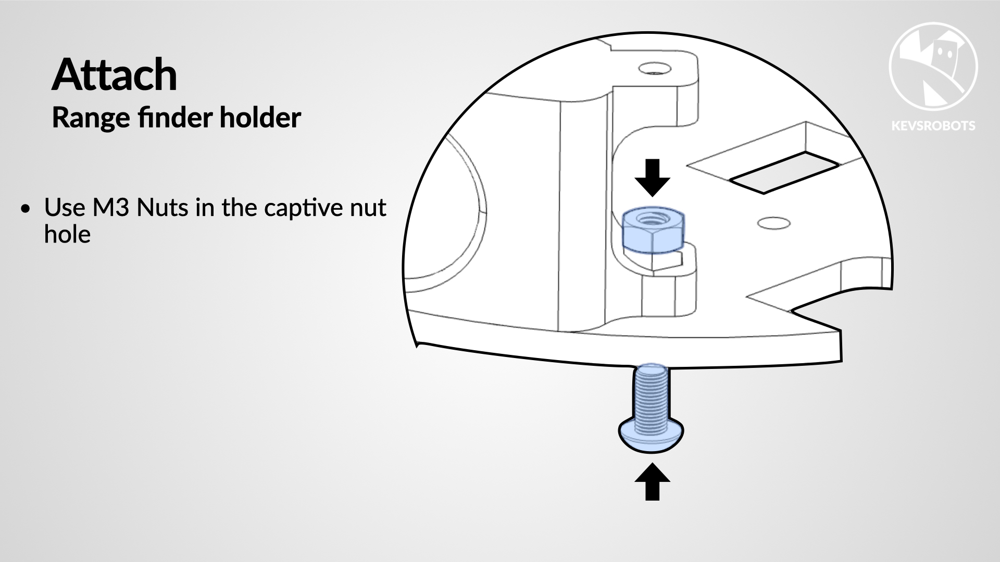
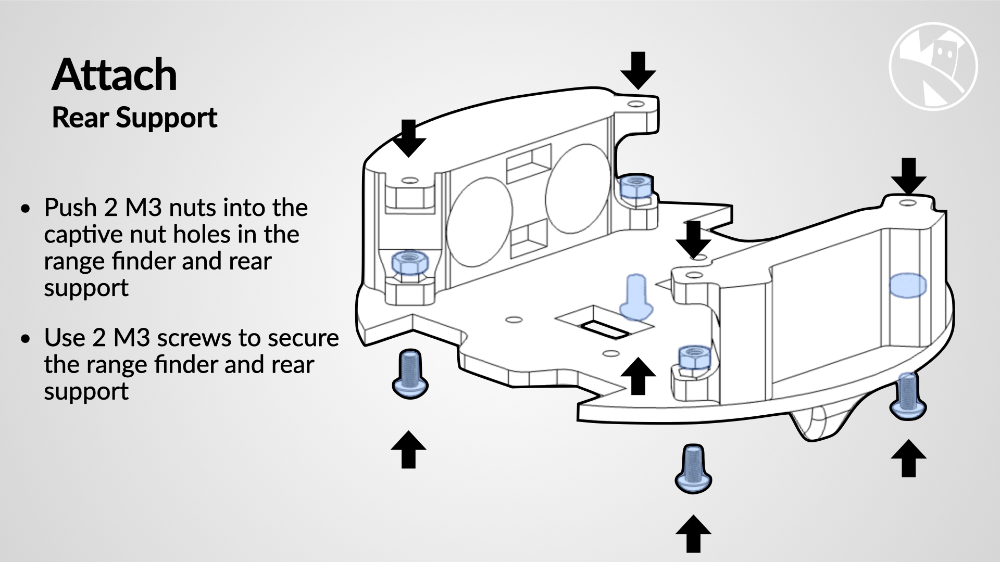
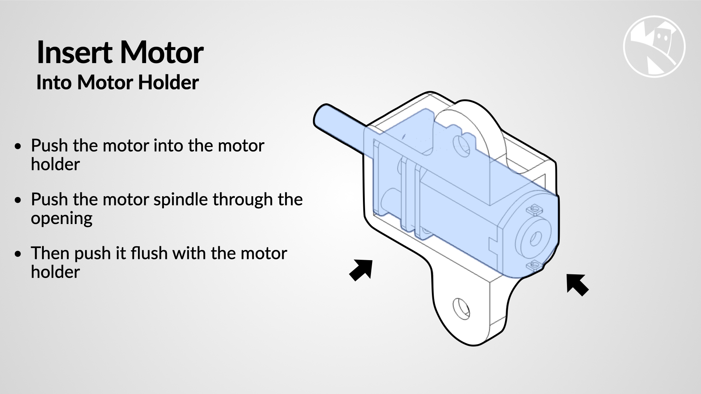
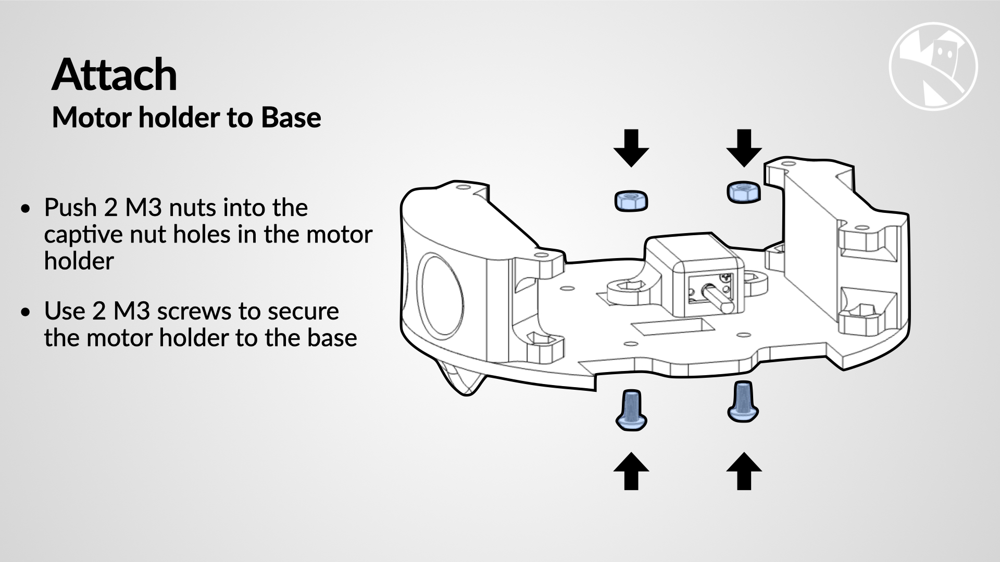
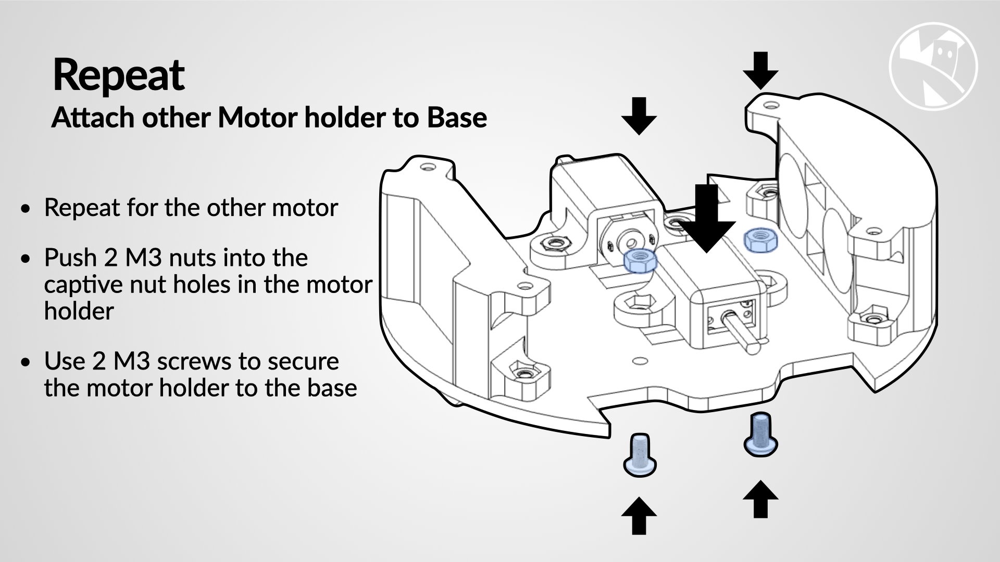
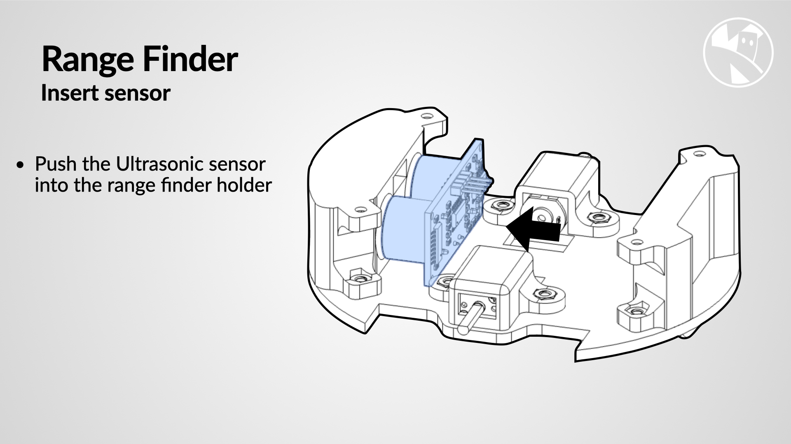
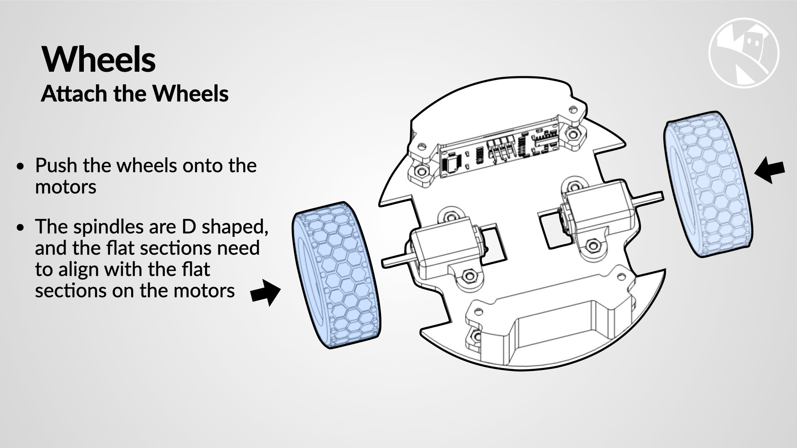
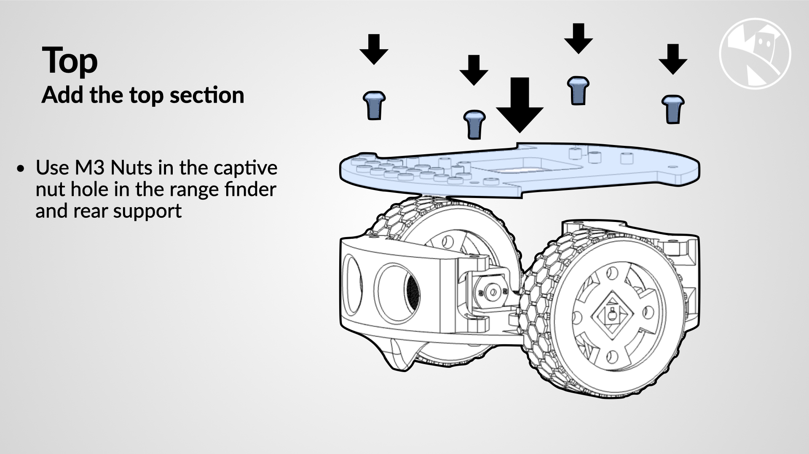
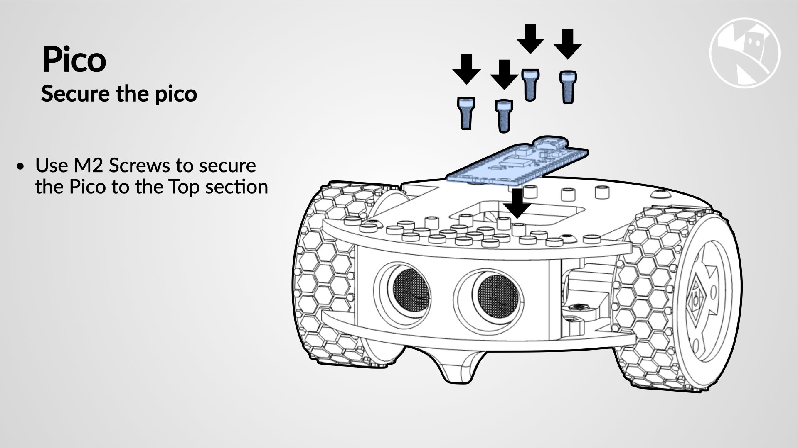

{:class="cover"}

---

By the end of this lesson you will be able to assemble the BurgerBot chassis, fit the motors, wheels and range finder, and check it over before you power it up.

---

Step | Detail
---|---
{:class="img-fluid w-100"}| Use M3 Nuts in the captive nut hole
{:class="img-fluid w-100"}| Push 2 M3 nuts into the captive nut holes in the range finder and rear support, Use 2 M3 screws to secure the range finder and rear support
{:class="img-fluid w-100"}| Push the motor into the motor holder, Push the motor spindle through the opening, Then push it flush with the motor holder
{:class="img-fluid w-100"}| Push 2 M3 nuts into the captive nut holes in the motor holder, Use 2 M3 screws to secure the motor holder to the base
{:class="img-fluid w-100"}| Repeat for the other motor, Push 2 M3 nuts into the captive nut holes in the motor holder, Use 2 M3 screws to secure the motor holder to the base
{:class="img-fluid w-100"}| Push the Ultrasonic sensor into the range finder holder
{:class="img-fluid w-100"}| Push the wheels onto the motors, The spindles are D shaped, and the flat sections need to align with the flat sections on the motors
{:class="img-fluid w-100"}| Use M3 Nuts in the captive nut hole in the range finder  and rear support
{:class="img-fluid w-100"}| Use M2 Screws to secure the Pico to the Top section
{:class="table table-striped"}

---

## Wiring and general assembly notes

1. Begin by soldering the Pico LiPo SHIM to the Pico. Apply some flux to make the soldering process easier.
1. Solder the red cable to the 5 volt on the Pico. Take note of the captive nuts where the battery will be placed.
1. Screw the battery in place. Be sure to screw only the left-hand side so that the LiPo SHIM can be placed on top.
1. Connect the battery from the other side and press the button to check if the connection is working well.
1. Screw the assembly onto the base, using screws and captive nuts to make a secure connection.
1. Add the Pimoroni motors and screw them into place. Use pliers to squish the nuts and secure them.
1. Install the rangefinder and screw it into place. It has captive nuts that make it easy to screw.
1. Add the thin Moon Buggy wheels.
1. If you're adding the pen upgrade, install the servo holder. It has captive nuts that make it easy to put into place and secure.
1. Add the pen holder and the cog that goes against it.
1. Test fit the Sharpie to ensure it fits snugly.
1. Add the motor cables. If you forgot to do this before, you can undo the motor holders and then re-screw them back into place.
1. Crimp some female to male Dupont cables and connect the servo to the pins on the back of the Pico.
1. Check your connections and run some code to test your BurgerBot.

By following these steps, you can build your own BurgerBot just like the one in the [build video](02_video.html).

> **Teachers**: soldering and LiPo batteries are the two risks in this lesson. Soldering the SHIMs and the battery lead needs an iron, ventilation and supervision. Never short, crush or puncture the LiPo battery, and plug it in with the right polarity: have an adult check it before the first power-up. Allow a full lesson for the build, longer if the printed parts need cleaning up.

---

## Before you switch on

Take a minute to check these. Most "my robot is dead" problems are found here:

1. Both wheels are pushed fully on, with the flat of each D shaped hole lined up with the flat on the motor shaft.
2. The motor wires are clear of the wheels.
3. The range finder is pushed into its holder, and nothing metal can touch the bare pins underneath the Pico.
4. The battery is secure and its connector is the right way round.

---

## Try it Yourself

1. Before building, lay all the printed parts out and match each one to a step in the table.
2. Build one motor holder and spin the wheel by hand. Does it turn freely?
3. Challenge: time yourself building the second half of the robot. What would you do differently to speed it up?

---

## Common Issues

- **Problem**: The wheels wobble or slip on the motor shafts
- **Solution**: Line up the flat side of the D-shaped hole with the flat on the motor shaft, then push firmly
- **Why**: The flat is what transfers the motor's turning force to the wheel

- **Problem**: Nuts keep falling out of the captive nut holes
- **Solution**: Press them in with the tip of a screwdriver, or use pliers to squeeze them home
- **Why**: Printed holes are deliberately tight, so the nut needs a firm push to seat

- **Problem**: The robot rocks back and forth on the desk
- **Solution**: Check the base has its two nubs at the front and back and that both wheels are fully pushed on
- **Why**: The wheels and the two nubs are what hold the robot level

---

## Check your understanding


? Which way round do the wheels go onto the motor shafts?
- [ ] Either way
- [x] With the flat of the D shaped hole lined up with the flat on the shaft
- [ ] With the flat facing the ground
> The D shape stops the wheel slipping on the shaft.

? What holds the motors and the range finder in place on the printed parts?
- [ ] Glue
- [x] M3 nuts pushed into captive nut holes, and M3 screws
- [ ] Hot melt
> The captive nut holes hold the nuts so you only need a screwdriver.

? What should an adult check before you plug in the LiPo battery for the first time?
- [x] That the connector is the right way round and nothing is shorting
- [ ] That the wheels are the same colour
- [ ] That the code is saved
> A reversed or shorted LiPo battery can damage the electronics and is a fire risk.


---
