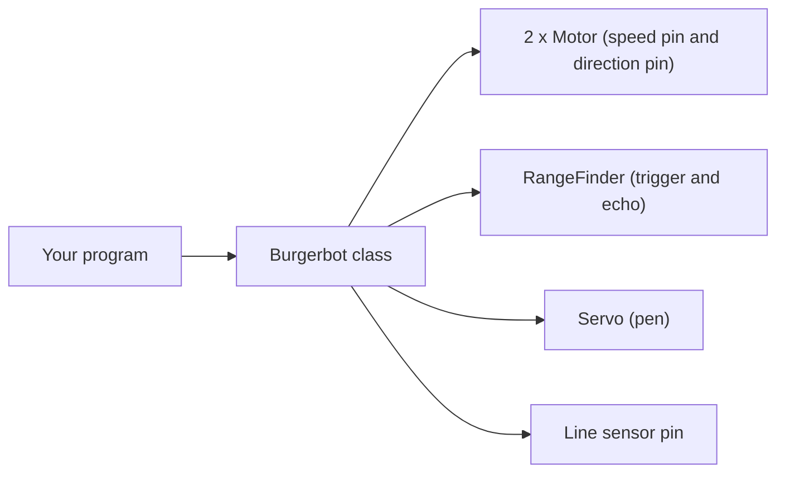

{:class="cover"}

---

By the end of this lesson you will be able to describe what the BurgerBot library controls, and name the Pico pins its code expects.

---

## BurgerBot MicroPython library

BurgerBot has a small MicroPython library that does the hard work of driving the motors and reading the sensors, so your own programs can be short and readable. It controls the motors, the range finder, the line sensor and the pen servo.

---

## Download the library

The library is a single file, `burgerbot.py`, in the [BurgerBot GitHub repository](https://github.com/kevinmcaleer/burgerbot).

1. Open [burgerbot.py on GitHub](https://github.com/kevinmcaleer/burgerbot/blob/main/burgerbot.py)
2. Click the **Download raw file** button
3. Copy it onto your Pico in the next lesson

The library works with the standard [MicroPython firmware for the Pico](/learn/how_to_install_micropython/). It only uses the built-in `machine`, `time` and `gc` modules, so you don't need any special firmware.

> ## Older versions
>
> Earlier versions of the library needed Pimoroni's MicroPython build and used method names like `turnleft()`. If you're following an old video, grab the latest `burgerbot.py` and use the names below.



---

## The Burgerbot class

Method or property | Description
---|---
`Burgerbot()` | Creates the robot object and sets the speed to 0.5
`forward(duration)` | Drives forward for `duration` seconds (default 0.5)
`backward(duration)` | Drives backward for `duration` seconds
`turn_left(duration)` | Spins left on the spot for `duration` seconds
`turn_right(duration)` | Spins right on the spot for `duration` seconds
`stop()` | Stops both motors
`left_motor(speed)` / `right_motor(speed)` | Sets one motor's speed, from -1 (full reverse) to 1 (full forward)
`speed` | The speed used by `forward()`, `backward()` and the turns, from -1 to 1. Read it with `bot.speed`, or change it with `bot.speed = 0.3`
`distance` | The distance to the nearest object from the range finder
`line_detected` | `True` when the line sensor sees a line
`pen_up()` / `pen_down()` / `pen_middle()` | Moves the pen servo
{:class="table table-code-fit"}

> ## Movement keeps going
>
> `forward(2)` starts the motors and waits for 2 seconds, but it doesn't stop them. Call `bot.stop()` when you want the robot to stop.

---

## Pins used

The library expects this wiring:

Part | Pico pins
---|---
Left motor | GP5 (speed), GP6 (direction)
Right motor | GP12 (speed), GP13 (direction)
Range finder | GP0 (trigger), GP1 (echo)
Pen servo | GP16
Line sensor | GP17
{:class="table table-code-fit"}

> ## Check your motor driver board
>
> In `burgerbot.py` each motor has one PWM speed pin and one direction pin (GP5 and GP6, GP12 and GP13). The Pimoroni Motor SHIM for Pico in the parts list is controlled differently, with two PWM inputs per motor, and Pimoroni's own library puts its motors on GP6, GP7, GP26 and GP27. GP6 is used for different things, so the Motor SHIM is not a drop-in match for this library as it stands. Check your driver board's documentation against the table before wiring, and change the `MOTOR_PINS` line in `burgerbot.py` if you wire to different pins. The custom PCB version of the robot, with its own libraries, is described on the [BurgerBot project pages](/projects/burgerbot/).

---

## Example demo

```python
from burgerbot import Burgerbot

bot = Burgerbot()
bot.speed = 0.5

bot.forward(1)
bot.turn_left(0.5)
bot.forward(1)
bot.stop()

print("Distance ahead:", bot.distance)
```

---

## Try it Yourself

1. Look at the pins table. Which pin does the left motor use for direction?
2. Open `burgerbot.py` in Thonny and find the `MOTOR_PINS` line and the `RangeFinder(trigger_pin=0, echo_pin=1)` line. What would you change to move the range finder to different pins?
3. Challenge: the `speed` setter raises a `ValueError` if you give it a number outside -1 to 1. Read the code and write the line you would type to trigger it.

---

## Common Issues

- **Problem**: `ImportError: no module named 'burgerbot'` when you run a program
- **Solution**: Save `burgerbot.py` onto the Pico itself, not just your computer, as shown in the next lesson
- **Why**: Python can only import modules that are on the board it is running on

- **Problem**: `ValueError: Speed value should be between -1 and +1`
- **Solution**: Give `speed` a number from -1 to 1, such as `0.5`
- **Why**: The library checks the value to protect the motors from nonsense speeds

---

## Check your understanding


? What happens after `bot.forward(2)` finishes?
- [ ] The robot stops automatically
- [x] The motors keep running until you call `bot.stop()` or another movement
- [ ] The robot reverses
> `forward()` sets the motor speed and waits. It doesn't stop the motors afterwards.

? How do you make BurgerBot drive more slowly?
- [ ] `bot.forward(0.3)`
- [x] `bot.speed = 0.3`
- [ ] `bot.left_motor(3)`
> `speed` sets how fast the motors run. The number passed to `forward()` is how long to drive for.

? Which two pins does the library use for the range finder?
- [x] GP0 (trigger) and GP1 (echo)
- [ ] GP5 and GP6
- [ ] GP16 and GP17
> The pins table lists GP0 and GP1 for the range finder.


---
