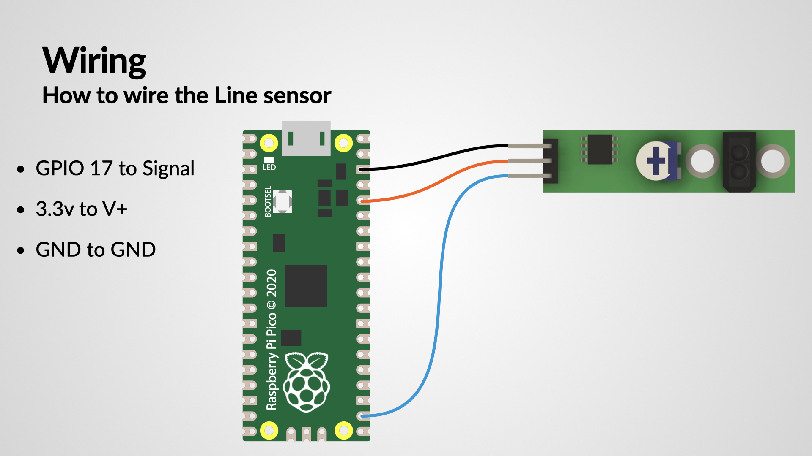

## Wiring up the Line sensor

Attach the following wires to the Pico:

Pico GPIO Pin | Line Sensor | Comments
--------------|------------|---
3.3v out      | V+ | Solder the end of a female dupont cable to the 3.3v out on the Pico
GND           | GND | Solder the end of a female dupont cable to the ground (GND) out on the Pico
GPIO 17       | Signal| Solder the end of a female dupont cable to GPIO 17 on the Pico
{:class="table table-code-fit"}

[{:class="img-fluid w-100"}](assets/wiring.jpg)

## MicroPython code

The TCRT5000 shines infrared light at the floor and measures how much bounces back. A black line reflects much less than white paper, so the sensor's output changes when it's over the line. The library reads this for you with `bot.line_detected`.

With one sensor, the trick is to follow the *edge* of the line: turn one way while you can see the line, and the other way when you can't. The robot wiggles along the edge.

```python
from burgerbot import Burgerbot

bot = Burgerbot()
bot.speed = 0.25          # go slowly so we don't overshoot the line

while True:
    if bot.line_detected:
        bot.left_motor(bot.speed)    # on the line: curve right, off it
        bot.right_motor(0)
    else:
        bot.left_motor(0)            # off the line: curve left, back onto it
        bot.right_motor(bot.speed)
```

We slow the robot down so it doesn't go too fast and miss the line, and the loop checks the sensor as often as it can.

> ## Wrong way round?
>
> Depending on your sensor, `line_detected` may be `True` over white instead of black. If the robot spins in circles, swap the two halves of the `if`.

---

## Try it yourself

Try different values for `bot.speed`. What's the fastest your BurgerBot can go and still stay on the line? Most TCRT5000 modules also have a small potentiometer for adjusting sensitivity.


? How does a single-sensor line follower stay on track?
- [ ] It drives straight and stops when it loses the line
- [x] It follows the edge, turning one way on the line and the other way off it
- [ ] It uses the range finder to see the line
> One sensor can only tell 'on' from 'off', so the robot zig-zags along the edge of the line.


---
