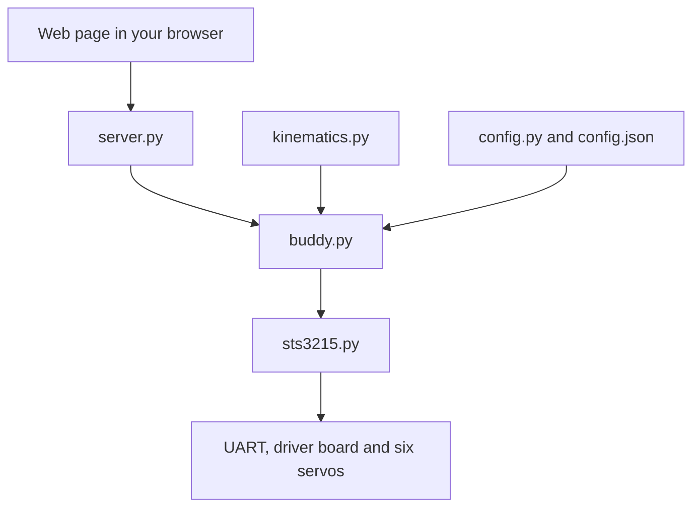

{:class="cover"}

---

Time to scale up. **Buddy** is a 6-DOF (six degrees of freedom) robot arm built from six STS3215 servos on a single data and power cable, from the base to the gripper. The wiring is almost invisible, which is the real magic of bus servos.

---

## The arm

Kev started from some arm files on Printables, wasn't happy with the look and fit, and remodelled the whole thing in Fusion 360, including a full model of the STS3215 so he could design mounts around it. This course is about the **electronics, the code and the control**, not the printing. For the printed parts and the build, see the repo and the video linked from the [Introduction](/learn/bus_servos/), and the video in lesson 13. Any arm built from six STS3215 servos in the same order will work with this code.

Buddy has six joints, each with a name and a servo ID. The numbering is a convention, and the code assumes it:

| ID | Joint | What it does |
| --- | --- | --- |
| 1 | `base` | Turns the whole arm left and right |
| 2 | `shoulder` | Tilts the upper arm forward and back |
| 3 | `elbow` | Bends the forearm |
| 4 | `wrist_pitch` | Tilts the hand up and down |
| 5 | `wrist_roll` | Twists the hand |
| 6 | `gripper` | Opens and closes the jaws |
{:class="table table-single"}

You can change the IDs in the config file later, but for now stick to 1 to 6.

## Step 1: number the servos

Each servo needs its own ID, and there's a rule you already know: **one at a time**. Use the `set_id` program from lesson 5 six times. Plug in one servo, set `CURRENT_ID = 1` and `NEW_ID` to its number, run it, and check the result. Power-cycle and confirm it stuck, then put a label on it. Do this for all six, then chain them in order and run the scan program to see `[1, 2, 3, 4, 5, 6]`.

Six servos can pull a lot of current when they move together, so make sure the 7.4V supply is up to it.

## Step 2: copy the project to the Pico

For the web panel later you need a **Pico W**. Download the repo from [github.com/kevinmcaleer/sts3215](https://github.com/kevinmcaleer/sts3215) and, from its folder on your computer, copy the runtime files to the board:

```bash
mpremote cp sts3215.py :
mpremote cp buddy.py :
mpremote cp config.py :
mpremote cp kinematics.py :
mpremote cp wifi.py :
mpremote cp server.py :
mpremote cp -r www :
```

Thonny works too: open each file and use File, Save as, Raspberry Pi Pico. Skip the demo files and the `tests/` folder. They aren't needed at runtime.

## The module map

Each file does one job, and they stack on top of one another.

| File | Job |
| --- | --- |
| `sts3215.py` | The low-level driver: ping, read, write and move over the bus |
| `buddy.py` | The six-joint wrapper: joint names, limits, multi-joint moves |
| `config.py` | Loads and saves `config.json` (joint settings and Wi-Fi) |
| `kinematics.py` | Forward and inverse kinematics, with tunable link lengths |
| `wifi.py` | Joins Wi-Fi, or starts its own access point |
| `server.py` | A small web server and JSON API |
| `www/` | The web page: HTML, CSS and JavaScript |
| `setup_id.py` | Changes a servo's ID |
| `calibrate.py` | Records the offsets for each joint |
{:class="table table-single"}



**Why this matters:** every layer only talks to the one below it. That means you can test the arm from the REPL without any web server, and drive it from the web without caring about UART packets.

## The Buddy class

`buddy.py` wraps the driver. You hand it the bus and it knows the joint names:

```python
Buddy(bus, joints=None, config_path=None)
```
{: .no-snakie }

With `config_path="/config.json"`, it loads your saved joint settings. If the file isn't there yet it falls back to defaults: IDs 1 to 6, offsets of 0, and limits of 0 to 360 degrees. Methods you'll meet in this course are `ping_all()`, `read_all_positions()`, `move_joint()`, `move_all()`, `move_all_sync()`, `set_torque_all()`, `gripper_open()`, `gripper_close()`, `home()` and `move_to_pose()`.

## The first check

Save this as `arm_check.py`. This complete program asks every joint if it's there and reads its position. It leaves torque off, so you can pose the arm by hand while you read the numbers.

```python
import time

from sts3215 import STS3215   # copy sts3215.py, buddy.py and config.py from the repo
from buddy import Buddy

bus = STS3215(uart_id=0, tx_pin=0, rx_pin=1, baudrate=1_000_000)
buddy = Buddy(bus, config_path="/config.json")

print("Ping:", buddy.ping_all())

buddy.set_torque_all(False)      # limp, so you can move it by hand
for _ in range(5):
    print("Positions (deg):", buddy.read_all_positions())
    time.sleep(1)
```

You should see `True` for all six joints. Then move each joint by hand and watch its number change. Right now the numbers are raw: 0 to 360 round the servo's full turn, with whatever zero the servo's encoder happens to have. Making them mean something is the next lesson's job.

## Try it Yourself

1. Move each joint by hand and note which direction makes the number go up. You'll need it when we meet `sign` in the next lesson.
2. Unplug one servo in the middle of the chain and run the check. What happens to the servos after it?
3. Challenge: write a loop that moves each joint 5 degrees from where it is now and back, one at a time, so you can check every joint is on the right ID.

## Common Issues

**Problem**: `ping_all` shows one joint as `False`.
**Solution**: Check that servo's ID with the scan program, then check its cable.
**Why**: Either its ID doesn't match the config, or the chain is broken before it.

**Problem**: `config: falling back to defaults` appears.
**Solution**: Nothing is wrong. You haven't made a `config.json` yet. Lesson 10 does.
**Why**: `load_config` quietly uses defaults when the file is missing.

**Problem**: `ImportError: no module named 'buddy'`.
**Solution**: Copy `buddy.py` and `config.py` onto the Pico.
**Why**: `buddy.py` imports from `sts3215`, and loads `config` when you give it a config path.
