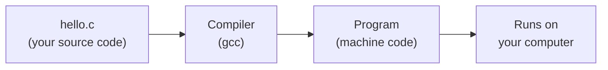

{:class="cover"}

---

By the end of this lesson you will be able to explain what a compiler does, and compile and run your first C program on your computer.

C is one of the oldest programming languages still in everyday use. It is fast, small and gives you direct control of the hardware, which is why it turns up inside robots, 3D printers and car dashboards. The Raspberry Pi Pico's own SDK is written in C, so learning C means you can read the code the Pico is built on.

---

## A short history

Dennis Ritchie created C at Bell Labs in the early 1970s so that operating systems could be written in something friendlier than assembly. It is why the Linux kernel is mostly C, and why many other languages borrow its curly braces and `for` loops. The Python you may know is itself written in C.

C is a **compiled** language. You write text (the **source code**), and a program called the **compiler** turns it into machine code the processor understands. Python reads your code line by line as it runs; C does all that work first.



For the Pico the middle step is a special compiler that makes code for the Pico's ARM chip, and the result is a `.uf2` file you copy onto the board. We'll do that in lesson 6.

---

## Why C on the Pico?

You can program the Pico in MicroPython, and for many robots it is the right choice. C offers different strengths:

| MicroPython | C with the Pico SDK |
|-------------|---------------------|
| Quick to write and change | More typing, but fast programs |
| Runs through an interpreter | Compiled to machine code |
| Memory is managed for you | You decide how memory is used |
| Great for learning and prototypes | Common in finished products |
{:class="table table-single"}

The trade is a stricter language. The compiler catches many mistakes before the program ever runs, which is a gift once you get used to it.

---

## Your first C program

Save this as `hello.c`:

```c
#include <stdio.h>

int main(void) {
    printf("Hello, I am a robot!\n");
    return 0;
}
```

Let's take it line by line.

- `#include <stdio.h>` pulls in the standard input and output library, which gives us `printf`.
- `int main(void)` is where every C program starts. `int` means it hands back a whole number when it finishes.
- `{ }` mark a block of code. Python uses indentation instead; C uses braces, and the indentation is only for humans.
- `printf("...\n");` prints text. The `\n` is a newline.
- Each statement ends with a semicolon `;`.
- `return 0;` tells the computer the program finished happily.

Compile and run it. On Linux, macOS or WSL, with `gcc` installed:

```bash
gcc -Wall -o hello hello.c
./hello
```

You should see:

```text
Hello, I am a robot!
```

`-Wall` asks the compiler to warn you about suspicious code, and `-o hello` names the finished program. Get in the habit of always using `-Wall`.

---

## Try it Yourself

1. Change the message to your robot's name and compile again.
2. Add a second `printf` line that prints a different message.
3. Remove the semicolon after the first `printf` and read the compiler's error. Put it back.
4. Challenge: remove the `\n` and see where the shell prompt lands. What does `\n` really do?

## Common Issues

- **Problem**: `gcc: command not found`
- **Solution**: Install a compiler. On Debian or Ubuntu, `sudo apt install build-essential`. On Windows, use WSL or an online C compiler for lessons 2 to 5.
- **Why**: A compiler is a separate program. It is not part of your operating system by default.

- **Problem**: `error: expected ';' before 'return'`
- **Solution**: Look at the line above the one the compiler names and add the missing `;`.
- **Why**: The compiler only notices the missing semicolon when it reaches the next statement.

- **Problem**: `./hello` says `No such file or directory`
- **Solution**: Check that `gcc` finished without errors, and that you are in the folder holding `hello`.
- **Why**: If compilation fails, no program is produced.

## Check your understanding


? What does a compiler do?
- [ ] It uploads code to the Pico
- [x] It turns source code into machine code the processor can run
- [ ] It runs your code line by line
> The compiler translates the whole program before it runs. Running line by line is what an interpreter does.

? What does `\n` do inside a `printf` string?
- [ ] Ends the program
- [x] Starts a new line
- [ ] Prints the letter n
> `\n` is the newline character.

? What marks a block of code in C?
- [ ] Indentation
- [x] Curly braces `{ }`
- [ ] A colon
> C uses braces. Indentation is for human readers only.

