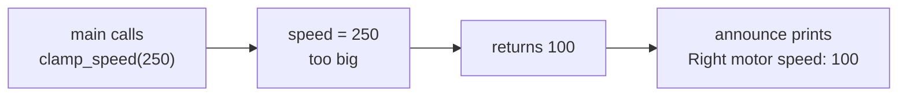

{:class="cover"}

---

By the end of this lesson you will be able to write functions that take inputs and return results, and declare them with prototypes.

As a robot program grows, you don't want one giant `main`. Functions let you name a chunk of code and use it wherever you like. You have already been using them: `printf` is a function somebody else wrote, and the Pico SDK is mostly functions such as `gpio_put` and `sleep_ms`.

---

## Anatomy of a function

```c
return_type function_name(parameter_list) {
    // code to run
}
```

- **return_type** is the kind of value handed back. `void` means nothing is returned.
- **function_name** is what you call it by.
- **parameters** are the inputs, each with a type.

A real example: motors accept speeds from -100 to 100, so we want one place that keeps any speed inside that range. Save this as `funcs.c`:

```c
#include <stdio.h>

int clamp_speed(int speed);
void announce(const char *name, int speed);

int clamp_speed(int speed) {
    if (speed > 100) {
        return 100;
    }
    if (speed < -100) {
        return -100;
    }
    return speed;
}

void announce(const char *name, int speed) {
    printf("%s motor speed: %d\n", name, speed);
}

int main(void) {
    announce("Left", clamp_speed(80));
    announce("Right", clamp_speed(250));
    announce("Spare", clamp_speed(-300));
    return 0;
}
```

Compile with `gcc -Wall -o funcs funcs.c` and run `./funcs`:

```text
Left motor speed: 80
Right motor speed: 100
Spare motor speed: -100
```



## What each part does

**Prototypes.** The two lines near the top that end in a semicolon are **function prototypes**. They tell the compiler "these functions exist, and here is how to call them" before it reaches their bodies. C reads top to bottom, so a function must be declared before you use it. A prototype lets you put `main` first or last as you prefer.

**Parameters are copies.** When you call `clamp_speed(250)`, the function gets its own copy of the number. Changing `speed` inside the function does not change the caller's variable.

**Return values.** `return` sends a value back and ends the function immediately. A `void` function can use a bare `return;` or just reach its closing brace.

**Strings.** `const char *name` is how C passes text. A string is an array of characters ending in a hidden zero byte, and `name` points to the first one. `const` promises we won't change it. You can read it as "some text", and `printf` prints it with `%s`.

**Why bother?** One function means one place to fix a bug. If your clamp is wrong, you fix it once instead of in twenty places.

---

## Try it Yourself

1. Write a function `int double_it(int x)` that returns `x * 2`, and print `double_it(21)`.
2. Change `clamp_speed` so the limits are 50 and -50.
3. Write `int battery_percent(float volts)` that returns 0 below 6.0 volts and 100 above 8.4 volts. Test it with a few values.
4. Challenge: write `int max_of(int a, int b)` and use it to find the larger of two sensor readings.

## Common Issues

- **Problem**: `warning: implicit declaration of function` (or `error: conflicting types`).
- **Solution**: Add a prototype above `main`, or move the function above where you call it.
- **Why**: The compiler reads from the top and must know a function before it sees a call.

- **Problem**: A function that should give back a number prints strange values.
- **Solution**: Check every path through the function ends in a `return`, and the type matches.
- **Why**: Reaching the end of a non-void function without returning leaves the result undefined.

- **Problem**: Changing a parameter inside a function does not change the original variable.
- **Solution**: Return the new value and assign it: `speed = clamp_speed(speed);`
- **Why**: C passes copies of values into functions.

## Check your understanding


? What does `void` mean as a return type?
- [ ] The function returns zero
- [x] The function returns nothing
- [ ] The function takes no parameters
> `void` as a return type means no value comes back.

? Why do we write a function prototype?
- [x] So the compiler knows a function exists before it sees its body
- [ ] To make the function run faster
- [ ] To stop the function being called
> C reads top to bottom, so functions must be known before they are called.

? In our program, what does `clamp_speed(250)` return?
- [ ] 250
- [x] 100
- [ ] -100
> Anything above 100 is cut back to 100.

