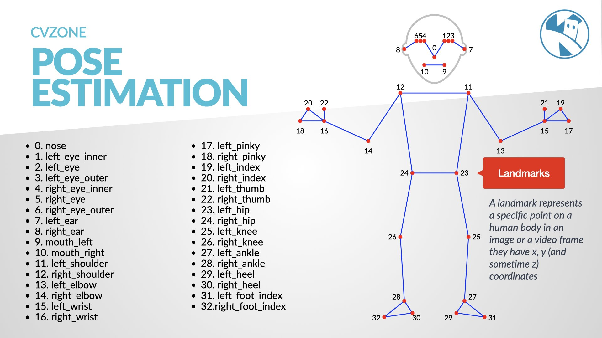

## Pose detection

Pose detection finds the position of a person's body: their head, shoulders, elbows, hips, knees and feet. It's used in fitness apps, motion capture and games. CVZone's `PoseDetector` uses MediaPipe's pose model, which finds **33 landmarks** on the body.

{:class="img-fluid w-75"}

Some useful landmark numbers:

Landmark | Body part
---|---
0 | Nose
11, 12 | Left and right shoulder
13, 14 | Left and right elbow
15, 16 | Left and right wrist
23, 24 | Left and right hip
25, 26 | Left and right knee
{:class="table table-code-fit"}

---

## The code

MediaPipe was installed in the first lesson, so you're ready to go.

```python
import cv2
from cvzone.PoseModule import PoseDetector

cap = cv2.VideoCapture(0)
detector = PoseDetector(detectionCon=0.5, trackCon=0.5)

while True:
    success, img = cap.read()
    if not success:
        break

    img = detector.findPose(img)
    lmList, bboxInfo = detector.findPosition(img, draw=True, bboxWithHands=False)

    if lmList:
        # Mark the centre of the body
        cv2.circle(img, bboxInfo["center"], 5, (255, 0, 255), cv2.FILLED)

        # Distance from the left shoulder (11) to the left wrist (15)
        length, img, info = detector.findDistance(lmList[11][0:2], lmList[15][0:2],
                                                  img=img, color=(255, 0, 0), scale=10)

        # Angle at the left elbow: shoulder (11), elbow (13), wrist (15)
        angle, img = detector.findAngle(lmList[11][0:2], lmList[13][0:2], lmList[15][0:2],
                                        img=img, color=(0, 0, 255), scale=10)

        # Is the elbow bent to about 50 degrees, give or take 10?
        print(int(angle), detector.angleCheck(myAngle=angle, targetAngle=50, offset=10))

    cv2.imshow("Pose Detection", img)
    if cv2.waitKey(1) & 0xFF == ord('q'):
        break

cap.release()
cv2.destroyAllWindows()
```

---

## How it works

- `detector.findPose(img)` runs the pose model and draws the skeleton on the image
- `detector.findPosition(img)` returns `lmList`, a list of 33 `[x, y, z]` landmarks, and `bboxInfo`, the box around the body. `lmList` is empty when nobody is in view
- `lmList[11][0:2]` takes just the `x, y` of landmark 11, the left shoulder
- `findDistance()` measures the distance between two points in pixels and draws it
- `findAngle()` measures the angle at the middle point. With shoulder, elbow and wrist, that's how bent the elbow is
- `angleCheck()` returns `True` if the angle is within `offset` degrees of the target

> ## Which side is left?
>
> Landmark 11 is the person's **own** left shoulder. If you're facing the camera, it appears on the right of the picture.

---

## Going further

- **Exercise counter:** count a bicep curl each time the elbow angle drops below 50 degrees and then goes back above 150
- **Posture check:** the angle between ear (7), shoulder (11) and hip (23) changes when you slouch at a desk. Try it from the side
- **Robot control:** raise your left or right arm to steer a robot

---


? Which three landmarks measure how bent the left elbow is?
- [ ] 0, 11 and 12
- [x] 11, 13 and 15
- [ ] 23, 25 and 27
> Shoulder (11), elbow (13) and wrist (15). The angle is measured at the middle point, the elbow.

? What does `detector.angleCheck(myAngle=angle, targetAngle=90, offset=15)` return when the angle is 100?
- [x] `True`
- [ ] `False`
> 100 is within 15 degrees of 90, so the check passes.


---
