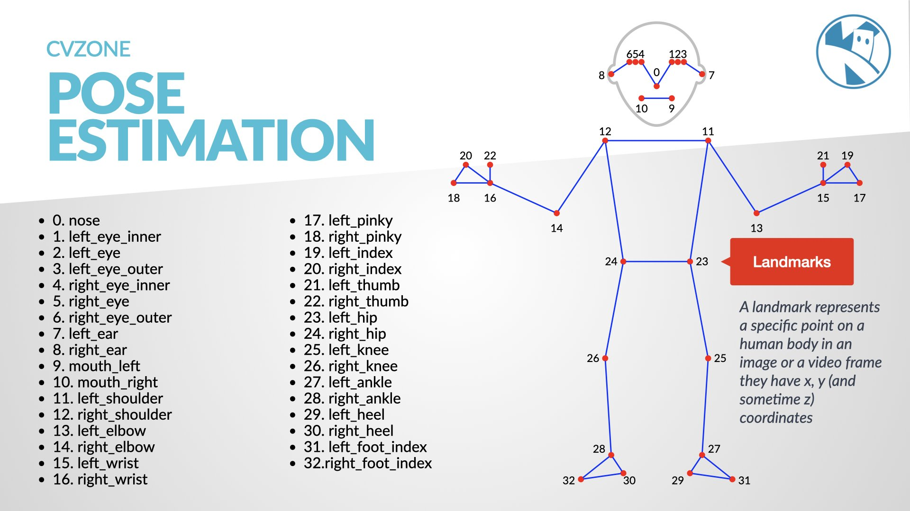

{:class="cover"}

---

By the end of this lesson you will be able to find body landmarks in the video and measure the angle at a joint such as the elbow.

## Pose detection

Pose detection finds the position of a person's body: their head, shoulders, elbows, hips, knees and feet. It's used in fitness apps, motion capture and games. CVZone's `PoseDetector` uses MediaPipe's pose model, which finds **33 landmarks** on the body.

{:class="img-fluid w-75"}

Some useful landmark numbers:

Landmark | Body part
---|---
0 | Nose
11, 12 | Left and right shoulder
13, 14 | Left and right elbow
15, 16 | Left and right wrist
23, 24 | Left and right hip
25, 26 | Left and right knee
{:class="table table-code-fit"}

---

## The code

MediaPipe was installed in the first lesson, so you're ready to go.

```python
import cv2
from cvzone.PoseModule import PoseDetector

cap = cv2.VideoCapture(0)
detector = PoseDetector(detectionCon=0.5, trackCon=0.5)

while True:
    success, img = cap.read()
    if not success:
        break

    img = detector.findPose(img)
    lmList, bboxInfo = detector.findPosition(img, draw=True, bboxWithHands=False)

    if lmList:
        # Mark the centre of the body
        cv2.circle(img, bboxInfo["center"], 5, (255, 0, 255), cv2.FILLED)

        # Distance from the left shoulder (11) to the left wrist (15)
        length, img, info = detector.findDistance(lmList[11][0:2], lmList[15][0:2],
                                                  img=img, color=(255, 0, 0), scale=10)

        # Angle at the left elbow: shoulder (11), elbow (13), wrist (15)
        angle, img = detector.findAngle(lmList[11][0:2], lmList[13][0:2], lmList[15][0:2],
                                        img=img, color=(0, 0, 255), scale=10)

        # Is the elbow bent to about 50 degrees, give or take 10?
        print(int(angle), detector.angleCheck(myAngle=angle, targetAngle=50, offset=10))

    cv2.imshow("Pose Detection", img)
    if cv2.waitKey(1) & 0xFF == ord('q'):
        break

cap.release()
cv2.destroyAllWindows()
```

---

## How it works

- `detector.findPose(img)` runs the pose model and draws a green dot on each landmark. In CVZone 2.0.0 the model runs in a background thread, so the first few frames have no landmarks yet
- `detector.findPosition(img)` returns `lmList`, a list of 33 `[x, y, z]` landmarks, and `bboxInfo`, the box around the body. `lmList` is empty when nobody is in view
- `lmList[11][0:2]` takes just the `x, y` of landmark 11, the left shoulder
- `findDistance()` measures the distance between two points in pixels and draws it
- `findAngle()` measures the angle at the middle point, in degrees from 0 to 360. With shoulder, elbow and wrist, that's how bent the elbow is. A straight arm reads about 180. A bent arm can read a small number such as 20 or its mirror image, 340, depending on which way the forearm swings, so for a bend check use `min(angle, 360 - angle)` (the next lesson does this)
- `angleCheck()` returns `True` if the angle is within `offset` degrees of the target

> ## Which side is left?
>
> Landmark 11 is the person's **own** left shoulder. If you're facing the camera, it appears on the right of the picture.

---

## Try it Yourself

1. Run the program and print the `lmList[0]` nose position. Move your head and watch the numbers change.
2. Change the landmarks to 12, 14 and 16 and measure your right elbow.
3. Print "Hands up" when your left wrist (15) has a smaller `y` than your nose (0). Remember that `y` counts down from the top of the picture.
4. Challenge: measure the angle at your knee using landmarks 23, 25 and 27, and stand side-on to the camera.

---

## Common Issues

- **Problem**: `lmList` is empty even though you are in the picture.
- **Solution**: Step back so your upper body is in view, make sure the room is lit, and wait a second after starting.
- **Why**: The model needs a whole person to see, and CVZone 2.0.0 runs it in the background, so the first frames have nothing yet.

- **Problem**: The angle jumps between a small number and one near 360.
- **Solution**: Use `min(angle, 360 - angle)`.
- **Why**: `findAngle()` measures from 0 to 360, so the same bend can read as 20 or 340.

- **Problem**: The program is slow on the Pi.
- **Solution**: Close other programs, use a smaller camera frame, or try a Pi 5 if you have one.
- **Why**: Pose detection looks at the whole body, which is a lot of work for a small computer.

> **Teachers**: Pose detection needs learners to stand in front of the camera, so ask for permission, offer the choice to be off screen, and remember it only finds landmark points, so no one is identified. Allow room for a learner to stand back far enough for the camera to see their upper body. It is more work for the Pi than face detection, so compare a Pi 4 with a Pi 5 if you have both.

---

## Going further

- **Exercise counter:** count a bicep curl each time the elbow angle drops below 50 degrees and then goes back above 150
- **Posture check:** the angle between ear (7), shoulder (11) and hip (23) changes when you slouch at a desk. Try it from the side
- **Robot control:** raise your left or right arm to steer a robot

---


? Which three landmarks measure how bent the left elbow is?
- [ ] 0, 11 and 12
- [x] 11, 13 and 15
- [ ] 23, 25 and 27
> Shoulder (11), elbow (13) and wrist (15). The angle is measured at the middle point, the elbow.

? What does `detector.angleCheck(myAngle=angle, targetAngle=90, offset=15)` return when the angle is 100?
- [x] `True`
- [ ] `False`
> 100 is within 15 degrees of 90, so the check passes.

? What does `lmList` hold when nobody is in view?
- [ ] A list of zeros
- [x] It is empty, so you check `if lmList:` first
- [ ] It raises an error
> The program checks `if lmList:` before using landmarks, because it is empty when no one is detected.


---
