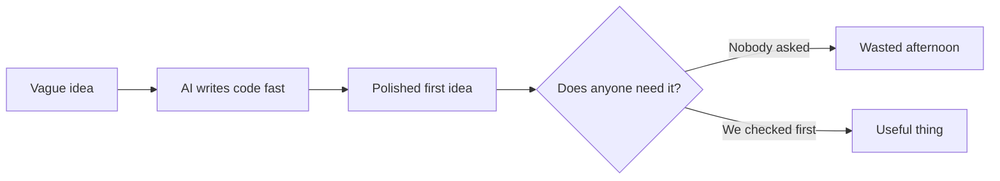

{:class="cover"}

---

By the end of this lesson you will be able to explain why fast, AI-written code makes choosing *what* to build more important, and spot a brief that jumps straight to a solution.

---

## Building is cheap, choosing is hard

A few years ago, the slow part of making a robot was writing the code. You'd spend an evening getting a sensor to print a number. Now you can type "write MicroPython for a Pico that reads a soil sensor and lights an LED" and have something that runs before your tea goes cold.

That's brilliant. It also means the expensive mistake has moved. It used to be "this took me a week to build". Now it's "I built the wrong thing really well, in an afternoon, and nobody uses it".

### What is vibe coding?

Andrej Karpathy coined the term in a post on X in February 2025. He described it as a way of coding where you "fully give in to the vibes, embrace exponentials, and forget that the code even exists" ([MIT Technology Review](https://www.technologyreview.com/2025/04/16/1115135/what-is-vibe-coding-exactly/)). He saw it as fine for throwaway weekend projects.

Here's our position: vibe coding is great for prototypes. This course is about how you take a prototype seriously, so the thing you end up with is something a real person wants and can trust.

### It feels faster

In July 2025, [METR ran a study](https://metr.org/blog/2025-07-10-early-2025-ai-experienced-os-dev-study/) with 16 experienced open-source developers working on 246 real tasks, mostly using Cursor Pro with Claude 3.5 and 3.7 Sonnet. With AI allowed, tasks took **19% longer**. Before they started, the developers expected AI to speed them up by 24%. Afterwards, they still believed it had sped them up by 20%.

To be fair, METR said in [February 2026](https://metr.org/blog/2026-02-24-uplift-update/) that the tools have moved on, and a newer study is hard to run because developers no longer want to work without AI. The lesson still stands: it *feels* faster. Measure, don't trust the feeling.

---

## The marshmallow challenge

Tom Wujec's [marshmallow challenge](https://www.tomwujec.com/marshmallow-challenge), adapted from Peter Skillman, gives teams 20 sticks of spaghetti, one yard of tape, one yard of string and one marshmallow. In 18 minutes they build the tallest free-standing structure they can, with the marshmallow on top.

Kindergarteners beat business students. Why? The kids "spend more time playing and prototyping". The business students plan, then build, "with almost no time to fix the design". The marshmallow goes on at the last second, the tower falls over, and there's no time left.

Vibe coding can turn you into the business student without you noticing. You plan in a prompt, the AI builds the lot in one go, and you only find out it doesn't stand up at the end.

> **Teachers**: the marshmallow challenge is a great first session. The [d.school version](https://dschool.stanford.edu/tools/spaghetti-marshmallow-challenge) runs it in 30 minutes in groups of 3 to 4. Afterwards, ask each group when they first put the marshmallow on, and link that to "test early".

---

## The trap: building the first idea really well

Our first ideas are usually the obvious ones, and the AI is very good at making obvious ideas look finished. A polished prototype is hard to throw away, even when it's solving the wrong problem. Design thinking slows you down at the *start*, the cheap end, so you can go fast later with confidence.

---

## Plant Helper progress

Here's the brief we've been handed:

> "Build a robot that waters the classroom plants."

It sounds clear. But notice what it does: it names a **solution** (a robot that waters) before anyone has said what the **problem** is. Are the plants dying? When? Who looks after them now? Is watering even the issue, or is it knowing *when* to water?

Throughout this course we'll follow a made-up class: Ms Okafor, a Year 5 teacher; Leo and Priya, two pupils on plant-monitor duty; and Mr Hughes, the caretaker, who is in on Fridays. In lesson 3 we'll go and find out what's really going on.

For now, write the brief at the top of a page and underline every word that describes a solution rather than a problem.

---

## Try it Yourself

1. **Spot the solution.** Rewrite "Build an app that reminds me to drink water" so it describes only the problem.
2. **Check your feeling.** Next time you use an AI assistant for a small task, note how long you think it took, then check the clock. Was it what you expected?
3. **Challenge:** Run the marshmallow challenge with friends or family. Note when your team first put the marshmallow on top.

---

## Common Issues

**Problem**: The AI's first version looks so good you don't want to change it.
**Solution**: Treat the first version as a question, not an answer. Ask "what did this teach us?" and be ready to bin it.
**Why**: Polished work feels finished, so we defend it instead of testing it.

**Problem**: You can't tell what the problem is from the brief.
**Solution**: That's normal. Write down your questions and go and ask the people involved.
**Why**: Most briefs are written as solutions. Finding the problem is your first job.

---

## Check your understanding


? In the METR study, how did tasks with AI allowed compare with tasks without it?
- [ ] They were 24% faster
- [x] They took 19% longer, even though developers believed AI had sped them up
- [ ] There was no difference
> Developers expected a 24% speed-up and afterwards believed it was 20%, but tasks took 19% longer. It feels faster; measure it.

? Why do kindergarteners often beat business students at the marshmallow challenge?
- [x] They spend more time playing and prototyping, so they find problems early
- [ ] They plan more carefully
- [ ] They use more tape
> The business students plan and then build, with almost no time to fix the design.

? What's wrong with the brief "Build a robot that waters the classroom plants"?
- [ ] It's too short
- [x] It names a solution before anyone knows what the problem is
- [ ] Robots can't water plants
> It jumps straight to "a robot that waters". The real problem might be something else entirely.

