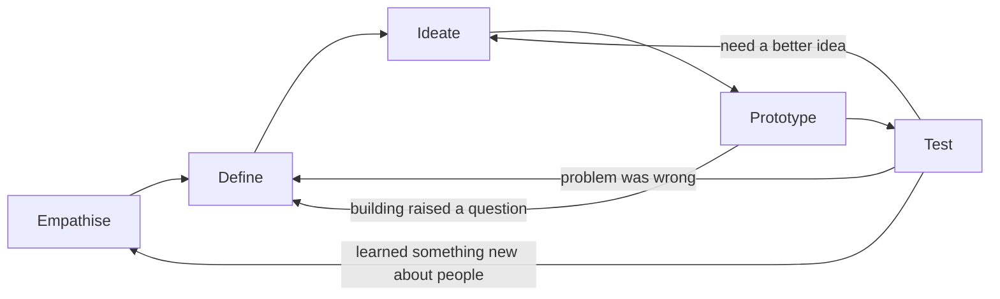
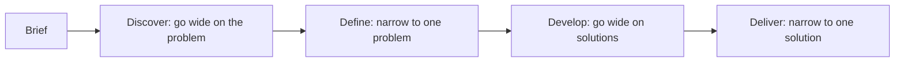

{:class="cover"}

---

By the end of this lesson you will be able to name the five design thinking modes, use three lenses to judge an idea, and say where an AI assistant helps in each mode and where it can't.

---

## What is design thinking?

Tim Brown of IDEO described design thinking in the [Harvard Business Review in June 2008](https://store.hbr.org/product/design-thinking/R0806E) as a method of meeting people's needs and desires in a technologically feasible and strategically viable way. That gives us three handy lenses for any idea:

| Lens | The question it asks | Plant Helper example |
| --- | --- | --- |
| **Desirable** | Do people actually want this? | Will Leo and Priya use it on plant duty? |
| **Feasible** | Can we build it? | Can a Pico and a sensor tell wet soil from dry? |
| **Viable** | Can it keep going? | Is it cheap and safe enough for a school to keep? |
{:class="table table-single"}

A good idea sits where all three overlap. A brilliant robot nobody wants fails the first lens. A wish that needs a £500 part fails the third.

---

## The five modes

The Hasso Plattner Institute of Design at Stanford, the d.school, proposed five modes ([d.school resources](https://dschool.stanford.edu/resources)):

1. **Empathise**: watch and talk to the people you're designing for
2. **Define**: say clearly whose problem you're solving and why
3. **Ideate**: come up with lots of ideas, then choose
4. **Prototype**: make quick, cheap things that answer questions
5. **Test**: put them in front of real people and learn

It's not a strict recipe. The stages "do not have to follow a specific order" ([Interaction Design Foundation](https://ixdf.org/literature/article/5-stages-in-the-design-thinking-process)). A test often sends you back to empathise, and a prototype can change how you define the problem.

---

## The Double Diamond

The UK Design Council has shared the [Double Diamond](https://www.designcouncil.org.uk/resources/the-double-diamond/history-of-the-double-diamond/) since 2004. It has four phases: **Discover, Define, Develop, Deliver**. Each diamond opens out (divergent thinking, lots of options) and then closes in (convergent thinking, choosing).

The first diamond is about finding the right problem; the second is about finding the right solution. Vibe coding tends to skip straight to Deliver. The Design Council's [Framework for Innovation](https://www.designcouncil.org.uk/resources/framework-for-innovation/) also lists four principles worth sticking on the wall: "Put people first", "Communicate visually and inclusively", "Collaborate and co-create" and "Iterate, iterate, iterate".

---

## Where AI helps, and where it can't

| Mode | AI can help | AI can't do it for you |
| --- | --- | --- |
| Empathise | Drafting interview questions, summarising your own anonymised notes | Meeting the real people and noticing what they do |
| Define | Rewording your POV, suggesting How Might We questions | Deciding which need matters most |
| Ideate | Adding extra ideas *after* yours | Knowing which ideas fit your people and place |
| Prototype | Writing code fast, suggesting parts | Choosing what question the prototype should answer |
| Test | Drafting test scripts and unit tests | Watching a real person get confused |
{:class="table table-single"}

Notice the pattern: AI is good at *producing*. It's poor at *knowing your situation*, because it has never been in your classroom.

---

## Watch: how to design and make a robot



In this livestream I go through how I design and make a robot. Watch for the moments where an idea changes because of something learned along the way.

---

## Plant Helper progress

Let's map the Plant Helper onto the five modes. Write the five mode names down the side of a page and, next to each, one question we'll need to answer:

- Empathise: who looks after the plants now, and what goes wrong?
- Define: whose problem are we solving?
- Ideate: what are all the ways we could help?
- Prototype: what's the cheapest way to try our favourite?
- Test: does it work for Leo and Priya?

---

## Try it Yourself

1. **Three lenses.** Pick a gadget you own and score it 1 to 5 for desirable, feasible and viable.
2. **Find the loop.** Think of a project of yours that changed direction. Which arrow on the five-mode diagram did it follow?
3. **Challenge:** Ask an AI assistant to "design a plant watering robot". Sort its answer into the five modes. Which modes did it skip?

---

## Common Issues

**Problem**: You try to finish each mode perfectly before moving on.
**Solution**: Do a quick pass through all five, then loop back.
**Why**: The modes are non-linear. Testing early tells you which mode needs more work.

**Problem**: Your idea is exciting but nobody seems to want it.
**Solution**: Check the desirable lens first, before feasible.
**Why**: Makers love "can we build it?", but it's the last question that matters if nobody wants it.

---

## Check your understanding


? Which three lenses come from Tim Brown's description of design thinking?
- [ ] Fast, cheap and good
- [x] Desirable, feasible and viable
- [ ] Discover, define and deliver
> Meeting people's needs (desirable) in a technologically feasible and strategically viable way.

? What do the two diamonds in the Double Diamond show?
- [x] Going wide (divergent) and then narrowing (convergent), first on the problem, then on the solution
- [ ] Two separate teams working in parallel
- [ ] Design and then coding
> Discover and Define find the right problem; Develop and Deliver find the right solution.

? Which job can an AI assistant NOT do for you in the Empathise mode?
- [ ] Draft interview questions
- [ ] Summarise anonymised notes
- [x] Meet the real people and notice what they do
> The AI has never been in your classroom. It can only help with what you bring back.

