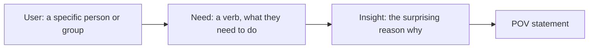

{:class="cover"}

---

By the end of this lesson you will be able to write a point-of-view statement from your empathy work, turn it into How Might We questions that are neither too broad nor too narrow, and spot a problem statement that hides a solution.

---

## From notes to a point of view

After empathising you'll have pages of notes. The Define mode squeezes them into one sentence that says whose problem you're solving and why. That sentence is a **point of view**, or POV, and it has three parts:

The pattern is: **[user] needs [need] because [insight].**

- The **user** is specific. "Pupils on plant duty", not "people".
- The **need** is something they need to *do*, written as a verb. It is not a product.
- The **insight** is the thing you learned that you didn't know before. It's what makes the POV worth having.

---

## Good and bad problem statements

| Statement | What's wrong or right |
| --- | --- |
| "People need plants." | Too vague. Which people? Need to do what? |
| "The class needs a watering robot." | A solution in disguise. It decides the answer for you |
| "Pupils need to water plants because plants need water." | No insight. We knew that already |
| "Leo and Priya need a way to tell at a glance which plant needs water, because they can't judge it by looking and they're afraid of getting it wrong." | Specific user, a need that's a verb, and a real insight |
{:class="table table-single"}

The second one is the sneakiest. "Needs a robot" sounds like a problem, but it's really a solution. If you start there, you'll never consider anything that isn't a robot.

---

## How Might We questions

A POV tells you the problem. A **How Might We** question turns it into an opportunity you can brainstorm on. "How might we..." is widely used by IDEO and the d.school because each word helps: *how* assumes there's an answer, *might* says it's fine if some ideas fail, and *we* says it's a team effort.

The trick is the size of the question:

- **Too broad**: "How might we make plants happier?" Anything goes, so nothing helps.
- **Too narrow**: "How might we add an LED to the watering can?" The answer is already in the question.
- **About right**: "How might we help Leo and Priya know which plant needs water today?"

Write several. Each one opens a slightly different door: "How might we make watering feel less risky?", "How might we make plant duty clear over a weekend?"

---

## Try the POV builder

Type a user, a need and an insight below. The builder writes the point-of-view statement, three How Might We questions, and a short brief you can copy into an AI assistant.



Try changing only the insight and notice how much the How Might We questions change with it.

---

## Problem or solution?

Some statements look like problems but smuggle in a solution. Sort them.


Pupils can't tell by looking whether a plant is dry | left | It describes what goes wrong, with no answer built in.
We need an app that sends watering reminders | right | It names an app. That's a solution.
Plants die over the holidays when nobody is in | left | A real problem you can design for in many ways.
The class needs an automatic pump | right | A pump is one answer, not the problem.
Nobody is sure whose job the plants are | left | A problem about responsibility, not about kit.
We should put a camera on every pot | right | That's an idea for a solution.
Mr Hughes sometimes waters plants that were already watered | left | It describes a real situation, with no answer chosen.
The plants need a robot | right | The brief again: a solution pretending to be a need.



---

## Using AI in Define

An AI assistant is handy here for rewording. Give it your POV and ask for ten How Might We questions of different sizes, then pick the ones that feel right. What it can't do is choose your insight. That came from Leo and Priya, and it's the most valuable thing you have.

---

## Plant Helper progress

From the empathy notes in lesson 3, the class chose this point of view:

> **Leo and Priya, the pupils on plant duty, need a way to tell at a glance which plant needs water, because they can't judge it by looking and they're afraid of getting it wrong.**

And a few How Might We questions to brainstorm from:

- How might we show which plant needs water today?
- How might we make watering feel safe to get wrong?
- How might we keep the plants alive over a weekend?

Notice "robot" and "pump" have disappeared. The brief has turned from a solution into a problem.

---

## Try it Yourself

1. **Fix a statement.** Rewrite "Our club needs a scoreboard app" as a POV with a user, need and insight.
2. **Resize it.** Write one How Might We question for the Plant Helper that's too broad, one too narrow, and one about right.
3. **Challenge:** Ask an AI for ten How Might We questions from the Plant Helper POV. How many of them smuggle in a solution?

---

## Common Issues

**Problem**: Your POV's need is a thing, like "needs a sensor".
**Solution**: Rewrite it as a verb: "needs to know", "needs to remember", "needs to feel sure".
**Why**: A noun is a solution. A verb leaves room for many solutions.

**Problem**: Your insight is obvious.
**Solution**: Go back to your empathy map and look for the surprise, especially where says and does don't match.
**Why**: The insight is what you learned. If it's obvious, you haven't used your research yet.

---

## Check your understanding


? What are the three parts of a point-of-view statement?
- [ ] Problem, solution, budget
- [x] User, need and insight
- [ ] Who, when and where
> The pattern is: [user] needs [need] because [insight].

? Which of these smuggles in a solution?
- [ ] Pupils can't tell whether a plant is dry
- [x] The class needs an automatic pump
- [ ] Plants die over the holidays
> A pump is one possible answer. Writing it into the problem stops you considering anything else.

? Which How Might We question is about the right size?
- [ ] How might we make plants happier?
- [ ] How might we add an LED to the watering can?
- [x] How might we help Leo and Priya know which plant needs water today?
> The first is too broad, the second already contains its answer.

