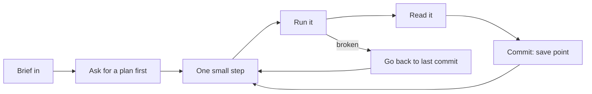

{:class="cover"}

---

By the end of this lesson you will be able to build a prototype with an AI assistant in small, checkable steps, use git commits as save points, and spot the three most common AI coding traps.

---

## The loop

Vibe coding goes wrong when you ask for everything at once and accept whatever comes back. It goes right when you work in a tight loop:



1. **Brief in.** Start every session by giving the AI your `BRIEF.md` from [lesson 5](/learn/design_thinking/05_a_brief_your_ai_can_use.html).
2. **Ask for a plan first.** "Before writing any code, list the steps you'd take." Check the plan against the brief. Fix it now, while it's only words.
3. **One small step at a time.** "Do step 1 only."
4. **Run it.** Every time. Don't stack up three untested changes.
5. **Read it.** You don't have to understand every line, but you should know what each part is for. Ask the AI to explain anything you don't.
6. **Commit.** When it works, `git commit`. Each commit is a save point you can go back to (see the [Git course](/learn/git/)).

---

## Good and bad prompts

| Bad prompt | Better prompt |
| --- | --- |
| "Make the plant thing work." | "Using BRIEF.md, write a plan for logging moisture readings to a CSV file. Don't write code yet." |
| "Fix it." | "Running it gives `FileNotFoundError` on line 12. Explain why, then suggest the smallest fix." |
| "Add the buzzer and button and a web page." | "Add only the buzzer from the brief. Don't change the LED code." |
| "Make it better." | "Check this against the acceptance criteria in BRIEF.md and tell me which ones it doesn't meet." |
{:class="table table-single"}

Good prompts point at the brief, ask for one thing, and say what *not* to touch.

---

## Watch: letting Copilot write flight code



This is part 3 of my [Pico Drone project](/projects/picodrone/), where we let Copilot write the flight code. A drone is about as unforgiving as a prototype gets, so it's a good place to see why running and reading each step matters.

---

## The traps, with evidence

**Hallucinated packages.** AI assistants sometimes suggest libraries that don't exist. [Spracklen and colleagues (USENIX Security 2025)](https://arxiv.org/abs/2406.10279) tested 576,000 code samples from 16 language models. At least 5.2% of the packages suggested by commercial models, and 21.7% from open-source models, didn't exist, with 205,474 unique made-up package names. Before you install anything the AI asks for, check that it exists and that it's the one you meant.

**Insecure code.** [Veracode's 2025 GenAI Code Security Report](https://www.veracode.com/press-release/ai-generated-code-poses-major-security-risks-in-nearly-half-of-all-development-tasks-veracode-research-reveals/) tested over 100 language models on 80 coding tasks. In 45% of tasks the AI introduced an OWASP Top 10 vulnerability. Java failed over 70% of the time, and defences against cross-site scripting failed 86% of the time. If your project touches a web page, a login or a network, it needs a proper review.

**The feeling of speed.** Remember [METR's study](https://metr.org/blog/2025-07-10-early-2025-ai-experienced-os-dev-study/) from lesson 1: developers believed AI had sped them up by 20% when tasks actually took 19% longer. Time yourself.

---

## Plant Helper progress

Before the robot exists, let's build a small software side-piece: a **plant log** script for your computer that appends moisture readings to a CSV file. Later, Ms Okafor can open it in a spreadsheet and see which plants dry out fastest.

Here's what came out of the loop, step by step: plan, then "write a function that appends one reading", run, commit, then "print the file back", run, commit. It uses only Python's standard library, so there's nothing to install.

```python
import csv
import datetime
import os

LOG_FILE = "plant_log.csv"


def log_reading(plant, percent, path=LOG_FILE):
    """Append one moisture reading to the CSV log, adding a header if the file is new."""
    new_file = not os.path.exists(path)
    with open(path, "a", newline="") as f:
        writer = csv.writer(f)
        if new_file:
            writer.writerow(["time", "plant", "moisture_percent"])
        now = datetime.datetime.now().isoformat(timespec="seconds")
        writer.writerow([now, plant, percent])


# Example readings, as percentages. Later these will come from the Pico.
readings = {"Spider plant": 72, "Cactus": 41, "Basil": 18}

for plant, percent in readings.items():
    log_reading(plant, percent)

with open(LOG_FILE, newline="") as f:
    for row in csv.reader(f):
        print(row)
```

Save it as `plant_log.py` and run it with `python3 plant_log.py`. Each run adds three more rows. Open `plant_log.csv` in a spreadsheet to see them.

> **Teachers**: AI coding tools have age limits and need accounts. If pupils can't have their own, the teacher can drive one account on the projector while the class writes the prompts, and everyone runs the result on their own machine.

---

## Try it Yourself

1. **Run and commit.** Run the script, then make your first commit: `git add plant_log.py` and `git commit -m "Plant log: append readings"`.
2. **One small step.** Ask your AI to add a column for who did the reading. Ask for a plan first. Run it, read it, commit.
3. **Challenge:** Ask the AI to print the driest plant from the log. Before you run its answer, check it hasn't asked you to install a package. If it has, does that package exist?

---

## Common Issues

**Problem**: The AI rewrote code that was already working.
**Solution**: Go back to your last commit with `git restore plant_log.py`, then ask again and say "change only the function X, leave everything else as it is".
**Why**: Asked to change one thing, AI assistants often "tidy up" the rest. Commits make that cheap to undo.

**Problem**: The AI tells you to `pip install` a library you've never heard of.
**Solution**: Search for it on the official package index and check its name, author and downloads. Ask the AI if the standard library can do it instead.
**Why**: Models invent package names, and a made-up name someone has registered could be malicious.

**Problem**: A test was failing, and now it passes, but the AI "fixed" the test instead of the code.
**Solution**: Check the diff. If the test changed, reject it, and say "the test is correct, fix the code".
**Why**: Changing the test is the easiest way to make it pass. You own the acceptance criteria, not the AI. We dig into this in [lesson 11](/learn/design_thinking/11_test_the_code.html).

---

## Check your understanding


? What should you ask the AI for before any code?
- [ ] A finished program
- [x] A plan, which you check against your brief
- [ ] A list of packages to install
> A plan is only words, so it's cheap to fix.

? In Spracklen and colleagues' study, roughly what share of packages suggested by open-source models didn't exist?
- [ ] 0.5%
- [ ] 5.2%
- [x] 21.7%
> At least 5.2% from commercial models and 21.7% from open-source models were made up.

? Why commit after every working step?
- [x] Each commit is a save point you can go back to if the AI breaks something
- [ ] Git makes the code run faster
- [ ] The AI can't read uncommitted code
> If the next change goes wrong, you restore the last working version instead of untangling it.

