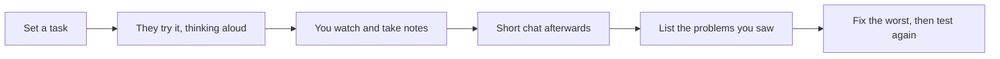

{:class="cover"}

---

By the end of this lesson you will be able to run a short usability test with real people, record what matters, and explain why a few small tests beat one big one.

---

## Why test with people?

The AI can tell you whether your code runs. Only a person can tell you whether your *design* works. You know what amber means, because you chose it. Leo and Priya don't. A usability test is how you find out what your thing looks like from the outside.

---

## How to run a usability test

- **Give a task, not a tour.** Don't say "this is the green light, which means...". Say "Can you tell me if this plant needs watering?" and watch.
- **Ask them to think aloud.** "Please say what you're thinking as you go." You'll hear the confusion before you see it.
- **Stay quiet.** The hardest part. If they get stuck, count to ten before you speak. Being stuck is the data.
- **Don't defend.** If they say "that's weird", say "thanks, tell me more". Never "ah, but it's supposed to...".
- **Thank them.** Make it clear you're testing the design, not them. Nobody can fail.



### What to measure

You don't need fancy tools. For each person and each task, write down:

| Measure | What it tells you |
| --- | --- |
| Did they complete the task? | Whether it works at all |
| How long did it take? | Whether it's quick enough to be "at a glance" |
| Where did they hesitate or ask? | Which part is confusing |
| What did they say, word for word? | How they think about it, in their language |
{:class="table table-single"}

---

## How many people?

Jakob Nielsen's article ["Why You Only Need to Test with 5 Users"](https://www.nngroup.com/articles/why-you-only-need-to-test-with-5-users/) (NN/g, March 2000) suggests five participants find about 85% of usability problems. His model says each tester finds a share **L** of the problems, typically 31%, and the share found by **n** testers is:

<!-- code-check: fragment -->
```python
found = 1 - (1 - L) ** n  # share of problems found by n testers, when each finds a share L (about 0.31)
```
{: .no-snakie }

In words: each new tester mostly finds problems the earlier ones already found, so the curve rises fast and then flattens. That's why Nielsen recommends spending your budget on three studies of five users, fixing things in between, rather than one study of fifteen.



Try 5 testers, then 15, and notice how little the curve climbs after the first few.

---

## Plant Helper progress

The class tested the coded traffic light from lesson 9 with five pupils, giving each the task "Can you tell me which plants need watering?". Remember, this is our made-up example class.

What they found:

- **Pupils read amber as "broken".** Three of the five said things like "that one's not working" when the amber LED was lit. Amber didn't mean "water soon" to them.
- **Green and red were clear.** Everyone got those right, quickly.
- From the Wizard of Oz card in lesson 7, Leo and Priya kept asking Ms Okafor, "Can I tell it I've watered it?" They wanted a way to **record that they'd watered** a plant, so the next monitor, or Mr Hughes on Friday, wouldn't water it again.

None of that would come out of a code review. Both go into the next version in lesson 12.

> **Teachers**: when pupils test with other pupils, keep it short and friendly, get the tester's agreement first, and make sure everyone knows it's the design being tested, not them. Avoid recording children; written notes without surnames are enough. Watch for younger testers who say what they think you want to hear.

---

## Try it Yourself

1. **Task, not tour.** Write three tasks for testing the Plant Helper. None of them should explain what the colours mean.
2. **Test one person.** Run one task with a friend or family member. Stay silent for the whole task and write down every hesitation.
3. **Challenge:** Test with five people. Count how many new problems each person found. Did your numbers follow the flattening curve?

---

## Common Issues

**Problem**: You keep explaining the design during the test.
**Solution**: Write your task on a card, hand it over, and sit on your hands.
**Why**: Every explanation hides a problem you'd otherwise have seen.

**Problem**: Everyone says it's great but nobody uses it.
**Solution**: Watch what they do with the task, not what they say about it afterwards.
**Why**: People are polite. Behaviour is more honest than opinions.

**Problem**: Your five testers were all your friends from the robot club.
**Solution**: Test with the real users, here pupils on plant duty and the teacher.
**Why**: People who already know how things like this work don't stumble where real users do.

---

## Check your understanding


? What's the best way to start a usability test?
- [ ] Give a tour explaining every feature
- [x] Give a task, such as "can you tell me if this plant needs watering?", and watch
- [ ] Ask whether they like it
> A task shows you what they understand without your help.

? According to Nielsen, about how many usability problems do five testers find?
- [ ] 31%
- [x] About 85%
- [ ] 100%
> Each tester finds about 31%, but they overlap, so the curve flattens. Five find about 85%.

? What did the Plant Helper tests show?
- [x] Pupils read amber as "broken", and they wanted to record that they'd watered a plant
- [ ] The red LED was too dim
- [ ] Nobody looked at the lights
> Green and red were clear. Amber and the missing "watered" record go into version 2.

