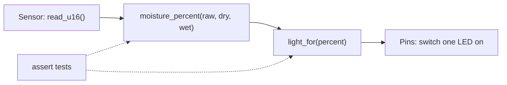

{:class="cover"}

---

By the end of this lesson you will be able to separate your program's logic from its hardware, test that logic with plain `assert` statements, and spot an AI that changes a test to make it pass.

---

## You own the acceptance criteria

An AI can write tests for you, and that's a real time saver. But it's your brief that says what "working" means. If you let the AI decide both the code *and* what counts as correct, it's marking its own homework.

So the split is: **you** write down what must be true (from the brief's acceptance criteria), and the **AI** can help turn those sentences into test code. You check that each test matches a criterion.

---

## Test the logic separately from the hardware

Testing with a real sensor in a real pot is slow: you have to wait for soil to dry. But most of the Plant Helper's decisions don't need the sensor at all. Given a raw number, what percentage is it? Given a percentage, which light? Those are **pure functions**: same input, same output, no pins.



The middle two boxes can be tested in a fraction of a second, with no wiring. Only the ends touch hardware.

---

## Edge cases

Edge cases are the inputs right at the boundaries, where bugs like to hide:

- A raw reading **drier than DRY** (above it) should still give 0%, not a negative number.
- A raw reading **wetter than WET** (below it) should still give 100%, not 120%.
- Exactly **30%** should be amber, not red.
- Exactly **60%** should be green, not amber.
- **29%** is red, **59%** is amber.

---

## Plant Helper progress

Here are the two pure functions, and the tests. They use only plain `assert`, so they run on the Pico in MicroPython and on your computer in Python, with no test library to install. Save it as `test_plant.py` and run it.

```python
def moisture_percent(raw, dry, wet):
    """Turn a raw sensor reading into 0 to 100 percent. dry is the higher number."""
    percent = (dry - raw) * 100 // (dry - wet)
    if percent < 0:
        return 0
    if percent > 100:
        return 100
    return percent


def light_for(percent):
    """Which LED to show for a moisture percentage."""
    if percent >= 60:
        return "green"
    if percent >= 30:
        return "amber"
    return "red"


DRY = 50000
WET = 20000

# moisture_percent: the ends, the middle, and beyond the ends
assert moisture_percent(DRY, DRY, WET) == 0
assert moisture_percent(WET, DRY, WET) == 100
assert moisture_percent(35000, DRY, WET) == 50
assert moisture_percent(60000, DRY, WET) == 0      # drier than DRY clamps to 0
assert moisture_percent(10000, DRY, WET) == 100    # wetter than WET clamps to 100

# light_for: each boundary
assert light_for(100) == "green"
assert light_for(60) == "green"
assert light_for(59) == "amber"
assert light_for(30) == "amber"
assert light_for(29) == "red"
assert light_for(0) == "red"

print("All Plant Helper tests passed")
```

If every test passes, you'll see `All Plant Helper tests passed`. If one fails, Python stops with an `AssertionError` and the line number of the failing test.

Try breaking it on purpose: change `>= 30` to `> 30` in `light_for` and run it again. The `light_for(30)` test catches it. That's the test doing its job.

### Watch for an AI that edits the test

Here's a pattern to watch for. You ask the AI to "make the tests pass". It looks, sees `light_for(30) == "amber"` failing, and changes the test to `== "red"`. All green! But the brief says 30% is amber. The code is still wrong; the AI just moved the goalposts.

Always check the diff after the AI touches tests. A changed test needs a reason from your brief, not "so it passes".

---

## Should a test catch this?


A reading of 30% lights the red LED | left | The brief says 30% is amber, so a boundary test should catch it.
Pupils think amber means broken | right | That's a design problem. Only testing with people finds it.
A raw reading above DRY gives -12% | left | A clamping edge case. A test with a very dry reading catches it.
The LED is too dim to see from the back of the room | right | Code tests can't see light. You need to look in the real room.
The AI changed a test from amber to red | left | Your tests and the brief disagree. Checking the diff against the brief catches it.
Leo wants to record that he watered a plant | right | A need, found by watching and asking, not by asserts.
light_for(60) returns amber | left | 60% is green in the brief. A boundary test catches it.
The sensor wire falls out of the breadboard | right | A hardware fault. You find it by checking the wiring.



---

## Try it Yourself

1. **Break it.** Change `// (dry - wet)` to `// dry` and run the tests. Which ones fail?
2. **Add a test.** Write an `assert` for a reading of 44000. Work out the answer by hand first.
3. **Challenge:** Ask an AI to write more tests for `light_for` and `moisture_percent`. Check every one against the brief. Did it get any boundary wrong?

---

## Common Issues

**Problem**: `ZeroDivisionError` when you run the tests.
**Solution**: Check `DRY` and `WET` are different numbers.
**Why**: The formula divides by `dry - wet`, which is zero if they're the same.

**Problem**: All tests pass, but the AI changed some of them.
**Solution**: Compare the tests to the brief's acceptance criteria and undo any change that doesn't match.
**Why**: Editing the test is the easiest way to make it pass. Tests only protect you if they stay true to the brief.

**Problem**: You can't test anything without the sensor plugged in.
**Solution**: Move the logic into pure functions that take numbers in and give answers out.
**Why**: Logic that reads pins directly can only be tested on the bench. Pure functions can be tested anywhere.

---

## Check your understanding


? Why pull the logic into pure functions like light_for(percent)?
- [ ] They run faster on the Pico
- [x] They can be tested with plain asserts, without any hardware
- [ ] MicroPython requires it
> Same input, same output, no pins. You test the decisions quickly and only touch hardware at the ends.

? What should light_for(30) return, according to the brief?
- [ ] "red"
- [x] "amber"
- [ ] "green"
> Amber covers 30 to 59%, so exactly 30 is amber. It's a boundary worth testing.

? An AI makes a failing test pass by changing the expected answer. What do you do?
- [ ] Accept it, the tests pass now
- [x] Check the change against the brief, and if the brief disagrees, undo it and fix the code instead
- [ ] Delete the test
> You own the acceptance criteria. The test should change only if the brief does.

