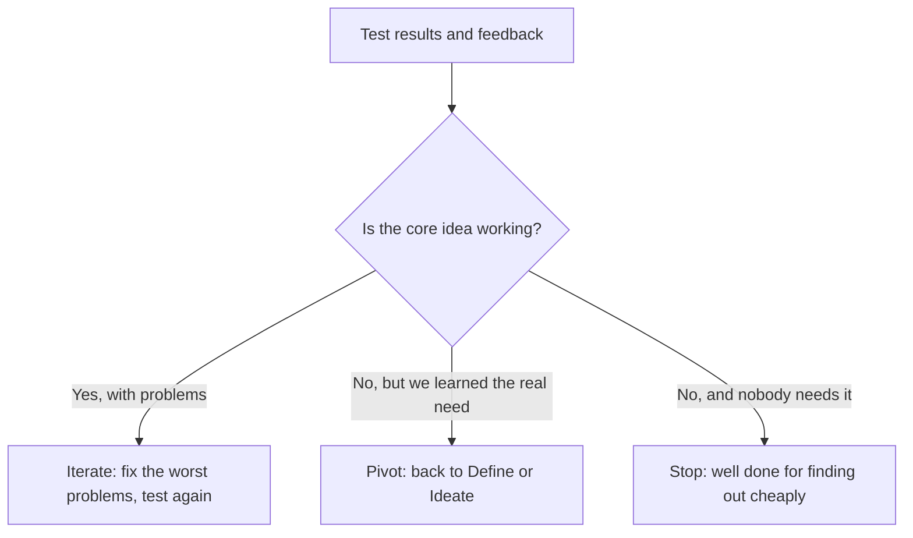

{:class="cover"}

---

By the end of this lesson you will be able to turn test results into a decision, update your brief before you touch the code, and build version 2 of the Plant Helper with a "watered" button and an end-of-day check.

---

## I like, I wish, What if

After a test, gather feedback with three sentence starters from the d.school:

- **I like...** what's working, so you don't break it by accident
- **I wish...** what's frustrating or missing
- **What if...** new ideas, without having to defend them yet

They're friendly enough for a Year 5 class and honest enough for anyone. Collect them on sticky notes, then group them.

---

## Iterate, pivot or stop

With the feedback in front of you, make one of three decisions:



Stopping isn't failing. Finding out early that nobody needs something is exactly what design thinking is for.

---

## Update the brief first, then prompt from it

When you iterate, it's tempting to type "add a button" straight into the AI. Don't. Change `BRIEF.md` first, then ask the AI to update the code *from the brief*. That way the brief stays the true description of the project, your acceptance criteria grow with it, and the next AI session starts from the right place.

And **change one thing at a time**. Add the button, test it, commit. Then the buzzer change, test it, commit. If you change three things and something breaks, you won't know which.

---

## Plant Helper progress

The tests in lesson 10 gave the class this feedback:

- **I like** the green and red lights: they're clear from across the room.
- **I wish** amber didn't look like it was broken.
- **I wish** I could tell it I'd watered the plant.
- **What if** it beeped before home time when a plant needs water?

The core idea works, so the decision is **iterate**. The changes for v2:

1. **Amber gets a printed key card** next to the pot: "Green: fine. Amber: water soon, it's not broken. Red: water now." No code needed for that one.
2. **A "watered" button on GP12.** A quick press means "I've watered this plant". The light goes green for a grace period, so the next monitor, or Mr Hughes on Friday, knows not to water it again.
3. **An end-of-day chirp.** The class wanted a beep at 3pm. But the Pico has no real-time clock: `time.localtime()` is only the real time if Thonny or Snakie set it when connecting, or a Pico W fetches it with `ntptime`. On a USB charger in a classroom, neither happens. So v2 uses a **button-triggered end-of-day check** instead: hold the button for two seconds at home time and it chirps if the plant needs water.

### The brief changes first

Here are the lines added to `BRIEF.md`:

```markdown
## Must (v2)
- A "watered" button on GP12 (Pin.PULL_UP, pressed reads 0)
- A short press shows green for 15 minutes, then goes back to the sensor
- Holding the button for 2 seconds runs an end-of-day check that chirps
  the buzzer on GP16 three times if the plant is red

## Acceptance criteria (v2)
- Given the light is red, when Leo presses the button, then it shows green.
- Given the button was pressed 15 minutes ago, when the Pico reads the sensor, then the light follows the sensor again.
- Given the plant is red, when Ms Okafor holds the button for 2 seconds, then the buzzer chirps three times.
- Given the plant is green, when Ms Okafor holds the button for 2 seconds, then the buzzer stays quiet.
```

### The v2 program

Add the buzzer and button to the wiring from lesson 9:

- Piezo buzzer: one leg to GP16, the other to GND.
- Push button: one leg to GP12, the other to GND. `Pin.PULL_UP` keeps the pin high, so it reads 1 normally and 0 when pressed.

This builds on lesson 9's traffic light and uses the tested `moisture_percent()` and `light_for()` functions from lesson 11, unchanged.

```python
from machine import Pin, ADC, PWM
import time

DRY = 50000                  # your reading in air: replace with yours
WET = 20000                  # your reading in water: replace with yours
GRACE_MS = 15 * 60 * 1000    # stay green for 15 minutes after watering
HOLD_MS = 2000               # hold this long for the end-of-day check

sensor = ADC(26)
leds = {
    "green": Pin(15, Pin.OUT),
    "amber": Pin(14, Pin.OUT),
    "red": Pin(13, Pin.OUT),
}
button = Pin(12, Pin.IN, Pin.PULL_UP)   # pressed reads 0
buzzer = PWM(Pin(16))
buzzer.duty_u16(0)


def moisture_percent(raw, dry, wet):
    """Turn a raw sensor reading into 0 to 100 percent. dry is the higher number."""
    percent = (dry - raw) * 100 // (dry - wet)
    if percent < 0:
        return 0
    if percent > 100:
        return 100
    return percent


def light_for(percent):
    """Which LED to show for a moisture percentage."""
    if percent >= 60:
        return "green"
    if percent >= 30:
        return "amber"
    return "red"


def show(colour):
    """Light only the LED for this colour."""
    for name in leds:
        leds[name].value(1 if name == colour else 0)


def chirp(times=3):
    buzzer.freq(2000)
    for i in range(times):
        buzzer.duty_u16(32768)
        time.sleep(0.15)
        buzzer.duty_u16(0)
        time.sleep(0.15)


def press_length_ms():
    """Wait for the button to be let go, and return how long it was held."""
    start = time.ticks_ms()
    while button.value() == 0:
        time.sleep(0.02)
    return time.ticks_diff(time.ticks_ms(), start)


watered_at = None

while True:
    percent = moisture_percent(sensor.read_u16(), DRY, WET)
    colour = light_for(percent)

    if watered_at is not None:
        if time.ticks_diff(time.ticks_ms(), watered_at) < GRACE_MS:
            colour = "green"
        else:
            watered_at = None

    show(colour)

    if button.value() == 0:
        held = press_length_ms()
        if held >= HOLD_MS:
            print("End of day check:", percent, "%")
            if light_for(percent) == "red":
                chirp()
        else:
            watered_at = time.ticks_ms()
            show("green")
            print("Watered. Green for 15 minutes.")

    time.sleep(0.1)
```

Notice the end-of-day check uses the real sensor reading, `light_for(percent)`, not the grace-period green. If a plant was "watered" but the soil is still bone dry, it still chirps.

Run the lesson 11 tests again after any change to the two functions, then commit. That's v2.

---

## Try it Yourself

1. **Collect feedback.** Ask three people to use your Plant Helper and give one I like, one I wish and one What if each.
2. **Shorten the grace period.** Change `GRACE_MS` to 10 seconds so you can test the grace period without waiting. Remember to change it back.
3. **Challenge:** On a Pico W, the class could use `ntptime` to get the real time and chirp at 3pm automatically. Update the brief first, with a new acceptance criterion, then ask your AI to make the change from the brief.

---

## Common Issues

**Problem**: The light goes green the moment you plug it in, without pressing anything.
**Solution**: Check the button is wired between GP12 and GND, and the code uses `Pin.PULL_UP`.
**Why**: Without the pull-up the pin floats, and random noise can read as 0, which looks like a press.

**Problem**: The end-of-day check never runs, it always counts as "watered".
**Solution**: Hold the button for a full two seconds, or lower `HOLD_MS` while testing.
**Why**: Any press shorter than `HOLD_MS` counts as a quick "watered" press.

**Problem**: You asked the AI to add the button and it also rewrote `light_for()`.
**Solution**: Restore your last commit, re-run the lesson 11 tests, and ask again with "don't change light_for or moisture_percent".
**Why**: Changing one thing at a time keeps your tested code safe.

---

## Check your understanding


? What are the three d.school feedback starters?
- [x] I like, I wish, What if
- [ ] Good, bad, ugly
- [ ] Start, stop, continue
> They capture what's working, what isn't, and new ideas.

? Why does v2 use a button-held end-of-day check instead of chirping at 3pm?
- [ ] The buzzer can't play in the afternoon
- [x] The Pico has no real-time clock unless Thonny or Snakie set it, or a Pico W uses ntptime
- [ ] MicroPython doesn't have a time module
> On a USB charger in a classroom, nothing sets the clock, so 3pm can't be trusted.

? When you iterate, what should you change first?
- [ ] The code
- [x] BRIEF.md, then prompt the AI from the updated brief
- [ ] The wiring
> The brief stays the true description of the project, and the acceptance criteria grow with it.

