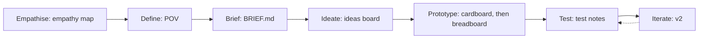
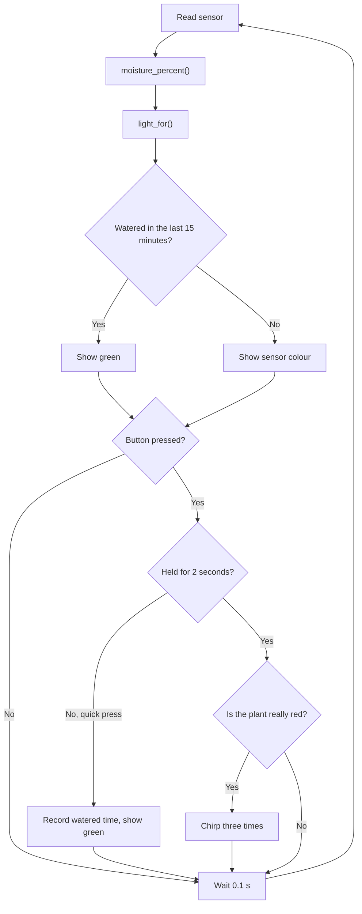

{:class="cover"}

---

By the end of this lesson you will be able to take a brief through all five design thinking modes on your own, finishing with a tested, working Plant Helper and a folder of artefacts that shows how you got there.

---

## The whole loop on one page

So far we've followed a made-up class: Ms Okafor, Leo, Priya and Mr Hughes. Now it's your turn, with your own plants and your own people. Work down this checklist. Each stage leaves an **artefact**, something you keep in your project folder, so anyone (including your AI assistant) can see why the Plant Helper is the way it is.



### 1. Empathise

- [ ] Watch the plants and the people who look after them for at least two days
- [ ] Interview two or three people with "tell me about the last time..." questions
- [ ] Make an empathy map: says, thinks, does, feels
- **Artefact:** `empathy_map.jpg` (a photo of your paper map) and your anonymised notes

### 2. Define

- [ ] Write a POV: [user] needs [need] because [insight]
- [ ] Write three How Might We questions, checking none is too broad or too narrow
- **Artefact:** `POV.txt`, or the top of your brief

### 3. Brief

- [ ] Write `BRIEF.md` with who it's for, the problem, must / should / won't, constraints and Given / When / Then acceptance criteria
- [ ] Put "no pump" in the won't list
- **Artefact:** `BRIEF.md`

### 4. Ideate

- [ ] Crazy 8s on your own, before you ask any AI
- [ ] Ask an AI for ten more ideas that are different from yours
- [ ] Place them on an impact and effort grid, then dot vote
- **Artefact:** a photo of your ideas board, and one line on why you chose what you chose

### 5. Prototype

- [ ] Make a cardboard traffic-light card and run a Wizard of Oz test for a few days
- [ ] Calibrate your sensor and write down your DRY and WET numbers
- [ ] Build the traffic light on a breadboard, one part at a time
- **Artefact:** `calibration.txt` with your numbers and the date

### 6. Test

- [ ] Run `test_plant.py` from lesson 11 until every assert passes
- [ ] Test with five real users, giving a task, not a tour
- [ ] Write down what each tester did and said
- **Artefact:** `test_notes.md`

### 7. Iterate

- [ ] Collect I like / I wish / What if feedback and decide: iterate, pivot or stop
- [ ] Update `BRIEF.md` first, then the code, one change at a time, committing after each
- **Artefact:** the final `main.py` and a git history you can read like a diary

---

## Wiring

| Pin | Part | Notes |
| --- | --- | --- |
| GP26 (ADC0) | Capacitive soil moisture sensor, analogue out | Sensor VCC to 3V3, GND to GND. Reads higher when dry |
| GP15 | Green LED | Through a 220 ohm resistor to the long leg; short leg to GND |
| GP14 | Amber LED | Through a 220 ohm resistor; put the printed key card next to it |
| GP13 | Red LED | Through a 220 ohm resistor |
| GP16 | Piezo buzzer | Driven with PWM; other leg to GND |
| GP12 | "Watered" push button | Other leg to GND. `Pin.PULL_UP`, pressed reads 0 |
{:class="table table-single"}

Power the Pico from USB only, and keep it and the breadboard away from the watering can. Only the probe end of the sensor goes in the soil.

> **Teachers**: one kit per group of three or four works well. If kits are shared between classes, label each Pico and keep each group's `main.py` and calibration numbers in their own folder, because every sensor's DRY and WET readings are different. Lessons 1 to 7 and 10 need no kit, so groups can work on those while others build.

---

## The final program

This is the v2 program from [lesson 12](/learn/design_thinking/12_iterate.html), with the tested functions from [lesson 11](/learn/design_thinking/11_test_the_code.html). Put your own DRY and WET numbers in, then save it to the Pico as `main.py` so it runs whenever the Pico is plugged in.

```python
from machine import Pin, ADC, PWM
import time

DRY = 50000                  # your reading in air: replace with yours
WET = 20000                  # your reading in water: replace with yours
GRACE_MS = 15 * 60 * 1000    # stay green for 15 minutes after watering
HOLD_MS = 2000               # hold this long for the end-of-day check

sensor = ADC(26)
leds = {
    "green": Pin(15, Pin.OUT),
    "amber": Pin(14, Pin.OUT),
    "red": Pin(13, Pin.OUT),
}
button = Pin(12, Pin.IN, Pin.PULL_UP)   # pressed reads 0
buzzer = PWM(Pin(16))
buzzer.duty_u16(0)


def moisture_percent(raw, dry, wet):
    """Turn a raw sensor reading into 0 to 100 percent. dry is the higher number."""
    percent = (dry - raw) * 100 // (dry - wet)
    if percent < 0:
        return 0
    if percent > 100:
        return 100
    return percent


def light_for(percent):
    """Which LED to show for a moisture percentage."""
    if percent >= 60:
        return "green"
    if percent >= 30:
        return "amber"
    return "red"


def show(colour):
    """Light only the LED for this colour."""
    for name in leds:
        leds[name].value(1 if name == colour else 0)


def chirp(times=3):
    buzzer.freq(2000)
    for i in range(times):
        buzzer.duty_u16(32768)
        time.sleep(0.15)
        buzzer.duty_u16(0)
        time.sleep(0.15)


def press_length_ms():
    """Wait for the button to be let go, and return how long it was held."""
    start = time.ticks_ms()
    while button.value() == 0:
        time.sleep(0.02)
    return time.ticks_diff(time.ticks_ms(), start)


watered_at = None

while True:
    percent = moisture_percent(sensor.read_u16(), DRY, WET)
    colour = light_for(percent)

    if watered_at is not None:
        if time.ticks_diff(time.ticks_ms(), watered_at) < GRACE_MS:
            colour = "green"
        else:
            watered_at = None

    show(colour)

    if button.value() == 0:
        held = press_length_ms()
        if held >= HOLD_MS:
            print("End of day check:", percent, "%")
            if light_for(percent) == "red":
                chirp()
        else:
            watered_at = time.ticks_ms()
            show("green")
            print("Watered. Green for 15 minutes.")

    time.sleep(0.1)
```

### How it works



### Check it against the brief

Go back to your `BRIEF.md` and tick off each acceptance criterion, with a real pot:

- Dry soil: red. Freshly watered: green. In between: amber.
- A quick press turns it green, and after the grace period it follows the sensor again.
- Holding the button with a red plant chirps; with a green plant it stays quiet.
- Someone who has never seen it can tell you what colour it's showing from their desk.

If every one passes, you're done. If not, you know exactly which one to work on next.

---

## Make it yours

The real skill in this course isn't the Plant Helper. It's the loop. Pick a new brief and take it all the way round, using the same seven stages and the same artefacts:

- **"Build a robot for my pet."** Who's the user, the pet or the owner? What does the owner actually struggle with?
- **"Make a helper for my grandparent."** Watch a day first. The need might not be what anyone expects.
- **"Make a scoreboard for our club."** Who keeps the score now, and what goes wrong when they do?

Start every one the same way: underline the solution words in the brief, and go and talk to someone.

---

## Plant Helper progress

That's it: the Classroom Plant Helper is built, tested and iterated. It started as "Build a robot that waters the classroom plants" and became something smaller, safer and more useful, because we found out what Leo and Priya actually needed before we asked an AI to write a line of code.

---

## Try it Yourself

1. **Build the folder.** Make a project folder with every artefact from the checklist, then add and commit them with git.
2. **More plants.** The Pico also has ADC on GP27 and GP28. Update the brief for two plants first, then ask your AI to change the code from the brief.
3. **Challenge:** Take one of the "Make it yours" briefs through all seven stages. Bring the artefacts to a friend and see if they can understand your decisions without you explaining.

---

## Common Issues

**Problem**: The program runs from Thonny or Snakie but not when the Pico is plugged into a charger.
**Solution**: Save it on the Pico as `main.py`, not under another name.
**Why**: The Pico only runs `main.py` automatically when it powers up.

**Problem**: The readings drift over a few weeks.
**Solution**: Re-run the calibration from lesson 9 and update `DRY` and `WET`.
**Why**: Soil type, temperature and the sensor itself all change the raw numbers a little.

**Problem**: You skipped straight to the code for your "Make it yours" brief.
**Solution**: Stop and do one interview first. It takes ten minutes.
**Why**: The code is the cheap part now. Building the wrong thing is the expensive part.

---

## Check your understanding


? Why keep an artefact from each stage, like the empathy map and BRIEF.md?
- [ ] They're needed for the code to run
- [x] So anyone, including your AI assistant, can see why the project is the way it is
- [ ] To make the folder look full
> The artefacts carry the reasons behind your decisions from one stage, and one AI session, to the next.

? Which pin does the Plant Helper's moisture sensor use?
- [ ] GP12
- [ ] GP15
- [x] GP26 (ADC0)
> GP26 is an ADC pin, so it can read the sensor's analogue voltage.

? What should you do first with a brand new brief like "Make a scoreboard for our club"?
- [ ] Ask the AI to write the code
- [x] Underline the solution words and go and talk to the people involved
- [ ] Buy the parts
> Every brief starts with Empathise, the same way the Plant Helper did.

