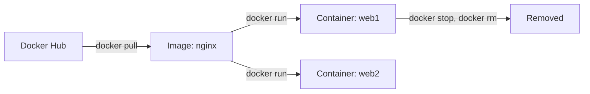

{:class="cover"}

---

By the end of this lesson you will be able to pull an image, start several containers from it, and list, stop and remove them.

## Images and containers

An **image** is a frozen, read-only template. A **container** is what you get when you start one. You can start many containers from the same image, just as you can print many copies of one robot blueprint.



Each container gets its own thin writable layer on top of the image. Change a file in `web1` and `web2` never notices, and the image itself stays untouched.

## Pull an image

Let's download `nginx`, a popular web server, from Docker Hub:

```bash
docker pull nginx
docker images
```

`docker images` lists what you have downloaded. You'll see `nginx` with a tag, which defaults to `latest`. Tags name versions of an image, so `python:3.12-slim` means the `python` image at version 3.12, slim flavour.

## Run a container

```bash
docker run -d --name web -p 8080:80 nginx
```

Let's read that flag by flag:

- `-d` runs the container **detached**, in the background, so you get your terminal back.
- `--name web` gives it a name. Without one, Docker invents a funny name like `quirky_turing`.
- `-p 8080:80` connects port 8080 on your Pi to port 80 inside the container. We'll look at this properly in lesson 6.
- `nginx` is the image to start from.

Open `http://localhost:8080` in a browser on the Pi, or `http://<your-pi-address>:8080` from another computer. You should see "Welcome to nginx!". If you have no browser handy, try `curl http://localhost:8080`.

## See what is running

```bash
docker ps
```

You'll see a table with the container's ID, image, status, ports and name. Add `-a` to include stopped containers too:

```bash
docker ps -a
```

## Stop and remove

```bash
docker stop web
docker rm web
```

Stopping freezes the container but keeps it around, so `docker start web` could bring it back. Removing deletes it. The `nginx` image stays on disk so the next `docker run` is instant.

## A throwaway shell

Here's a handy trick. Run a tiny Linux and poke around, then have Docker clean up after you with `--rm`:

```bash
docker run -it --rm alpine sh
```

`-it` gives you an interactive terminal. Inside, try `ls` and `cat /etc/os-release`, then type `exit`. The container is deleted the moment you leave.

## Common Issues

- **Problem**: `Bind for 0.0.0.0:8080 failed: port is already allocated`.
- **Solution**: Pick another host port, such as `-p 8081:80`, or stop the container using 8080 (`docker ps` shows which).
- **Why**: Only one program can listen on a given port of your machine at once.

- **Problem**: `The container name "/web" is already in use`.
- **Solution**: Run `docker rm web` first (add `-f` if it is still running), or choose a different name.
- **Why**: Stopped containers keep their names until they are removed.

> **Teachers**: If several learners share one Pi, or share one network, host ports such as 8080 will clash. Give each learner or group their own port range (for example 8081, 8082, ...) before they start.

## Try it Yourself

1. Start a second nginx container named `web2` on port 8081, and check both pages load.
2. Run `docker ps` and `docker images`. How many containers do you have, and how many nginx images?
3. Challenge: stop and remove both containers, then run `docker images` again. Is nginx still there? Why?

## Check your understanding


? How many containers can you start from one image?
- [ ] Only one
- [x] As many as you like
- [ ] Two at most
> An image is a template. Every `docker run` makes a new container from it.

? What does `-d` do in `docker run -d nginx`?
- [ ] Deletes the container when it stops
- [x] Runs the container in the background
- [ ] Downloads the image only
> `-d` is detached mode. Deleting on exit is what `--rm` does.

? Which command shows stopped containers as well as running ones?
- [ ] `docker ps`
- [x] `docker ps -a`
- [ ] `docker images`
> `docker ps` lists only running containers. Adding `-a` shows all of them.

