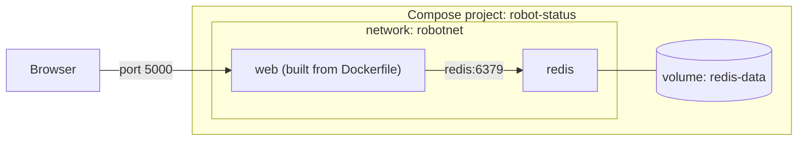

{:class="cover"}

---

By the end of this lesson you will be able to write a Compose file for a two-service app, and start, inspect and stop it with `docker compose`.

## Why Compose?

Last lesson we typed four long `docker` commands to run two containers, a network and a volume. Miss one flag and it breaks. **Docker Compose** lets you write all of that down once in a YAML file and start the lot with one command.



> A quick note on names. Older tutorials type the command with a hyphen between the two words. That is the retired Compose version 1. Today Compose is a Docker plugin, so you type `docker compose` with a space. Old files also began with a `version` line; that is now obsolete and you can leave it out.

## Tidy up first

Let's remove the containers we started by hand, so the names and ports are free:

```bash
docker rm -f robot-status redis
docker network rm robotnet
```

Keep the `robot-data` volume if you like; Compose will make its own.

## Write compose.yaml

In `~/robot-status`, create a file called `compose.yaml` with `nano compose.yaml`:

```yaml
services:
  web:
    build: .
    ports:
      - "5000:5000"
    environment:
      REDIS_HOST: redis
      ROBOT_NAME: Sparky
    depends_on:
      - redis
    networks:
      - robotnet

  redis:
    image: redis:7-alpine
    command: redis-server --appendonly yes
    volumes:
      - redis-data:/data
    networks:
      - robotnet

volumes:
  redis-data:

networks:
  robotnet:
```

YAML uses **spaces for indentation** (never tabs), and the indentation shows what belongs to what. Here is how each part maps to the commands you typed last lesson:

| In the file | Same as typing |
| --- | --- |
| `build: .` | `docker build -t robot-status .` |
| `ports: "5000:5000"` | `-p 5000:5000` |
| `environment:` | `-e REDIS_HOST=redis -e ROBOT_NAME=Sparky` |
| `volumes: redis-data:/data` | `-v robot-data:/data` |
| `networks: robotnet` | `--network robotnet` |
| `command:` | the command after the image name |
{:class="table table-single"}

The service names, `web` and `redis`, are also the **hostnames** on the network. That's why `REDIS_HOST: redis` works.

`depends_on` makes Compose start Redis before the web service. It controls start order, not whether Redis is fully ready. Our app only talks to Redis when someone visits, so that's fine here.

## Start the stack

```bash
docker compose up -d
```

`up` builds the image if needed, creates the network and volume, and starts both services. `-d` runs them in the background. Open `http://localhost:5000` and the page is back, counting visits in Redis.

## Everyday Compose commands

```bash
docker compose ps
docker compose logs -f
docker compose logs web
docker compose exec web sh
docker compose stop
docker compose start
docker compose down
```

- `ps` lists the services of this project.
- `logs -f` follows the logs of every service at once, with the service name in front of each line.
- `exec web sh` opens a shell in the `web` service. You use the service name, not a container name.
- `stop` and `start` pause and resume everything.
- `down` stops and **removes** the containers and the network. The volume stays, so your visit count survives.

To remove the volume as well, which deletes the data, add `-v`: `docker compose down -v`.

Compose reads `compose.yaml` from the current folder, so run these from `~/robot-status`. Check a file for mistakes, without starting anything, with:

```bash
docker compose config
```

## Rebuild after changing code

Edited `app.py`? Tell Compose to rebuild:

```bash
docker compose up -d --build
```

Only the changed layers are rebuilt, and only the `web` container is replaced.

## Common Issues

- **Problem**: `yaml: line 5: found character that cannot start any token` or `mapping values are not allowed here`.
- **Solution**: Check your indentation uses spaces, not tabs, and that each key has a colon followed by a space. Run `docker compose config` to find the line.
- **Why**: In YAML, indentation is the structure. One wrong space changes what a line belongs to.

- **Problem**: `no configuration file provided: not found`.
- **Solution**: `cd ~/robot-status` so you are in the folder that holds `compose.yaml`.
- **Why**: Compose looks in the current folder for `compose.yaml` (or the older name `docker-compose.yml`).

- **Problem**: You typed the old hyphenated command and got `command not found`.
- **Solution**: Use `docker compose` with a space.
- **Why**: Compose v2 is a plugin of the `docker` command. The hyphenated program belongs to the retired version 1.

## Try it Yourself

1. Run `docker compose up -d`, then `docker compose ps`. Which ports do you see?
2. Change `ROBOT_NAME: Sparky` to your own robot's name, run `docker compose up -d`, and refresh the page. Compose should recreate only `web`.
3. Challenge: run `docker compose down`, then `docker compose up -d`. Does the visit count survive? Now try `docker compose down -v` and compare.

## Check your understanding


? Which command starts every service in a Compose file in the background?
- [ ] `docker compose build`
- [x] `docker compose up -d`
- [ ] `docker run compose`
> `up` creates and starts the services, `-d` detaches them. `docker compose` is the modern plugin command.

? What does `docker compose down` remove by default?
- [ ] The named volumes as well
- [ ] The images
- [x] The containers and the network, but not the volumes
> Volumes are kept unless you add `-v`, so your data survives a `down`.

? Why does `REDIS_HOST: redis` work in our file?
- [x] The service name `redis` is its hostname on the network
- [ ] Docker guesses the address
- [ ] It is a special Compose keyword
> Services on a Compose network can reach each other by service name.

