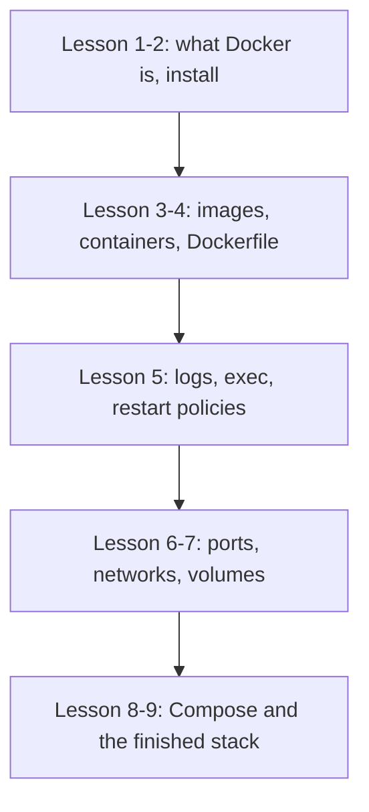

{:class="cover"}

---

By the end of this lesson you will be able to recap the Docker workflow you learned, and choose what to learn next.

## What you built

You started by running someone else's container and finished with your own two-service stack, described in a single file, that checks its own health, restarts itself and keeps its data.

## The commands you now know

| Job | Command |
| --- | --- |
| Download an image | `docker pull nginx` |
| Build an image | `docker build -t robot-status .` |
| Run a container | `docker run -d --name web -p 8080:80 nginx` |
| See containers | `docker ps -a` |
| Read logs | `docker logs -f robot-status` |
| Open a shell | `docker exec -it robot-status sh` |
| Make a network | `docker network create robotnet` |
| Make a volume | `docker volume create robot-data` |
| Start a stack | `docker compose up -d` |
| Stop a stack | `docker compose down` |
{:class="table table-single"}

## Where next

The Homelab pathway continues with courses on the same ideas:

- [Docker Swarm](/learn/docker_swarm/): link several Raspberry Pis into a cluster and run your Compose stacks across all of them. The `overlay` network from lesson 6 comes into play here.
- [Podman](/learn/podman/): a daemonless alternative that reads the same images and uses almost the same commands. Everything you learned here carries over.
- [K3s](/learn/k3s/): a small Kubernetes for the Pi, for when you want the big orchestrator.
- [Introduction to the Linux Command Line on Raspberry Pi OS](/learn/linux_intro/): if any terminal commands felt shaky, this is the refresher.

The best next step, though, is your own project. Pick something you already run on your Pi, such as a sensor logger, a MQTT broker or a small dashboard, and put it in a container. The official [Docker documentation](https://docs.docker.com/) is excellent when you get stuck.

## Common Issues

- **Problem**: Disk space slowly fills up with old images and stopped containers.
- **Solution**: Run `docker system df` to see what is using space, then `docker container prune` and `docker image prune`.
- **Why**: Docker keeps everything until you remove it, and a Pi's SD card is small.

> **Teachers**: When learners finish, ask them to run `docker compose down -v` and `docker image prune` on shared machines, so the next class starts clean. A good revision task is to have learners write a one-page cheat sheet of the commands in this lesson in their own words.

## Try it Yourself

1. Write down, from memory, the three commands you'd use to build, run and inspect your own image. Then check them against the table above.
2. Pick a program you have written for a robot or sensor and write a Dockerfile for it.
3. Challenge: put the robot status stack on a second Pi or PC. What do you need to copy across, and what could you push to Docker Hub instead?

## Check your understanding


? Which command would you use to see how much disk space Docker is using?
- [ ] `docker ps -a`
- [x] `docker system df`
- [ ] `docker stats`
> `docker system df` summarises the space used by images, containers and volumes.

? Which course shows you how to run Compose stacks across several Raspberry Pis?
- [x] Docker Swarm
- [ ] Introduction to the Linux Command Line
- [ ] Podman
> The Docker Swarm course clusters several Pis. Podman is a daemonless alternative to Docker.

? What carries over directly from Docker to Podman?
- [ ] Nothing at all
- [x] Images and almost all of the commands
- [ ] Only the Compose file syntax
> The Podman course builds on the same image format and nearly identical commands.

