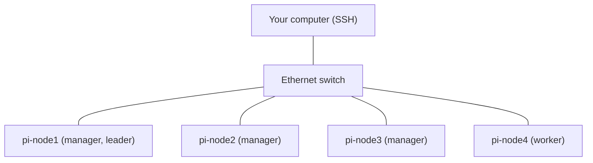

{:class="cover"}

---

By the end of this lesson you will be able to sketch a Raspberry Pi Swarm cluster, choose how many managers and workers it needs, and list the network ports it will use.

---

## What is a cluster?

A cluster is a group of computers (called ) that work together. Why bother with several small computers? Two reasons that matter to makers:

- **Resilience**: if one Pi crashes or loses power, the others keep your services running.
- **Room to grow**: need more capacity? Add another Pi instead of replacing the one you have.

Swarm is Docker's built-in way to do this. It is part of Docker Engine, so there is no extra software to install. It is also a lot lighter than Kubernetes, which makes it a good fit for Pis with 4 or 8 GB of RAM.

---

## Managers and workers

Every swarm node has one of two roles:

- **Manager nodes** hold the swarm's brain: which services should be running, and where. They also accept your `docker` commands.
- **Worker nodes** simply run the containers (called *tasks*) that managers hand them.

By default, managers run tasks too. On a small cluster that is exactly what you want, because you do not have Pis to spare.

### Why you want an odd number of managers

Managers keep their shared state in agreement using a method called **Raft**. Raft only works while a majority of managers can still talk to each other (a *quorum*). That is why you want an odd number:

| Managers | Failures survivable | Notes |
| --- | --- | --- |
| 1 | 0 | Fine for learning, but if it dies you lose control |
| 3 | 1 | The best choice for a small cluster |
| 5 | 2 | Overkill for a few Pis |
| 2 | 0 | Worse than one: either failing breaks quorum |
{:class="table table-single"}

If a worker dies, your services move to other nodes. If you lose the *quorum* of managers, the running containers carry on, but you cannot change anything until the managers are back.

Docker's own advice is not to go above seven managers. For a Pi cluster, **three managers is plenty**, and a four-Pi cluster is typically three managers plus one worker, or even four nodes of which three are managers.

---

## A small cluster design

Here is a friendly four-Pi design. Every Pi connects to one Ethernet switch.

Give each Pi a clear hostname such as `pi-node1` and an IP address that never changes, such as `192.168.50.11`, `.12`, `.13` and `.14`. Swarm remembers nodes by IP address, so a Pi whose address changes can fall out of the cluster.

---

## Ports that must be open

If your Pis sit behind a firewall, or you use a managed switch, these ports must be open **between all nodes**:

| Port | Used for |
| --- | --- |
| 2377/tcp | Cluster management traffic (managers listen here) |
| 7946/tcp and 7946/udp | Nodes discovering each other |
| 4789/udp | The overlay network that carries traffic between containers |
{:class="table table-single"}

Raspberry Pi OS does not ship with a firewall switched on, so a plain home setup just works. These ports matter when you add a firewall, or when the cluster sits on a school or work network.

---

## Hardware checklist

- **Power**: use the official 27 W supply for each Pi 5, or a quality multi-port supply. Under-voltage causes random crashes that look like software bugs.
- **Cooling**: a Pi 5 under load runs warm. The official Active Cooler or a case with a fan keeps it from throttling.
- **Storage**: a microSD card works, but it wears out under constant Docker writes. An NVMe or USB SSD is far more reliable if you can afford one.
- **Network**: Ethernet to a switch. Wi-Fi works for experiments but adds delay and dropouts.

**Common mistake**: building four nodes from a tangle of USB chargers. Plan the power first.

---

## Try it Yourself

1. Draw your own cluster on paper: how many Pis, which are managers, which IP addresses.
2. Work out how many manager failures your design survives, using the table above.
3. Challenge: you only own two Pis. Is it better to make both managers or just one? Explain why using quorum.

---

## Common Issues

- **Problem**: A two-manager swarm stops accepting commands when one Pi is switched off.
- **Solution**: Use one or three managers, not two.
- **Why**: Raft needs a majority. With two managers the majority is both of them, so losing one breaks quorum.

- **Problem**: Nodes randomly drop out of the swarm after a router reboot.
- **Solution**: Give every Pi a fixed IP, either with a DHCP reservation in your router or a static address on the Pi.
- **Why**: Swarm identifies nodes by address. When a Pi gets a new one, the others can no longer find it.

---

## Check your understanding


? Why is a three-manager swarm better than a two-manager swarm?
- [ ] Three managers run containers faster
- [x] Three managers keep a majority (quorum) when one fails, two do not
- [ ] Docker refuses to start with two managers
> Raft needs a majority of managers. With three, losing one leaves two (a majority). With two, losing one leaves half, which is not a majority.

? Which port do managers listen on for cluster management traffic?
- [ ] 4789/udp
- [ ] 7946/tcp
- [x] 2377/tcp
> Port 2377 over TCP carries cluster management. 7946 is node discovery and 4789 is the overlay network.

? What does a worker node do?
- [ ] Stores the swarm's Raft state
- [x] Runs the containers (tasks) that managers assign to it
- [ ] Accepts `docker service` commands from you
> Workers just run tasks. Managers keep the state and take your commands.

