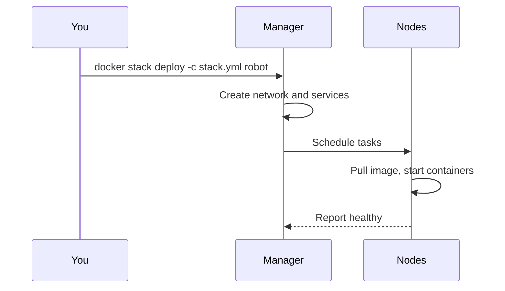

{:class="cover"}

---

By the end of this lesson you will be able to deploy a stack with `docker stack deploy`, inspect where its tasks run, and remove it cleanly.

---

## What happens when you deploy

You hand your `stack.yml` to a manager. The manager reads it, creates a network for the stack, creates one **service** per entry, and the scheduler places **tasks** (the actual containers) on nodes with room for them. Each node then pulls the image and starts the container.



---

## Step 1: deploy

On a manager, in the folder holding `stack.yml` from the last lesson:

```bash
docker stack deploy -c stack.yml robot
```

`robot` is the stack name. It becomes a prefix: your services are named `robot_web` and `robot_cache`, and the network is `robot_default`. Choose a name you will recognise.

You'll see lines like `Creating network robot_default` and `Creating service robot_web`. The command returns right away. The Pis then pull images in the background, which can take a minute on a first run.

---

## Step 2: check on it

```bash
docker stack services robot
```

This shows each service and a REPLICAS column such as `3/3`: three running out of three wanted. If it says `1/3` give it a moment. To see *where* each task landed:

```bash
docker stack ps robot
```

You'll see one row per task with its node, state and how long it has been running. Notice that `robot_web` is spread across nodes while `robot_cache` sits on the manager, just as the placement constraint asked.

Other useful views:

```bash
docker stack ls
docker service logs robot_web
```

---

## Step 3: use it

Open a browser or use `curl` against any node on port 8180:

```bash
curl -I http://192.168.50.12:8180
```

You should get `HTTP/1.1 200 OK` from nginx, whichever node you ask.

Inside the stack, services find each other by **service name**. The `web` containers can reach Redis at the hostname `cache`, because Swarm adds a private DNS entry on the stack's overlay network. You never need an IP address.

---

## Step 4: change and redeploy

Edit `stack.yml`, for example change `replicas: 3` to `replicas: 4`, and run the same command:

```bash
docker stack deploy -c stack.yml robot
```

Swarm compares the file with what is running and changes only what differs. This is the **declarative** approach: you describe the state you want, and Swarm makes it so. It is why we keep the stack file in Git.

---

## Step 5: remove the stack

```bash
docker stack rm robot
```

This removes the services and the stack's network, but **not** named volumes. Your Redis data stays on the node until you delete the volume yourself with `docker volume rm`.

---

## A note on startup order

Swarm ignores `depends_on`, so `web` may start before `cache` is ready. For a real app, make the app retry its connection, or give the dependency a health check. In our nginx example this does not matter, but it is a classic cause of "it works on my laptop, but not on the cluster".

---

## Try it Yourself

1. Deploy the stack, then run `docker stack ps robot` and note which node each task is on.
2. Open the page through each Pi's IP address on port 8180.
3. Change the `web` replicas to 5, redeploy and watch `docker stack services robot` count up.
4. Challenge: remove the stack, then run `docker volume ls` on the manager. What is left over, and why?

---

## Common Issues

- **Problem**: `this node is not a swarm manager`.
- **Solution**: Run `docker stack deploy` on a manager node.
- **Why**: Only managers can create services.

- **Problem**: A service stays at `0/3` replicas and `docker stack ps` shows `no suitable node`.
- **Solution**: Check the placement constraints and memory limits against what your nodes have.
- **Why**: The scheduler refuses to place a task where its constraints or resources cannot be met.

- **Problem**: `port is already allocated` or a published port will not start.
- **Solution**: Pick another published port, or remove the old service using it.
- **Why**: A published port is reserved on every node, so two services cannot share it.

> **Teachers**: The first image pull on a classroom network can be slow if every group pulls the same image at once. Pull `nginx:alpine` and `redis:7-alpine` on each Pi before the lesson, and stagger deployments. Docker Hub also limits anonymous pulls per IP address, which a shared school network can hit quickly.

---

## Check your understanding


? What are the stack name `robot` and a service `web` combined into?
- [ ] `web.robot`
- [x] `robot_web`
- [ ] `robot-web-1`
> Swarm prefixes services with the stack name and an underscore, so `web` becomes `robot_web`.

? What happens to named volumes when you run `docker stack rm`?
- [x] They are kept
- [ ] They are deleted
- [ ] They move to the manager
> Removing a stack keeps your data volumes, so you must delete them yourself if you no longer want them.

? How can the `web` service reach the Redis service?
- [ ] By its container ID
- [x] By the service name, `cache`, over the stack's network
- [ ] By guessing the node's IP address
> Swarm provides DNS for service names on the overlay network.

