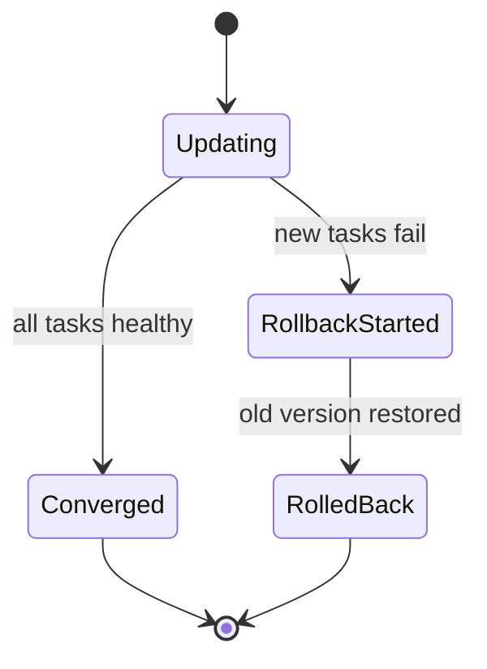

{:class="cover"}

---

By the end of this lesson you will be able to scale a service, roll out and roll back an update, and drain a node so it can be worked on safely.

---

## Scaling a service

Imagine your robot's web dashboard suddenly gets popular. You can add replicas in one command (using the service name, `<stack>_<service>`):

```bash
docker service scale robot_web=6
```

Swarm starts three more tasks and spreads them across your nodes. Scale back down just as easily:

```bash
docker service scale robot_web=3
```

You can also change `replicas:` in `stack.yml` and run `docker stack deploy` again. Pick one habit and stick with it: if you scale by hand, a later `docker stack deploy` will put the number back to whatever the file says.

Swarm does not have built-in auto-scaling. Other tools, or a script that watches a metric and calls `docker service scale`, can do it, but on a small Pi cluster you will usually scale by hand.

Replicas cost memory. Six copies of a heavy app on a 4 GB Pi can run it out of RAM, which is why the `resources: limits:` from lesson 7 matter.

---

## Rolling updates

Say there is a new version of your app. Update the image:

```bash
docker service update --image nginx:1.27-alpine robot_web
```

Because we set `update_config` in the stack file, Swarm replaces one task at a time (`parallelism: 1`), waits between them and starts each new task before stopping the old one. Visitors never see a gap. Watch it happen with:

```bash
docker service ps robot_web
```

You'll see old tasks marked `Shutdown` and new ones `Running`.



### Rolling back

Did the new version misbehave? Swarm remembers the previous definition of a service:

```bash
docker service rollback robot_web
```

The service returns to the earlier image and settings. With `failure_action: rollback` in the file, Swarm does this for you when new tasks fail their health check.

---

## Draining a node

Before you reboot a Pi, change its SD card or fit a fan, move its work elsewhere. This is called **draining**:

```bash
docker node update --availability drain pi-node3
```

Swarm stops the tasks on that node and starts replacements on the others. The node stays in the swarm but gets no new tasks. When you are finished:

```bash
docker node update --availability active pi-node3
```

Notice that bringing a node back to `active` does **not** move tasks back onto it. That surprise is what the next lesson fixes.

A word of warning from testing this on a single node: if you drain the only node that can run a task (for example a service pinned to it by a placement constraint), the task has nowhere to go and sits in `Pending` until the node is active again. Drain only when other nodes can take over.

---

## Removing a service

```bash
docker service rm robot_web
```

Use `docker stack rm` for a whole stack. Setting `--replicas 0` is not draining: it just stops all copies of that service but leaves the service defined.

---

## A short scaling checklist

| You want to | Command |
| --- | --- |
| Change the number of copies | `docker service scale robot_web=N` |
| Update the image | `docker service update --image <image> robot_web` |
| Undo the last update | `docker service rollback robot_web` |
| Empty a node for maintenance | `docker node update --availability drain <node>` |
{:class="table table-single"}

> **Teachers**: Scaling and rolling updates are great to demonstrate live: ask a learner to refresh a page while you update the service. If your classroom Pis are shared, remember that draining a node will interrupt other groups' work on it.

---

## Try it Yourself

1. Scale `robot_web` to 6, run `docker service ps robot_web` and count tasks per node, then scale back to 3.
2. Update the image to another nginx tag with `docker service update --image`, and watch the old and new tasks in `docker service ps`.
3. Run `docker service rollback robot_web` and confirm the image goes back.
4. Challenge: drain one worker, then count the tasks on the remaining nodes. Then make the node active again. Do the tasks return?

---

## Common Issues

- **Problem**: After `docker service scale`, the stack goes back to the old replica count on the next deploy.
- **Solution**: Change `replicas:` in `stack.yml` so the file matches what you want.
- **Why**: A stack deploy applies the file as the source of truth.

- **Problem**: A drained node's tasks stay `Pending`.
- **Solution**: Check `docker service ps --no-trunc <service>`. Make sure another node meets the constraints and has memory.
- **Why**: The scheduler can only place a task where it fits.

- **Problem**: An update hangs on one task.
- **Solution**: Read `docker service ps` for the error. Fix it, or run `docker service rollback`.
- **Why**: With `parallelism: 1`, a failing task blocks the whole update by design.

---

## Check your understanding


? What does draining a node do?
- [ ] Deletes the node from the swarm
- [x] Moves its tasks to other nodes and stops new ones being placed on it
- [ ] Reboots the node
> A drained node stays in the swarm but runs no tasks until it is made active again.

? How do you undo a bad update?
- [x] `docker service rollback <service>`
- [ ] `docker service undo`
- [ ] Re-flash the Pi
> Swarm remembers the previous service definition and `rollback` restores it.

? Why might a manual `docker service scale` seem to be forgotten?
- [ ] Swarm ignores scale commands
- [x] A later `docker stack deploy` restores the replica count from the file
- [ ] Scaling only lasts one minute
> The stack file is the source of truth for a stack-deployed service.

