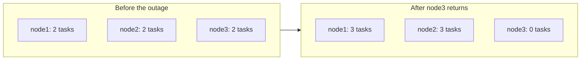

{:class="cover"}

---

By the end of this lesson you will be able to explain why Swarm does not rebalance automatically, and rebalance a service across your nodes with `docker service update --force`.

---

## The problem: the lopsided cluster

Here is a real situation. You have three nodes and six web tasks, two on each. You drain `pi-node3` to change its SD card. Swarm moves its two tasks to the others, so now `pi-node1` and `pi-node2` run three each. You make `pi-node3` active again.



`pi-node3` is back, healthy and idle, while the other two do all the work. The cluster is *working* but badly balanced. The same happens when you add a brand new node: it joins empty.

---

## Why doesn't Swarm fix it by itself?

It is a design choice. Automatically moving running containers would restart them, and a restart means a moment of downtime or lost in-memory state. Swarm prefers stability: it only places tasks when something forces it to (a new task, a failed node, a drain). You decide when the disruption is worth it.

---

## The fix: force an update

```bash
docker service update --force robot_web
```

`--force` re-creates the tasks even though nothing in the service definition changed. Swarm then runs its scheduler again, and because the idle node has the fewest tasks, the new tasks tend to land there. Your `update_config` rules (one at a time, start-first) still apply, so the service stays up while it happens.

Check the result:

```bash
docker service ps robot_web --filter desired-state=running
```

You should see the tasks more evenly spread. We tested this: on a single node a forced update replaced the task cleanly and the service converged again.

Note that the scheduler spreads by *number of tasks* on each node, not by CPU load, so the result is even in count rather than perfect in load.

---

## Rebalance with care

- Do it when traffic is low, not in the middle of a demo.
- Only rebalance services that tolerate a restart. A service with a single replica will briefly restart.
- Services pinned by a placement constraint cannot move, and shouldn't.
- On a big cluster, rebalance one service at a time.

A tip for a cluster of Pis: you can write a small script that loops over your services and runs `docker service update --force` on each, with a sleep between them.

---

## Try it Yourself

1. Scale `robot_web` to 6, drain one worker, then make it active again. Run `docker service ps robot_web` to see the imbalance.
2. Run `docker service update --force robot_web` and compare the spread.
3. Challenge: write a shell loop that force-updates every service in your stack, waiting 30 seconds between each. Hint: `docker stack services robot --format '{{.Name}}'` lists the names.

---

## Common Issues

- **Problem**: After `--force`, the idle node still has no tasks.
- **Solution**: Check the node is `Ready` and `Active` in `docker node ls`, and that your constraints allow it.
- **Why**: The scheduler skips nodes that are drained, down or excluded by a constraint.

- **Problem**: A single-replica service goes offline for a few seconds.
- **Solution**: Run at least two replicas for anything you want to stay online, or accept a short gap.
- **Why**: Replacing the only task means a short moment with none.

> **Teachers**: This is the best lesson for teaching "why isn't it automatic?". Ask learners to predict what will happen before they force the update. Predicting, then testing, sticks far better than being told.

---

## Check your understanding


? Why does a node that comes back from maintenance start empty?
- [ ] Docker deletes its containers
- [x] Swarm does not move running tasks back automatically
- [ ] It needs a new token
> Swarm only schedules tasks when it has to, so a returned node stays idle until something new is placed.

? What does `docker service update --force` do?
- [x] Re-creates a service's tasks, giving the scheduler a chance to spread them out
- [ ] Deletes and recreates the node
- [ ] Changes the image tag
> It replaces tasks without changing the definition, and the new tasks are scheduled afresh.

? Why does Swarm avoid automatic rebalancing?
- [ ] It cannot count tasks
- [x] Moving containers restarts them, and it prefers stability
- [ ] Rebalancing is not supported on ARM
> Restarting running tasks can interrupt your services, so the choice is left to you.

