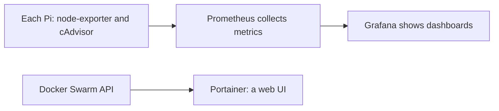

{:class="cover"}

---

By the end of this lesson you will be able to check the health of a swarm using built-in commands, build a simple live status view, and choose a monitoring tool that suits a Raspberry Pi cluster.

---

## Three questions to ask your cluster

Monitoring answers three questions:

1. **Are my nodes up?** (`docker node ls`)
2. **Are my services running as many copies as I asked for?** (`docker service ls`)
3. **Is anything running out of CPU, memory, disk or heat?** (needs a little more)

You can answer the first two with built-in commands, which is where we start.

---

## Built-in commands

```bash
docker node ls
docker service ls
docker service ps robot_web
docker service logs --tail 20 robot_web
```

- `docker service ls` shows `REPLICAS` such as `3/3`. If it says `2/3`, something is wrong.
- `docker service ps` shows each task's node and state, and the error if it failed.
- `docker service logs` gathers log lines from every task of a service.

`docker stats` is also useful, but remember it is **per node**: it only shows containers running on the machine where you type it. Swarm has no single command for cluster-wide CPU and memory.

Hardware checks on each Pi:

```bash
vcgencmd measure_temp
vcgencmd get_throttled
df -h /
free -h
```

`vcgencmd measure_temp` shows the CPU temperature, and `vcgencmd get_throttled` returns `throttled=0x0` when the Pi is healthy. Any other value means the Pi has hit under-voltage or thermal limits, so check the power supply and cooling.

---

## A live status view in two lines

You do not need any extra software for a handy dashboard. On a manager, run:

```bash
watch -n 5 'docker node ls; echo; docker service ls'
```

Leave it open on a spare monitor or terminal. Within five seconds of switching a Pi off, you will see the node flip to `Down` and a service's replicas drop and recover.

---

## Tools you can add



- **Portainer** is a web interface for managing containers, services and stacks. It is the easiest first step and gives you a visual cluster overview. Follow Portainer's own Swarm installation guide for the current stack file.
- **Prometheus and Grafana** are the standard pair for metrics: Prometheus collects numbers over time and Grafana draws graphs. They have arm64 builds, run happily on a Pi, and need you to run an exporter on each node to see its CPU and memory (Node Exporter for the host, cAdvisor for containers). Run the exporters as a *global* service, which means one task per node.
- **ELK (Elasticsearch, Logstash, Kibana)** is a logging stack that is generally heavy on memory. On a small Pi cluster, a lighter log tool such as Loki is a gentler choice, or simply use `docker service logs`.

Whatever you choose, deploy it as a stack on the swarm itself, and give it resource limits so it does not starve your real services. Monitoring that crashes the cluster is worse than none.

---

## Try it Yourself

1. Run `watch -n 5 'docker node ls; echo; docker service ls'` and leave it running.
2. Run `vcgencmd measure_temp` on each Pi, first idle, then while a service is busy. How much does it change?
3. Switch one worker off (or `sudo reboot` it) and watch the view. How long until the node shows `Down`? How long until the tasks reappear elsewhere?
4. Challenge: read about the `mode: global` setting for a service and sketch how you would run a metrics exporter on every Pi.

---

## Common Issues

- **Problem**: `docker stats` on the manager shows nothing for a service.
- **Solution**: Run `docker stats` on the node where the task is running (see `docker service ps`).
- **Why**: Docker stats reads the local Docker Engine only.

- **Problem**: `vcgencmd get_throttled` returns something other than `0x0`.
- **Solution**: Use the official power supply and cable, and improve cooling.
- **Why**: Non-zero flags record under-voltage or overheating, which cause random cluster glitches.

- **Problem**: The monitoring stack makes the Pis slow or crash.
- **Solution**: Put memory limits on it, and drop heavy components such as Elasticsearch.
- **Why**: A Pi has limited RAM, and monitoring tools compete with your services for it.

> **Teachers**: Prometheus and Grafana are free, but Grafana's setup involves default admin logins. Change the admin password and keep the dashboard on the classroom network only, not on the internet.

---

## Check your understanding


? Why does `docker stats` not give a whole-cluster view?
- [ ] It only works on managers
- [x] It reads the Docker Engine on the machine you run it on
- [ ] It needs Grafana installed
> `docker stats` is local to the node, so cluster-wide metrics need a tool such as Prometheus.

? What does `docker service ls` show you for each service?
- [ ] The CPU temperature
- [x] The number of running replicas against the number wanted
- [ ] The Raft leader
> The REPLICAS column such as `3/3` quickly shows whether the service is healthy.

? Why run node exporters as a global service?
- [x] So that one runs on every node
- [ ] So that they run only on the leader
- [ ] So that they use less memory
> Global mode puts one task on each node, which is what a per-node exporter needs.

