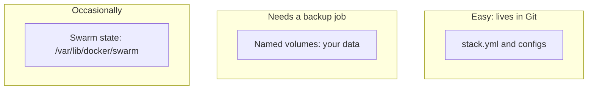

{:class="cover"}

---

By the end of this lesson you will be able to back up a data volume and the swarm state, and recover a swarm that has lost its managers.

---

## What needs backing up?



1. **Your stack files and configs.** Keep them in a Git repository. If everything else is lost, you can redeploy from these.
2. **Your data volumes.** Databases, uploads and anything your containers store. This is the part that cannot be recreated.
3. **The swarm state**, which holds service definitions, secrets and cluster identity. Useful, but if you keep your stack files in Git, you can rebuild it.

One thing that does **not** exist, although you might see it in older guides: there is no `docker swarm backup` command. We checked: Docker reports `unknown command`. Swarm backups are done by copying files, as below.

---

## Backing up a data volume

Volumes live on one node's disk, so back them up on the node that holds them. A neat trick is to start a throwaway container that mounts the volume and archives it:

```bash
docker run --rm \
  -v robot_cache-data:/data \
  -v "$PWD":/backup \
  alpine tar czf /backup/cache-data.tgz -C /data .
```

`robot_cache-data` is the volume's real name: stack volumes get the stack name as a prefix, so check `docker volume ls`. The command writes `cache-data.tgz` into your current folder. Now copy that file off the Pi, to another machine or a USB drive:

```bash
scp cache-data.tgz you@your-computer:/backups/
```

To restore, make sure the volume exists and unpack into it:

```bash
docker run --rm \
  -v robot_cache-data:/data \
  -v "$PWD":/backup \
  alpine tar xzf /backup/cache-data.tgz -C /data
```

For regular, automatic backups use `cron` to run the archive command, or a tool such as restic or BorgBackup, which keep many versions and can encrypt.

A database such as PostgreSQL should be backed up with its own dump tool (`pg_dump`), not by copying files while it is running, or the copy may be inconsistent.

---

## Backing up the swarm state

The swarm's state lives in `/var/lib/docker/swarm` on every manager. Docker's documented way to back it up:

1. If you use autolock, make sure you have the unlock key.
2. Pick a manager that is **not the leader**, ideally in a three-manager swarm so that the other two keep the quorum.
3. Stop Docker on it, copy the folder, then start Docker again:

```bash
sudo systemctl stop docker
sudo tar czf swarm-state.tgz -C /var/lib/docker swarm
sudo systemctl start docker
```

Stopping the manager briefly is why you want three of them. The archive contains your swarm's secrets and keys, so keep it somewhere private and, ideally, encrypted.

---

## Recovering from lost quorum

Suppose two of three managers are destroyed. The swarm cannot elect a leader, and you cannot change anything. If you still have one manager, you can force it to start a fresh single-manager swarm *using its existing data*:

```bash
docker swarm init --force-new-cluster --advertise-addr 192.168.50.11
```

Your services and configuration are kept. Then add new managers and workers as in lesson 4, and re-balance. This is a last resort: only run it on a manager whose data is the one you want to keep.

### Restoring the swarm state on a new manager

If the managers are all gone but you have a `swarm-state.tgz`: on a fresh Pi with Docker installed, stop Docker, empty and replace `/var/lib/docker/swarm` with the backup, start Docker, and run the `--force-new-cluster` command above. If the swarm was autolocked, unlock it with your key first.

---

## Test it

A backup you have never restored is a hope, not a backup. Once a quarter, restore a volume into a scratch volume and check the data is there. Do the swarm restore on a spare Pi, never on your working cluster.

> **Teachers**: Backups can contain secrets and personal data. In a classroom, use made-up data, and delete backup files from shared Pis at the end of the session. Restoring on a spare Pi is also an excellent end-of-unit practical.

---

## Try it Yourself

1. Create a volume with `docker volume create demo`, put a file in it with a throwaway container, then archive it with the `tar` command.
2. Delete the volume, create it again, and restore from the archive. Is your file back?
3. Initialise a swarm on a spare Pi, deploy a stack, copy `/var/lib/docker/swarm`, and write down the steps to restore it.
4. Challenge: write a `cron` job that backs up a volume nightly and keeps seven days of archives.

---

## Common Issues

- **Problem**: The volume name in the backup command is not found, and Docker creates a new empty one.
- **Solution**: Run `docker volume ls` and use the exact name, which includes the stack prefix.
- **Why**: Stack volumes are named `<stack>_<volume>`, and a wrong name quietly makes a new volume.

- **Problem**: After restoring `/var/lib/docker/swarm`, Docker will not start or the node stays locked.
- **Solution**: Check `journalctl -u docker`. If the swarm was autolocked, unlock it with `docker swarm unlock`.
- **Why**: The restored keys are encrypted with the old unlock key.

- **Problem**: A restored database fails to start.
- **Solution**: Restore from a proper dump (`pg_dump` or the database's own export), not a file copy of a running database.
- **Why**: A file-level copy taken mid-write can be corrupt.

---

## Check your understanding


? Which command creates a swarm state backup?
- [ ] `docker swarm backup`
- [ ] `docker stack export`
- [x] There is none: you stop Docker on a manager and copy `/var/lib/docker/swarm`
> Swarm has no backup command. The state is a folder you copy while Docker is stopped.

? Why back up from a manager that is not the leader, with three managers?
- [ ] Followers have newer data
- [x] The other two keep quorum while Docker is stopped on the one being copied
- [ ] Leaders cannot be copied
> With three managers, stopping one leaves two, which is still a majority.

? What is the safest way to keep your service definitions?
- [x] Stack files stored in Git
- [ ] Remembering the commands
- [ ] Only in the swarm state
> If your stack files are in Git you can redeploy everything even if the swarm is lost.

