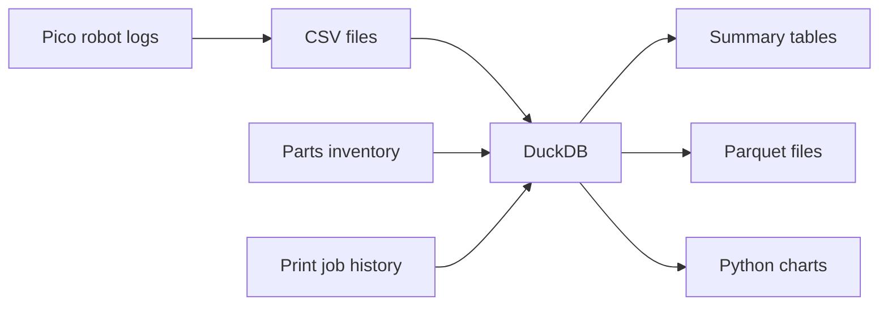

{:class="cover"}

---

By the end of this lesson you will be able to explain what DuckDB is, say when you would pick it over a spreadsheet or a server database, and describe the robot data project you will build.

Ahoy there makers! Your robots are quietly collecting data: temperatures, distances, battery voltages, print times. Most of us dump it into a CSV file and never look again. DuckDB is the tool that makes that pile of files answer questions in a fraction of a second, on the laptop or Raspberry Pi you already own.

## Overview

DuckDB is an in-process, [columnar](/resources/glossary.html#columnar) [SQL](/resources/glossary.html#sql) database. "In-process" means there is no server to install or run: the database lives inside your Python script (or the little command line tool) and reads files such as CSV and [Parquet](/resources/glossary.html#parquet) directly. It is built for *analytics*: summing, averaging and comparing millions of rows, rather than updating one row at a time.

This course follows one project. A small fleet of robots logs a reading every five minutes, and you also have a parts inventory and a 3D print history. By the end you will have a repeatable analytics workspace that answers questions like "which robot runs hottest?", "when does each battery hit its limit?" and "which printer wastes the most filament?".

This course is part of the [Databases learning pathway](/learn/learning_pathways/databases.html). If you have not used SQL before, the [SQL course](/learn/sql/) is a gentle warm-up, but every query here is explained from scratch.

## Course Content

- Install DuckDB and make the sample robot data
- Query it with SELECT, WHERE, GROUP BY and JOIN
- Build pipelines with CTEs, views, saved databases and COPY
- Use DuckDB from Python with Pandas, Polars and parameters
- Run an end-to-end analysis and draw a chart
- Treat a folder of files as a small data lake
- Write and read Parquet, including partitions and schema changes
- Tune performance with EXPLAIN, profiling and settings
- Finish with a capstone project of your own

## Key Results

After completing this course, you will:

- Query CSV and Parquet files with SQL without loading them into a server
- Save results in a `.duckdb` database file and share them as Parquet
- Run DuckDB from Python and move data to and from Pandas
- Read a folder of partitioned files and explain why it is fast
- Use `EXPLAIN` and timing to find out why a query is slow
- Build a small analytics project you can reuse on your own sensor logs

## What you'll need

- A computer running Windows, macOS or Linux (a Raspberry Pi 4 or 5 with a 64-bit OS works too)
- Python 3.11 or newer, because the DuckDB Python package needs it
- A text editor and a terminal
- About 50 MB of free disk space
- No robot required: the lessons generate their own sample data

Tested with DuckDB Python package 2.0.1 and command line shell 1.5.2. If your version is newer, the queries here should still work; if one does not, check the DuckDB release notes for what changed.

## How the course works

Each lesson opens with what you will be able to do, teaches one idea, then ends with `## Try it Yourself` exercises, a `## Common Issues` list and a short quiz. SQL goes in code blocks marked `sql`, and you can type it into the DuckDB shell or run it from Python. Program output is shown in plain boxes so you can compare it with your own.

Lessons 1 to 3 build up the shell, 4 and 5 move to Python, and 6 to 8 handle bigger data and speed. The sample data is generated by a script with a fixed random seed, so your numbers match the ones printed here.

New words are explained as they appear, and there is a [beginner glossary](09_conclusion#beginner-glossary-the-language-of-data) in the summary lesson. If you only have ten minutes, the [Quickstart](quickstart) is a one-page tour, and [Troubleshooting](troubleshooting) collects the usual fixes.

> **Teachers**: This course suits ages 14 and up who are comfortable with a terminal, in a computing or physics club or a college data unit. Allow 30 to 45 minutes per lesson. Each learner needs a computer with Python 3.11 or newer; nothing needs an account, a login or a classroom internet connection beyond the one-off `pip install`, so a locked-down school network is fine once the package is installed. The remote-file part of lesson 6 can be done entirely on one machine. With no robots, the generated data does everything, and classes can compare results because the random seed is fixed.

## Next up

Head to [01 installing](01_installing) to set up DuckDB and create your data. Prefer a quick taste first? Try the [Quickstart](quickstart).
