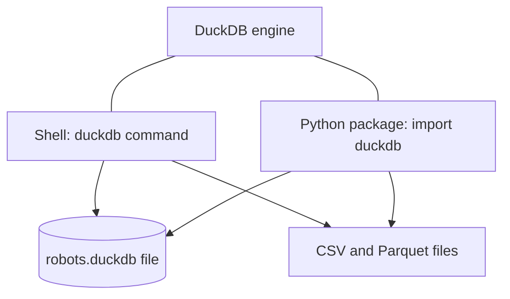

{:class="cover"}

---

By the end of this lesson you will be able to install DuckDB, generate the course's robot sample data, and run your first queries from both the shell and Python.

Let's get the kit on the bench. DuckDB comes in two flavours that share the same engine: a **shell** (the `duckdb` command) for typing SQL, and a **Python package** for scripts and notebooks. You can use either or both. A database file made by one opens in the other, as long as the two are close enough in version (see Common Issues).



## Install DuckDB

**Python package (any computer, Raspberry Pi included):**

```bash
python -m pip install --upgrade pip
python -m pip install duckdb pandas
```

The package needs Python 3.11 or newer. If your Pi's Python is older, check with `python3 --version` and install a newer one, or just use the shell.

**Shell:**

- macOS: `brew install duckdb`
- Windows: `winget install DuckDB.cli`
- Linux and Raspberry Pi OS (64-bit): download the zip for your machine (`duckdb_cli-linux-amd64.zip` for a PC, `duckdb_cli-linux-arm64.zip` for a Pi 4 or 5) from the DuckDB releases page on GitHub (`github.com/duckdb/duckdb/releases`), unzip it, and move the `duckdb` file somewhere on your `PATH`, for example `/usr/local/bin`.

Check that both work:

```bash
duckdb --version
python -c "import duckdb; print(duckdb.__version__)"
```

The shell I used printed `v1.5.2 (Variegata) 8a5851971f` and the Python package printed `2.0.1`. Yours may differ, and that is fine.

## Make your project and your data

Real analytics starts with files, so let's make some. Create a project folder, and save this script inside it as `make_data.py`. It writes three small CSV files: a sensor log from three robots (one reading every five minutes for four days), a parts inventory, and a 3D print job history. It also creates the `exports/` and `lake/` folders we will need later.

```python
# make_data.py - creates the sample data for the DuckDB course.
# Run it once from your project folder: python make_data.py
import csv
import os
import random
from datetime import datetime, timedelta

random.seed(42)  # same seed, same data, so your numbers match the lessons
os.makedirs("data", exist_ok=True)
os.makedirs("exports", exist_ok=True)
os.makedirs("lake", exist_ok=True)

# 1. Sensor log: three robots, one reading every 5 minutes for 4 days
robots = {
    "smars-1": {"base_temp": 24.0, "drain": 0.0011},
    "smars-2": {"base_temp": 26.0, "drain": 0.0014},
    "rover-3": {"base_temp": 28.0, "drain": 0.0020},
}
start = datetime(2025, 3, 3, 8, 0, 0)
with open("data/readings.csv", "w", newline="") as f:
    out = csv.writer(f)
    out.writerow(["ts", "robot", "temp_c", "distance_cm", "battery_v", "state"])
    for name, cfg in robots.items():
        battery = 8.4
        charging = False
        for i in range(4 * 24 * 12):
            ts = start + timedelta(minutes=5 * i)
            state = "driving" if random.random() < 0.35 else "idle"
            if battery < 6.6:
                charging = True       # plug in when the battery gets low
            elif battery >= 8.2:
                charging = False      # unplug when it is nearly full
            if charging:
                state = "charging"
            if state == "charging":
                battery = min(8.4, battery + 0.05)
            else:
                battery -= cfg["drain"] * (3 if state == "driving" else 1) * 5
            temp = cfg["base_temp"] + (4 if state == "driving" else 0) + random.gauss(0, 0.6)
            distance = max(2.0, random.gauss(60, 25)) if state == "driving" else 400.0
            out.writerow([ts.isoformat(sep=" "), name, round(temp, 2),
                          round(distance, 1), round(battery, 3), state])

# 2. Parts inventory
parts = [
    ("SG90 servo", "motor", 14, 2.10, "ServoShop"),
    ("N20 geared motor", "motor", 8, 3.50, "ServoShop"),
    ("TB6612 driver", "driver", 5, 4.20, "PiBits"),
    ("HC-SR04 sensor", "sensor", 11, 1.60, "PiBits"),
    ("VL53L0X sensor", "sensor", 4, 5.80, "PiBits"),
    ("DHT22 sensor", "sensor", 3, 4.90, "PiBits"),
    ("Pico", "controller", 6, 3.60, "PiBits"),
    ("Pico W", "controller", 2, 5.60, "PiBits"),
    ("18650 cell", "power", 9, 4.00, "CellMart"),
    ("2S battery holder", "power", 5, 0.90, "CellMart"),
    ("M3x8 screws (100)", "fixings", 6, 3.20, "BoltBarn"),
    ("PLA 1kg, grey", "filament", 3, 17.50, "FilamentCo"),
]
with open("data/parts.csv", "w", newline="") as f:
    out = csv.writer(f)
    out.writerow(["part", "category", "qty", "unit_price_gbp", "supplier"])
    out.writerows(parts)

# 3. Print job history: 60 jobs across three printers
printers = ["ender-3", "prusa-mini", "bambu-a1"]
models = ["SMARS chassis", "SMARS wheel", "SMARS track", "Pico case",
          "Sensor mount", "Battery lid", "Gripper claw", "Servo bracket"]
materials = ["PLA", "PETG", "TPU"]
with open("data/print_jobs.csv", "w", newline="") as f:
    out = csv.writer(f)
    out.writerow(["job_id", "model", "printer", "filament", "grams", "hours", "status", "started"])
    t = datetime(2025, 1, 6, 18, 0, 0)
    for job in range(1, 61):
        model = random.choice(models)
        material = random.choices(materials, weights=[6, 3, 1])[0]
        grams = round(random.uniform(4, 90), 1)
        hours = round(grams / random.uniform(14, 22), 2)
        status = random.choices(["done", "failed", "cancelled"], weights=[8, 2, 1])[0]
        out.writerow([job, model, random.choice(printers), material,
                      grams, hours, status, t.isoformat(sep=" ")])
        t += timedelta(hours=random.randint(8, 60))

print("Created data/readings.csv, data/parts.csv and data/print_jobs.csv")
```

Run it:

```bash
python make_data.py
```

You should see `Created data/readings.csv, data/parts.csv and data/print_jobs.csv`. The sensor file has 3,456 rows. The robots drive about a third of the time, run warmer when driving, and plug in to charge when the battery drops below 6.6 V (unplugging at 8.2 V), which gives us a nice story to explore.

## Your first queries in the shell

Start the shell inside your project folder:

```bash
duckdb
```

Then query a CSV file directly, with no import step:

```sql
SELECT * FROM 'data/readings.csv' LIMIT 3;
```

```
┌─────────────────────┬─────────┬────────┬─────────────┬───────────┬─────────┐
│         ts          │  robot  │ temp_c │ distance_cm │ battery_v │  state  │
│      timestamp      │ varchar │ double │   double    │  double   │ varchar │
├─────────────────────┼─────────┼────────┼─────────────┼───────────┼─────────┤
│ 2025-03-03 08:00:00 │ smars-1 │  24.48 │       400.0 │     8.395 │ idle    │
│ 2025-03-03 08:05:00 │ smars-1 │  28.08 │        56.8 │     8.378 │ driving │
│ 2025-03-03 08:10:00 │ smars-1 │   23.1 │       400.0 │     8.373 │ idle    │
└─────────────────────┴─────────┴────────┴─────────────┴───────────┴─────────┘
```

Notice DuckDB worked out the column types for you, including `timestamp` for `ts`. Now create a database file and load the data into a table:

```sql
.open robots.duckdb
CREATE TABLE readings AS SELECT * FROM read_csv('data/readings.csv');
SELECT COUNT(*) AS row_count FROM readings;
```

The count is `3456`. `.open` is a shell command (note the dot, and no semicolon) that creates `robots.duckdb` if it does not exist. Anything you create afterwards is saved in that file. Leave with `.quit`, start `duckdb robots.duckdb` later, and your `readings` table is still there.

## Your first script in Python

Save this as `first.py` in the same folder:

```python
import duckdb

# Opens robots.duckdb, or creates it if it is missing
con = duckdb.connect("robots.duckdb")
con.execute("CREATE OR REPLACE TABLE readings AS SELECT * FROM read_csv('data/readings.csv')")

rows = con.execute("SELECT COUNT(*) FROM readings").fetchone()[0]
print("rows:", rows)

hottest = con.execute(
    "SELECT robot, MAX(temp_c) FROM readings GROUP BY robot ORDER BY robot"
).fetchall()
print(hottest)

con.close()
```

It prints:

```
rows: 3456
[('rover-3', 33.58), ('smars-1', 29.48), ('smars-2', 31.64)]
```

`fetchone()` returns the first row as a tuple and `fetchall()` returns a list of tuples.

> **Teachers**: Installing the shell needs permission to put a program on the computer, which locked-down school machines often do not give. The Python package installs per user with `pip`, so use that route (or a virtual environment) and skip the shell. Run `make_data.py` once on a teacher machine and share the three CSV files if the class has no write access to their folders.

## Try it Yourself

1. Run `SELECT 42 AS answer;` in the shell, then change the alias to your own name.
2. In Python, change `con.execute(...)` so it prints how many readings belong to `rover-3` only (hint: add a `WHERE robot = 'rover-3'`).
3. Create a table `evens` in the shell using `SELECT * FROM range(0, 20, 2) AS t(x);`, then count its rows.
4. Challenge: find the row counts of `parts.csv` and `print_jobs.csv` using only `SELECT COUNT(*) FROM 'data/....csv'`.

## Common Issues

- **Problem**: `IO Error: No files found that match the pattern "data/readings.csv"`
- **Solution**: Run the shell from the project folder (check with `pwd`), and run `python make_data.py` first.
- **Why**: Paths are relative to the folder you started in, not to the script or the data.

- **Problem**: `ModuleNotFoundError: No module named 'duckdb'`
- **Solution**: Install with the same Python you run: `python -m pip install duckdb`.
- **Why**: `pip` and `python` can point at different installs, so use `python -m pip`.

- **Problem**: `IO Error: Could not set lock on file "robots.duckdb"`
- **Solution**: Close the other shell or Python session that has the file open, then try again.
- **Why**: A database file can have one writing process at a time.

- **Problem**: `Trying to read a database file with version number ..., but we can only read versions between ... The database file was created with an newer version of DuckDB.`
- **Solution**: Update the older one (`pip install --upgrade duckdb`, or download the latest shell) so the shell and Python package match.
- **Why**: DuckDB's file format changes between releases, and an older program cannot read a file written by a newer one. I hit this while writing the course, with a 1.5.2 shell and a 2.0.1 Python package.

## Check your understanding


? What does `.open robots.duckdb` do in the shell?
- [ ] Downloads a database from the internet
- [x] Opens that file as the current database, creating it if needed
- [ ] Runs every SQL file in the folder
> Without `.open` the shell uses a temporary in-memory database that vanishes when you quit.

? Why does the lesson use a fixed random seed in `make_data.py`?
- [ ] To make the file smaller
- [x] So everyone generates identical data and gets the same answers
- [ ] Because CSV files need it
> `random.seed(42)` makes the "random" numbers repeatable.

? Which Python version does the DuckDB package used in this course need?
- [ ] Python 2.7
- [ ] Any version
- [x] Python 3.11 or newer
> This is listed in the install step, and in the course intro.

