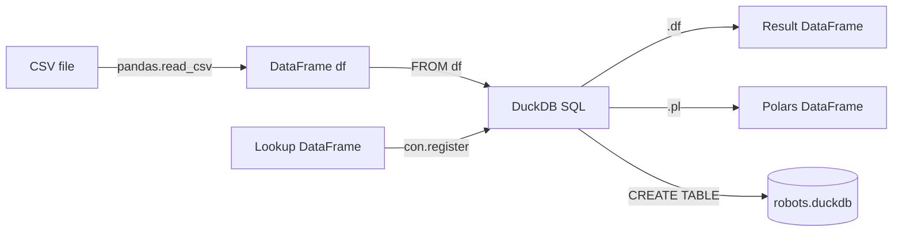

{:class="cover"}

---

By the end of this lesson you will be able to run SQL on a Pandas DataFrame, keep tables in a `.duckdb` file from a script, and pass values into queries safely.

Python is brilliant for loading and plotting data. SQL is brilliant for filtering and summarising it. DuckDB lets you use both in the same script with no server in between. All the code here runs on your computer, not on a Pico, and it needs `pip install duckdb pandas polars` (polars is only used once). Run each script from your project folder, where `data/readings.csv` lives.



## Pattern A: query a DataFrame directly

For quick exploration you do not even need a connection. DuckDB looks at the Python variables in scope, and if your SQL mentions a name that matches a DataFrame, it reads from it.

```python
import duckdb
import pandas as pd

df = pd.read_csv("data/readings.csv", parse_dates=["ts"])

res = duckdb.sql("""
    SELECT robot, state, ROUND(AVG(temp_c), 1) AS avg_temp
    FROM df
    GROUP BY robot, state
    ORDER BY robot, state
""").df()
print(res)
```

```
     robot     state  avg_temp
0  rover-3  charging      28.1
1  rover-3   driving      32.0
2  rover-3      idle      28.0
3  smars-1  charging      23.9
4  smars-1   driving      28.0
5  smars-1      idle      23.9
6  smars-2  charging      26.0
7  smars-2   driving      30.0
8  smars-2      idle      26.0
```

`duckdb.sql(...)` runs the query and `.df()` turns the answer into a Pandas DataFrame. Notice how the temperatures line up with the robots' base temperatures plus 4 degrees when driving, exactly as `make_data.py` built them.

Good to know: `duckdb.query(...)` is the same call with another name, and `.fetchall()` gives plain Python tuples if you do not want Pandas.

## Pattern B: a connection for tables and files

A connection holds state: tables, views and settings. Connect to a file and everything you create is saved.

```python
import duckdb

con = duckdb.connect("robots.duckdb")  # created if it does not exist

con.execute("""
    CREATE OR REPLACE TABLE readings AS
    SELECT * FROM read_csv('data/readings.csv')
""")
con.execute("""
    CREATE OR REPLACE VIEW v_driving AS
    SELECT * FROM readings WHERE state = 'driving'
""")

out = con.execute("""
    SELECT robot, COUNT(*) AS driving_samples, MAX(temp_c) AS peak_temp
    FROM v_driving
    GROUP BY robot
    ORDER BY robot
""").df()
print(out)

con.close()
```

```
     robot  driving_samples  peak_temp
0  rover-3              307      33.58
1  smars-1              350      29.48
2  smars-2              351      31.64
```

Always `con.close()` (or use `with duckdb.connect(...) as con:`) so the file lock is released for the next program. `duckdb.connect()` with no argument gives a throwaway in-memory database.

## Pattern C: register a DataFrame as a table

Sometimes a small lookup table lives in your Python code. `register` gives it a name that SQL can join against.

```python
import duckdb
import pandas as pd

robot_info = pd.DataFrame({
    "robot": ["smars-1", "smars-2", "rover-3"],
    "platform": ["SMARS", "SMARS", "Rover"],
    "motor": ["N20", "N20", "DC"],
})

con = duckdb.connect("robots.duckdb")
con.register("robot_info", robot_info)

res = con.execute("""
    SELECT i.platform, ROUND(AVG(r.temp_c), 1) AS avg_temp, COUNT(*) AS samples
    FROM readings r
    JOIN robot_info i ON i.robot = r.robot
    GROUP BY i.platform
    ORDER BY i.platform
""").df()
print(res)
con.close()
```

```
  platform  avg_temp  samples
0    Rover      29.1     1152
1    SMARS      26.2     2304
```

The registered name exists only for that connection, so nothing extra is saved in the file. This script expects the `readings` table from Pattern B.

## Polars results

If you prefer Polars, ask for its type instead of Pandas:

```python
import duckdb

q = duckdb.sql("""
    SELECT robot, MAX(temp_c) AS peak
    FROM 'data/readings.csv'
    GROUP BY robot
    ORDER BY robot
""")
print(q.pl())
```

`.pl()` needs `pip install polars` (it prints a small Polars table with `robot` and `peak` columns). Polars is optional for this course.

## Bind parameters, do not paste values

Building SQL by gluing strings together is a bug waiting to happen (a robot name with a quote in it breaks the query, and it opens the door to SQL injection). Use `?` placeholders and pass the values separately:

```python
import duckdb

con = duckdb.connect("robots.duckdb")
min_temp = 33
rows = con.execute(
    "SELECT ts, temp_c FROM readings WHERE robot = ? AND temp_c > ? ORDER BY temp_c DESC",
    ["rover-3", min_temp],
).fetchall()
print(len(rows), rows[:2])
con.close()
```

It prints `14` and the two hottest rows: `(datetime.datetime(2025, 3, 5, 13, 15), 33.58)` and `(datetime.datetime(2025, 3, 5, 19, 30), 33.56)`. The values arrive as real Python types, so timestamps come back as `datetime` objects.

> **Teachers**: A good moment to talk about SQL injection with older learners. Show what happens when a name is pasted into a query string, then fix it with `?`. All of this runs on one laptop with no accounts, so it is safe for any school network.

## Try it Yourself

1. In Pattern A, change the query to keep only `state = 'driving'` and sort by `avg_temp` descending.
2. In Pattern B, create a view `v_charging` and print how many charging samples each robot has.
3. In Pattern C, add a `weight_g` column to `robot_info` with values you invent, and compute grams per sample.
4. Challenge: write a function `hottest(robot, n)` that uses `?` placeholders and returns the `n` hottest readings for one robot as a DataFrame.

## Common Issues

- **Problem**: `Catalog Error: Table with name df does not exist!`
- **Solution**: Make sure the DataFrame is a normal variable in the same function or script, and spelled exactly as in the SQL.
- **Why**: DuckDB finds DataFrames by scanning the Python variables in scope; a typo or a variable inside another function is invisible to it.

- **Problem**: `ModuleNotFoundError: No module named 'polars'`
- **Solution**: Run `python -m pip install polars`, or use `.df()` for Pandas instead.
- **Why**: `.pl()` converts to Polars, which is a separate package.

- **Problem**: `IO Error: Could not set lock on file "robots.duckdb"`
- **Solution**: Close the other connection or shell that has the file open (`con.close()`), or restart the notebook kernel.
- **Why**: Only one program may write to a database file at a time.

## Check your understanding


? How does `duckdb.sql("SELECT * FROM df")` find the DataFrame `df`?
- [ ] You must call `register` first
- [x] DuckDB looks up Python variables with that name in scope
- [ ] It reads a file called df.csv
> This automatic lookup is handy for quick scripts. Use `register` when you want to name a DataFrame explicitly.

? Which is the safe way to use a Python value in a query?
- [ ] Build the SQL with an f-string
- [x] Use a `?` placeholder and pass the value in a list
- [ ] Convert the value to text first
> Placeholders keep values separate from the SQL, so quotes cannot break or hijack the query.

? Why close a connection to a database file?
- [x] To release the file lock so other programs can open it
- [ ] To delete the tables
- [ ] To make DuckDB faster
> A file database can only be written by one process at a time.

