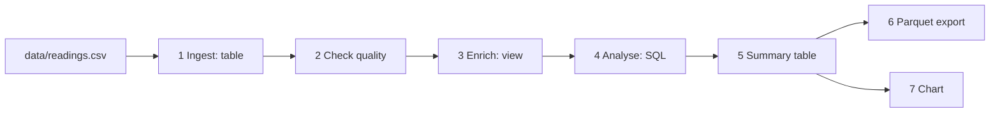
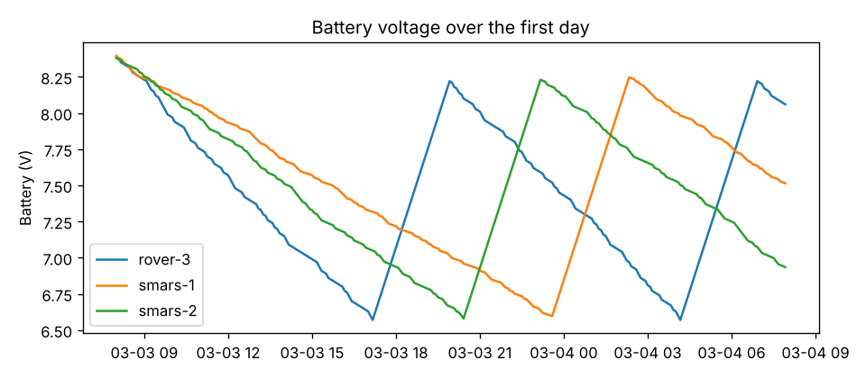

{:class="cover"}

---

By the end of this lesson you will be able to take a raw CSV through checking, enriching, summarising and exporting in one repeatable script, and draw a chart from the result.

Time to put it all together. We have three robots that log a reading every five minutes, and a burning question: **how often do they charge, and how do they spend their time?** One script will take us from raw file to answer, and you can rerun it any time with new data.



You need `pip install duckdb matplotlib`, the `data/` folder from lesson 1 and an `exports/` folder. Save this as `analysis.py` and run it from your project folder:

```python
import duckdb
import matplotlib

matplotlib.use("Agg")  # draw to a file, no window needed
import matplotlib.pyplot as plt

con = duckdb.connect("robots.duckdb")

# 1. Ingest: a table gives fast, repeatable queries
con.execute("""
    CREATE OR REPLACE TABLE readings AS
    SELECT * FROM read_csv('data/readings.csv')
""")

# 2. Quality checks: never trust data you have not looked at
print(con.sql("""
    SELECT COUNT(*) AS rows,
           MIN(ts) AS first_reading,
           MAX(ts) AS last_reading,
           MIN(temp_c) AS min_temp,
           MAX(temp_c) AS max_temp,
           COUNT(*) - COUNT(battery_v) AS missing_battery
    FROM readings
"""))

# 3. Enrich with a view: new columns, raw table untouched
con.execute("""
    CREATE OR REPLACE VIEW v_readings AS
    SELECT *,
           CAST(ts AS DATE) AS day,
           EXTRACT(hour FROM ts) AS hour,
           CASE WHEN battery_v < 6.8 THEN 'low' ELSE 'ok' END AS battery_band
    FROM readings
""")

# 4. Analyse: how do the robots spend their time?
print(con.sql("""
    SELECT robot,
           ROUND(100.0 * COUNT(*) FILTER (WHERE state = 'driving') / COUNT(*), 1) AS pct_driving,
           ROUND(100.0 * COUNT(*) FILTER (WHERE state = 'charging') / COUNT(*), 1) AS pct_charging
    FROM v_readings
    GROUP BY robot
    ORDER BY robot
"""))

# ...and how many separate charging sessions did each robot have?
print(con.sql("""
    WITH flagged AS (
        SELECT robot, ts, state,
               LAG(state) OVER (PARTITION BY robot ORDER BY ts) AS prev_state
        FROM readings
    )
    SELECT robot, COUNT(*) AS charge_sessions
    FROM flagged
    WHERE state = 'charging' AND prev_state <> 'charging'
    GROUP BY robot
    ORDER BY robot
"""))

# 5. Persist a summary table for later
con.execute("""
    CREATE OR REPLACE TABLE hourly_summary AS
    SELECT robot, hour,
           ROUND(AVG(temp_c), 2) AS avg_temp,
           ROUND(AVG(battery_v), 3) AS avg_battery,
           COUNT(*) AS samples
    FROM v_readings
    GROUP BY robot, hour
""")
print(con.sql("SELECT * FROM hourly_summary ORDER BY robot, hour LIMIT 3"))

# 6. Export to Parquet for other tools
con.execute("COPY hourly_summary TO 'exports/hourly_summary.parquet' (FORMAT parquet)")

# 7. Chart the battery over the first day
df = con.execute("""
    SELECT robot, ts, battery_v
    FROM readings
    WHERE ts < '2025-03-04 08:00:00'
    ORDER BY robot, ts
""").df()

fig, ax = plt.subplots(figsize=(8, 3.5))
for name, group in df.groupby("robot"):
    ax.plot(group["ts"], group["battery_v"], label=name)
ax.set_ylabel("Battery (V)")
ax.set_title("Battery voltage over the first day")
ax.legend()
fig.tight_layout()
fig.savefig("exports/battery_day1.png", dpi=120)
print("saved exports/battery_day1.png")

con.close()
```

## What you should see

The checks come first:

```
┌───────┬─────────────────────┬─────────────────────┬──────────┬──────────┬─────────────────┐
│ rows  │    first_reading    │    last_reading     │ min_temp │ max_temp │ missing_battery │
│ int64 │      timestamp      │      timestamp      │  double  │  double  │      int64      │
├───────┼─────────────────────┼─────────────────────┼──────────┼──────────┼─────────────────┤
│  3456 │ 2025-03-03 08:00:00 │ 2025-03-07 07:55:00 │    22.32 │    33.58 │               0 │
└───────┴─────────────────────┴─────────────────────┴──────────┴──────────┴─────────────────┘
```

Four days, no missing batteries, and temperatures in a believable range. Then the analysis:

```
┌─────────┬─────────────┬──────────────┐
│  robot  │ pct_driving │ pct_charging │
│ varchar │   double    │    double    │
├─────────┼─────────────┼──────────────┤
│ rover-3 │        26.6 │         23.0 │
│ smars-1 │        30.4 │         14.3 │
│ smars-2 │        30.5 │         17.2 │
└─────────┴─────────────┴──────────────┘
```

and the charge sessions come out as 9 for `rover-3`, 5 for `smars-1` and 6 for `smars-2`. The rover is the hungriest robot: its bigger motors drain the pack faster, so it spends nearly a quarter of its life on the charger.

The sessions query uses a **window function**. `LAG(state) OVER (PARTITION BY robot ORDER BY ts)` looks at the previous row *within the same robot*. A new session starts wherever the state is `charging` but the previous state was not. Without it, we would have counted every five-minute charging sample as a session.

The chart saved to `exports/battery_day1.png` shows the battery draining, then jumping back up when each robot is plugged in:



## Why this shape works

- **Raw data stays raw.** The `readings` table is a faithful copy of the file. All the cleverness lives in views, so you can always go back.
- **Checks before analysis.** Row counts, ranges and missing values catch a broken sensor in seconds.
- **Summaries are tables.** `hourly_summary` is small and fast, and it is what you share or chart.
- **One script, repeatable.** `CREATE OR REPLACE` means you can run it again whenever new data arrives.

The same steps work in the shell: skip the Python, paste the SQL, and use `COPY` for the export.

> **Teachers**: This script is a good group project. Give each group the same CSV but a different question (temperature by hour, who drives furthest, who is low on battery) and have them present a chart. The fixed random seed means every group's data is identical, so answers can be checked against this page.

## Try it Yourself

1. Add a check that counts rows where `distance_cm` is below 5, and decide whether those would be real readings or sensor errors.
2. Change the chart to show `temp_c` for `rover-3` only over the whole four days.
3. Use `hourly_summary` to find which hour of the day the rover is hottest on average (filter to `robot = 'rover-3'`, then `ORDER BY avg_temp DESC LIMIT 1`).
4. Challenge: add the first-reading timestamp of each charge session (`ts` where `state = 'charging' AND prev_state <> 'charging'`) and print them for `smars-1`.

## Common Issues

- **Problem**: `ModuleNotFoundError: No module named 'matplotlib'`
- **Solution**: Run `python -m pip install matplotlib`.
- **Why**: DuckDB does the SQL; drawing is matplotlib's job, which is a separate package.

- **Problem**: `IO Error: Cannot open file "exports/hourly_summary.parquet": No such file or directory`
- **Solution**: Create the `exports` folder (`make_data.py` does this for you).
- **Why**: `COPY` will not create missing folders.

- **Problem**: The chart script hangs or says it cannot open a display.
- **Solution**: Keep `matplotlib.use("Agg")` above the `pyplot` import.
- **Why**: `Agg` draws straight to a file, so no screen is needed, which suits a headless Raspberry Pi.

## Check your understanding


? Why create a view for the new columns instead of changing the `readings` table?
- [ ] Views are faster than tables
- [x] The raw data stays untouched and the logic is easy to change
- [ ] Tables cannot have new columns
> A view is only a saved query, so you can edit it freely and always return to the original data.

? What does `LAG(state) OVER (PARTITION BY robot ORDER BY ts)` give you?
- [ ] The next row's state across all robots
- [x] The previous reading's state for the same robot
- [ ] The count of rows per robot
> `PARTITION BY` restarts the window for each robot, and `ORDER BY ts` puts the readings in time order.

? Why check row counts, ranges and missing values before analysing?
- [x] To catch broken or missing data before it skews your answers
- [ ] Because DuckDB refuses to run otherwise
- [ ] To make the query faster
> A dead sensor or a bad wire can produce nonsense that quietly ruins an average.

