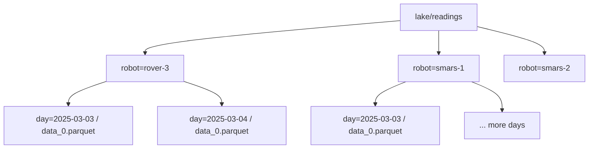
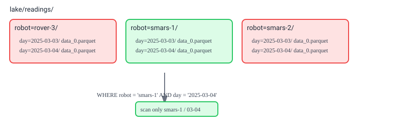

{:class="cover"}

---

By the end of this lesson you will be able to split data into a folder of partitioned Parquet files, query the whole folder as one table, and prove that DuckDB skips the files it does not need.

"Data lake" sounds grand, but it is just **files in folders**: lots of Parquet or CSV files that together hold a big dataset. Your robots might write one file per day, or per robot, and over a year that becomes hundreds of files. DuckDB can query them all as if they were one table, with no server in the middle.

You need the project folder from lesson 1 (with `data/readings.csv` and an empty `lake/` folder). Start the shell with plain `duckdb` in that folder.

## Build a small lake

Let's turn our sensor log into a lake with one file per robot per day. `PARTITION_BY` writes a folder tree for us:

```sql
COPY (
  SELECT *, CAST(ts AS DATE) AS day
  FROM read_csv('data/readings.csv')
) TO 'lake/readings' (FORMAT parquet, PARTITION_BY (robot, day));
```



List what was made with the built-in `glob` function, which works like `ls` but returns a table:

```sql
SELECT COUNT(*) AS files FROM glob('lake/readings/**/*.parquet');
SELECT file FROM glob('lake/readings/**/*.parquet') ORDER BY file LIMIT 3;
```

You get `15` files (3 robots times 5 calendar days), and paths such as `lake/readings/robot=rover-3/day=2025-03-03/data_0.parquet`. The `robot=rover-3` style folder names are called **Hive partitioning**: the folder name carries a column name and its value.

## Query the whole folder as one table

A glob pattern (a wildcard such as `*`) matches many files, and `read_parquet` stacks them together:

```sql
SELECT robot, day, COUNT(*) AS n
FROM read_parquet('lake/readings/*/*/*.parquet', hive_partitioning = true)
GROUP BY robot, day
ORDER BY robot, day
LIMIT 4;
```

```
┌─────────┬────────────┬───────┐
│  robot  │    day     │   n   │
│ varchar │    date    │ int64 │
├─────────┼────────────┼───────┤
│ rover-3 │ 2025-03-03 │   192 │
│ rover-3 │ 2025-03-04 │   288 │
│ rover-3 │ 2025-03-05 │   288 │
│ rover-3 │ 2025-03-06 │   288 │
└─────────┴────────────┴───────┘
```

Notice that `robot` and `day` are columns even though they are no longer stored inside the files: DuckDB reads them back from the folder names. (Current versions detect this layout automatically, and `hive_partitioning = true` makes the intent explicit.) Wrap it in a view for easy reuse:

```sql
CREATE OR REPLACE VIEW v_lake AS
SELECT * FROM read_parquet('lake/readings/*/*/*.parquet', hive_partitioning = true);
```

## Partition pruning: skip what you do not need



Here is the real payoff. If your `WHERE` filters on a partition column, DuckDB does not open the files in the other folders at all. Ask it to explain its plan:

```sql
EXPLAIN
SELECT COUNT(*)
FROM v_lake
WHERE robot = 'rover-3' AND day = '2025-03-04';
```

Part of the plan reads:

```
│       File Filters:       │
│ (day = '2025-03-04'::DATE)│
│    (robot = 'rover-3')    │
│                           │
│    Scanning Files: 1/15   │
```

`Scanning Files: 1/15` is the headline: out of 15 files, only one is touched. With 15 files that saves milliseconds; with 15,000 files on a network drive it saves minutes. The filter has to involve a **partition column** (`robot` or `day`). In my test, even `WHERE day = '2025-03-05'` on its own scanned 3 of 15 files (every robot, one day), and a filter on a column stored inside the files, such as `temp_c > 30`, cannot skip any file by folder name.

You can also point straight at one folder, with no filter needed:

```sql
SELECT COUNT(*) AS rows
FROM read_parquet('lake/readings/robot=rover-3/day=2025-03-04/*.parquet');
```

That returns `288` (24 hours times 12 readings an hour).

## A manifest: know what is in the lake

When files change, results can quietly change with them. A **manifest** is a table listing the files and their row counts, so you can check a lake before and after an update:

```sql
CREATE OR REPLACE TABLE lake_manifest AS
SELECT file_name AS file, num_rows
FROM parquet_file_metadata('lake/readings/*/*/*.parquet');

SELECT COUNT(*) AS files, SUM(num_rows) AS total_rows FROM lake_manifest;
```

You get `15` files and `3456` rows, the same as the original CSV. Reading only the metadata is very quick, because it comes from the footer of each Parquet file.

## Over the network: HTTP and S3

The same query works on remote files once the `httpfs` extension is loaded. Since a data lake is just files, a web server is a lake too. Try it on your own machine: in a second terminal, start a tiny web server in your project folder with `python -m http.server 8000`, and then in DuckDB run:

```sql
INSTALL httpfs;
LOAD httpfs;

SELECT COUNT(*) AS rows
FROM read_parquet('http://localhost:8000/lake/readings/robot=rover-3/day=2025-03-04/data_0.parquet');
```

You should see the same `288`, now fetched over HTTP. A web server cannot list its folders for DuckDB, so name each file rather than using a `*` glob. Reading from S3 (Amazon's object storage, or a compatible service) works the same way with an `s3://bucket/path/*.parquet` address and, for private buckets, a secret holding your credentials:

```sql
CREATE SECRET my_s3 (
    TYPE s3,
    KEY_ID 'your-access-key-id',
    SECRET 'your-secret-key',
    REGION 'eu-west-2'
);
SELECT COUNT(*) FROM read_parquet('s3://my-bucket/readings/*/*/*.parquet');
```

Those are placeholders for your own account, so substitute real values and never paste real keys into a file you commit.

> **Teachers**: The local-file parts of this lesson run on any laptop. The `httpfs` extension has to be downloaded (`INSTALL`), which some school networks block, and S3 needs an account and often a payment card, so treat S3 as a demonstration rather than an exercise. The local `http.server` trick gives a safe, free way to see remote reads inside the classroom.

## Try it Yourself

1. Count the readings for `smars-2` on `2025-03-05` using only a folder path, with no `WHERE`.
2. Run `SELECT robot, ROUND(AVG(battery_v), 2) FROM v_lake WHERE day = '2025-03-05' GROUP BY robot;` and then `EXPLAIN` the same query. How many files are scanned?
3. Add `filename = true` inside `read_parquet(...)` and select the `filename` column to see which file each row came from.
4. Challenge: re-export the lake partitioned by `day` only (into `lake/by_day`), and compare `Scanning Files` for a one-day query against the robot-and-day version.

## Common Issues

- **Problem**: `IO Error: Failed to create directory "lake/readings": No such file or directory`
- **Solution**: Create the top-level `lake` folder first (`make_data.py` does this).
- **Why**: A partitioned `COPY` builds the folders beneath the output path, but not the parent of that path.

- **Problem**: `IO Error: No files found that match the pattern "lake/..."`
- **Solution**: Check the pattern and your working folder. `*` matches one level, `**` matches any number of levels.
- **Why**: A wrong depth or a typo matches nothing, and DuckDB treats an empty match as an error.

- **Problem**: A query on the whole lake is slow even with a `WHERE`.
- **Solution**: Filter on the partition columns (`robot`, `day`), and check `EXPLAIN` for `Scanning Files`.
- **Why**: Only filters on the folder-name columns let DuckDB skip whole files; a filter on `temp_c` still has to look inside the files that remain.

## Check your understanding


? What does the folder name `robot=rover-3` tell DuckDB?
- [ ] The file contains a column called rover-3
- [x] Rows in that folder have the value `rover-3` in a column named `robot`
- [ ] The folder is read-only
> This is Hive partitioning: the column name and value are stored in the path, so they are not repeated inside the file.

? In the plan, `Scanning Files: 1/15` means what?
- [ ] 1 of 15 rows matched
- [x] Only 1 of the 15 files had to be read
- [ ] The query took 1 second
> Partition pruning let DuckDB skip the 14 files whose folders could not match the filter.

? Why can you not use a `*` glob on a plain web server address?
- [ ] DuckDB does not support web servers
- [x] A web server does not provide a file listing DuckDB can expand, so you name each file
- [ ] Web servers only serve CSV
> Globs need a listing of the folder. S3 provides one; a basic web server does not.

