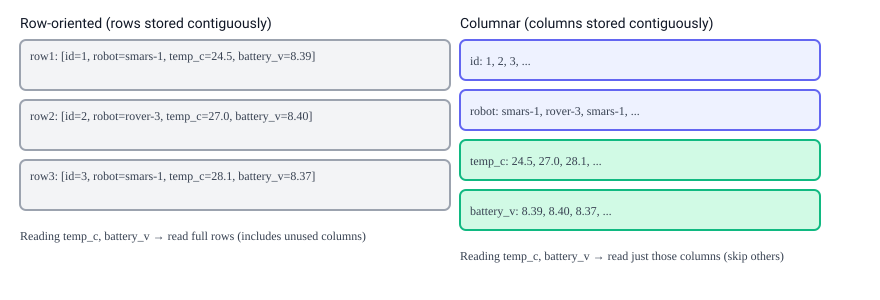

{:class="cover"}

---

By the end of this lesson you will be able to write Parquet files from DuckDB, compare their size with CSV, read their built-in statistics, and combine files whose columns have changed over time.

Parquet is the file format DuckDB loves most. It is **columnar**: instead of writing the file row by row like a CSV, it stores all the `temp_c` values together, then all the `battery_v` values, and so on.



That layout is a big win for analytics. A question like "what is the average temperature?" only needs one column, so a columnar file lets DuckDB skip the rest. Similar values stored side by side also compress very well, and Parquet keeps the column types, so a timestamp stays a timestamp.

Start the shell in your project folder with plain `duckdb`.

## Write Parquet and compare sizes

```sql
COPY (SELECT * FROM read_csv('data/readings.csv'))
  TO 'exports/readings.parquet' (FORMAT parquet);

COPY (SELECT * FROM read_csv('data/readings.csv'))
  TO 'exports/readings_zstd.parquet' (FORMAT parquet, COMPRESSION zstd);
```

Compare them with the original from your terminal (`dir` on Windows):

```bash
ls -l data/readings.csv exports/readings.parquet exports/readings_zstd.parquet
```

On my machine the sizes were:

| File | Bytes |
|---|---|
| `data/readings.csv` | 182,514 |
| `exports/readings.parquet` (default, snappy) | 39,858 |
| `exports/readings_zstd.parquet` | 24,908 |
{:class="table table-single"}

The default Parquet file is about a fifth of the CSV, and `zstd` compression squeezes it further for a little extra CPU time. Parquet also remembers the types:

```sql
SELECT column_name, column_type
FROM (DESCRIBE SELECT * FROM 'exports/readings.parquet');
```

You get `TIMESTAMP` for `ts`, `DOUBLE` for the numbers and `VARCHAR` for the text, with no guessing. A CSV has to be sampled and re-inferred every time it is read.

## Read only what you need

```sql
EXPLAIN
SELECT robot, AVG(temp_c)
FROM 'exports/readings.parquet'
WHERE temp_c > 33
GROUP BY robot;
```

In the plan, the `PARQUET_SCAN` box lists only `Projections: temp_c, robot` and `Filters: temp_c>33.0`. DuckDB never touches `ts`, `distance_cm`, `battery_v` or `state`. That is **column pruning** (also called projection pushdown). The filter is **pushed down** into the scan too, so the file reader can drop rows and whole chunks early. The takeaway: name the columns you need instead of `SELECT *`.

## Statistics: how chunks get skipped

Parquet files are split into **row groups**, and each column in a row group stores its minimum and maximum. Let's write a sorted file with small row groups so we can see this:

```sql
COPY (SELECT * FROM read_csv('data/readings.csv') ORDER BY robot, ts)
  TO 'exports/readings_sorted.parquet'
  (FORMAT parquet, COMPRESSION zstd, ROW_GROUP_SIZE 1000);

SELECT row_group_id, path_in_schema AS column_name, stats_min, stats_max, num_values
FROM parquet_metadata('exports/readings_sorted.parquet')
WHERE path_in_schema IN ('robot', 'temp_c')
ORDER BY path_in_schema, row_group_id;
```

```
┌──────────────┬─────────────┬───────────┬───────────┬────────────┐
│ row_group_id │ column_name │ stats_min │ stats_max │ num_values │
│    int64     │   varchar   │  varchar  │  varchar  │   int64    │
├──────────────┼─────────────┼───────────┼───────────┼────────────┤
│            0 │ robot       │ rover-3   │ smars-1   │       2048 │
│            1 │ robot       │ smars-1   │ smars-2   │       1408 │
│            0 │ temp_c      │ 22.35     │ 33.58     │       2048 │
│            1 │ temp_c      │ 22.32     │ 31.64     │       1408 │
└──────────────┴─────────────┴───────────┴───────────┴────────────┘
```

The groups hold 2,048 and 1,408 rows rather than 1,000 each: DuckDB builds row groups from chunks of 2,048 rows, so a small `ROW_GROUP_SIZE` is rounded up in practice. (Real files use a much larger default, which suits big data.) Look at the `temp_c` maximum for group 1: 31.64. A query for `temp_c > 33` can skip that whole group without reading it, because nothing in it can match. Sorting data by the column you filter on makes these ranges tight, so more groups can be skipped. With only 3,456 rows the saving is invisible; with 300 million it is the difference between seconds and minutes.

You can also check a file before trusting it: `SELECT * FROM parquet_schema('exports/readings.parquet');` lists the stored column types.

## Schema evolution: when the columns change

Sensors get upgraded. Imagine the first two days of readings were logged without a humidity sensor, and a newer logger adds a `humidity` column. Let's simulate that (the humidity numbers are invented for the exercise):

```sql
COPY (SELECT ts, robot, temp_c FROM read_csv('data/readings.csv') WHERE ts < '2025-03-05')
  TO 'exports/old.parquet' (FORMAT parquet);
COPY (SELECT ts, robot, temp_c, ROUND(40 + temp_c / 2, 1) AS humidity
      FROM read_csv('data/readings.csv') WHERE ts >= '2025-03-05')
  TO 'exports/new.parquet' (FORMAT parquet);
```

Now read both files together, two different ways:

```sql
-- Way 1: the default
SELECT * FROM read_parquet(['exports/old.parquet', 'exports/new.parquet']) LIMIT 1;

-- Way 2: match columns by name
SELECT COUNT(*) AS rows, COUNT(humidity) AS with_humidity
FROM read_parquet(['exports/old.parquet', 'exports/new.parquet'], union_by_name = true);
```

Way 1 quietly uses the columns of the *first* file, so `humidity` is not there at all and no error warns you. Way 2 builds the union of all columns, and fills the gaps with `NULL`: it returns 3,456 rows, of which 2,016 have a humidity value. Add `ORDER BY ts LIMIT 2` and you will see `NULL` humidity for the early readings.

The rules of thumb:

- **Adding a column** is safe. Use `union_by_name = true` when reading, and old rows show `NULL`.
- **Changing a type** (say `INTEGER` to `DOUBLE`) means casting everywhere, for example `CAST(x AS DOUBLE)`.
- **Renaming a column** is best done by adding the new one, then using `COALESCE(new_name, old_name)` in a view, so old files still work.

> **Teachers**: Parquet files cannot be opened in a text editor, which surprises learners used to CSV. Let them try, then show `SELECT * FROM 'file.parquet'`. All the files here are a few kilobytes, so classes can share them over email or a shared drive.

## Try it Yourself

1. Export only the `robot`, `ts` and `temp_c` columns to `exports/slim.parquet` and compare its size with `readings.parquet`.
2. Run `SELECT path_in_schema, SUM(total_compressed_size) AS bytes FROM parquet_metadata('exports/readings.parquet') GROUP BY path_in_schema ORDER BY bytes DESC;` and say which column takes the most space and why.
3. Write the file again with `COMPRESSION snappy` and check the size matches the default one, which shows what the default is.
4. Challenge: read `old.parquet` and `new.parquet` with `union_by_name = true`, then use `COALESCE(humidity, 50)` to fill the missing values with a default.

## Common Issues

- **Problem**: A column is missing after combining files, with no error.
- **Solution**: Add `union_by_name = true` to `read_parquet(...)`.
- **Why**: Without it, DuckDB follows the first file's columns and ignores extras in the others.

- **Problem**: `IO Error: Cannot open file "exports/readings.parquet": No such file or directory`
- **Solution**: Create the `exports` folder before writing.
- **Why**: `COPY` does not create folders.

- **Problem**: The Parquet file seems no smaller than the CSV.
- **Solution**: Check the data: very small files have little to compress, and long unique text or random numbers compress poorly. Try `COMPRESSION zstd`.
- **Why**: Compression works by finding repeated or similar values within a column.

## Check your understanding


? Why does a columnar file help the query `SELECT AVG(temp_c) FROM readings`?
- [ ] It stores the data sorted
- [x] Only the `temp_c` column needs to be read
- [ ] It stores the data as text
> Values of one column sit together, so DuckDB skips every other column.

? What do the `stats_min` and `stats_max` values for a row group allow DuckDB to do?
- [ ] Convert the types
- [x] Skip a whole group when its range cannot match the filter
- [ ] Compress the file further
> If the maximum `temp_c` in a group is 31.64, a filter of `temp_c > 33` cannot match anything in it.

? What does `union_by_name = true` do when reading several Parquet files?
- [ ] It sorts the files by name
- [x] It combines all columns by name and fills missing ones with NULL
- [ ] It deletes duplicate rows
> That is how files written before and after a new column was added can be read as one table.

