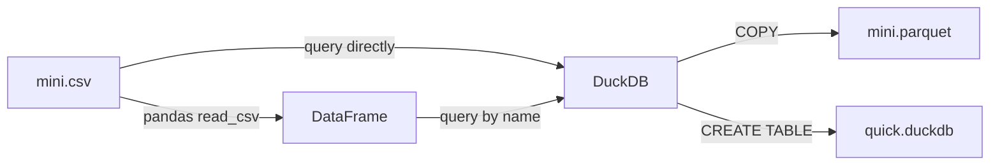

{:class="cover"}

---

By the end of this lesson you will be able to install DuckDB, query a CSV file with SQL, export the result as Parquet, and repeat it all from Python in about ten minutes.

This page is a speed run. The numbered lessons explain everything properly, using a bigger dataset that you generate in lesson 1. Here we use a four-row robot log that DuckDB writes for us, so there is nothing to download.

## Install

```bash
python -m pip install duckdb pandas
```

That gives you the Python package. For the standalone shell, `brew install duckdb` on macOS or `winget install DuckDB.cli` on Windows; lesson 1 covers Linux and the Raspberry Pi. Make a project folder and an `exports/` folder inside it (DuckDB will not create folders for you):

```bash
mkdir duckdb-robots
cd duckdb-robots
mkdir exports
```

## 90 seconds in the shell

Start it with `duckdb`, then paste:

```sql
-- Write a tiny sensor log to mini.csv
COPY (
  SELECT * FROM (VALUES
    ('2025-03-03 08:00:00', 'smars-1', 24.5, 8.39),
    ('2025-03-03 08:05:00', 'smars-1', 28.1, 8.37),
    ('2025-03-03 08:00:00', 'rover-3', 27.0, 8.40),
    ('2025-03-03 08:05:00', 'rover-3', 33.4, 8.31)
  ) AS t(ts, robot, temp_c, battery_v)
) TO 'mini.csv' (HEADER, DELIMITER ',');

-- Query the file directly, no import step
SELECT robot, ROUND(AVG(temp_c), 2) AS avg_temp, MIN(battery_v) AS low_v
FROM 'mini.csv'
GROUP BY robot
ORDER BY robot;
```

You should see:

```
┌─────────┬──────────┬────────┐
│  robot  │ avg_temp │ low_v  │
│ varchar │  double  │ double │
├─────────┼──────────┼────────┤
│ rover-3 │     30.2 │   8.31 │
│ smars-1 │     26.3 │   8.37 │
└─────────┴──────────┴────────┘
```

Now export the same data as Parquet and read it back:

```sql
COPY (SELECT * FROM 'mini.csv') TO 'exports/mini.parquet' (FORMAT parquet);
SELECT COUNT(*) FROM 'exports/mini.parquet';
```

The count is 4. Leave the shell with `.quit`.

## 90 seconds in Python

Save this as `quick.py` in the same folder and run `python quick.py`:

```python
import duckdb
import pandas as pd

# A DataFrame we can query by name
df = pd.read_csv("mini.csv")

result = duckdb.sql("""
    SELECT robot, ROUND(AVG(temp_c), 2) AS avg_temp
    FROM df
    GROUP BY robot
    ORDER BY robot
""").df()
print(result)

# Save to a database file for reuse
con = duckdb.connect("quick.duckdb")
con.execute("CREATE OR REPLACE TABLE mini AS SELECT * FROM df")
print(con.execute("SELECT COUNT(*) FROM mini").fetchone()[0])
con.close()
```

It prints a two-row table (`rover-3` 30.2, `smars-1` 26.3) and then `4`.



## Try it Yourself

1. Change the query to show the highest `temp_c` per robot using `MAX`.
2. Add a fifth row for a third robot to the `VALUES` list, rerun it and check the new average.
3. Challenge: query `exports/mini.parquet` from Python with `duckdb.sql("SELECT * FROM 'exports/mini.parquet'").show()`.

## Common Issues

- **Problem**: `IO Error: Cannot open file "exports/mini.parquet": No such file or directory`
- **Solution**: Create the `exports` folder first with `mkdir exports`, then rerun the `COPY`.
- **Why**: DuckDB creates the output file, but not the folders above it.

- **Problem**: `ModuleNotFoundError: No module named 'duckdb'`
- **Solution**: Run `python -m pip install duckdb pandas` with the same Python you use to run the script.
- **Why**: Machines often have several Pythons, and each has its own packages.

## Check your understanding


? Which query reads `mini.csv` without importing it first?
- [ ] `LOAD 'mini.csv'`
- [x] `SELECT * FROM 'mini.csv'`
- [ ] `IMPORT mini.csv`
> DuckDB treats a file name in the FROM clause as a table and picks the reader from the extension.

? Why did the Parquet export fail when the `exports` folder was missing?
- [ ] Parquet needs a plugin
- [x] DuckDB does not create parent folders
- [ ] The CSV was empty
> The file is created but its folder must already exist.

? How does Python let SQL see a Pandas DataFrame called `df`?
- [x] DuckDB finds the variable by name when it is used in the query
- [ ] You must save it to disk first
- [ ] You must convert it to a list
> This is called a replacement scan, and it is covered in lesson 4.

