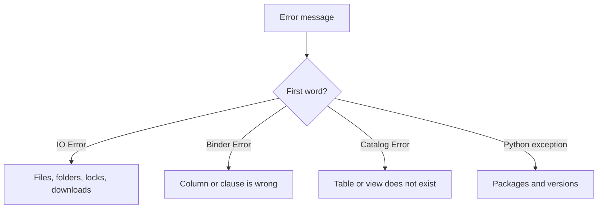

{:class="cover"}

---

By the end of this lesson you will be able to read a DuckDB error message, find its cause in this list, and apply the fix.

Errors are a normal part of making, not a sign you did something wrong. DuckDB's messages are quite helpful: they usually name the problem, show the line and often suggest a fix. Every message quoted below is a real one, produced while writing this course.

Reading the first word helps a lot: an **IO Error** is about files and the outside world, a **Binder Error** means DuckDB could not match your query to the columns it found, and a **Catalog Error** means a table, view or function was not found.

## Common Issues

### Files and folders

- **Problem**: `IO Error: Cannot open file "missingdir/mini.parquet": No such file or directory`, or `Failed to create directory "lake/readings"`
- **Solution**: Create the folder first (`mkdir exports`), or run `python make_data.py`, which creates `exports/` and `lake/`.
- **Why**: DuckDB writes the file but does not create the folders above it.

- **Problem**: `IO Error: No files found that match the pattern "data/readings.csv"`
- **Solution**: Check your working folder (`pwd`, or `import os; print(os.getcwd())`) and the spelling. For globs, `*` matches one folder level and `**` matches any depth.
- **Why**: Relative paths start from where you launched the shell or script, not from where the file lives.

### Databases and versions

- **Problem**: `IO Error: Could not set lock on file "robots.duckdb": Conflicting lock is held in ...`
- **Solution**: Close the other shell, notebook or script that has the file open (the message names the program and its process number).
- **Why**: A database file can have only one writing process at a time.

- **Problem**: `Trying to read a database file with version number ..., but we can only read versions between ... The database file was created with an newer version of DuckDB.`
- **Solution**: Upgrade the older program so the shell and Python package match: `python -m pip install --upgrade duckdb`, or download the latest shell.
- **Why**: Newer DuckDB releases can change the file format, and older ones cannot read it.

### Queries

- **Problem**: `Binder Error: column "robot" must appear in the GROUP BY clause or must be part of an aggregate function.`
- **Solution**: Add the column to `GROUP BY`, or wrap it in an aggregate such as `MAX(robot)`.
- **Why**: A summary query can only show bucket labels and summaries.

- **Problem**: `Binder Error: Referenced column "driving" not found in FROM clause!`
- **Solution**: Use single quotes for text values: `state = 'driving'`.
- **Why**: Double quotes mean a column or table name.

- **Problem**: `Binder Error: WHERE clause cannot contain aggregates!`
- **Solution**: Use `HAVING` for tests on `AVG`, `COUNT` and so on.
- **Why**: `WHERE` runs before grouping, so there are no group totals yet.

- **Problem**: `Catalog Error: Table with name print_jobs does not exist!`
- **Solution**: Load the table first (`CREATE TABLE print_jobs AS SELECT * FROM read_csv('data/print_jobs.csv')`), and check you opened the right `.duckdb` file.
- **Why**: A fresh shell starts with an empty in-memory database unless you pass a file name or use `.open`.

### Combining files

- **Problem**: A column is missing after reading several Parquet files together, with no error.
- **Solution**: Use `read_parquet([...], union_by_name = true)`.
- **Why**: Without it DuckDB follows the first file's columns and silently ignores extras in the others.

- **Problem**: Columns have clashing types when files are combined.
- **Solution**: Cast explicitly, for example `CAST(id AS BIGINT)`, and fill gaps with `CAST(NULL AS DOUBLE) AS new_col`.
- **Why**: Every part of a `UNION ALL` must have matching column types.

### Extensions and remote files

- **Problem**: `IO Error: Failed to download extension "httpfs" at URL ...`
- **Solution**: Check your internet connection or school proxy, or avoid the extension and use local files.
- **Why**: `INSTALL` fetches the extension from DuckDB's servers once per version.

- **Problem**: S3 reads give permission errors or time out.
- **Solution**: Check your access key, secret and region in `CREATE SECRET`, and that the bucket path is right.
- **Why**: S3 refuses requests that are not signed with valid credentials, and a wrong region can add delay.

### Python

- **Problem**: `ModuleNotFoundError: No module named 'duckdb'` (or `polars`, `pandas`, `matplotlib`)
- **Solution**: Install it with the Python you are running: `python -m pip install duckdb`.
- **Why**: A computer can have several Pythons, each with its own packages.

- **Problem**: `Catalog Error: Table with name df does not exist!` when querying a DataFrame
- **Solution**: Make sure the DataFrame is a variable in the same scope as the query and spelled the same way, or use `con.register("df", df)`.
- **Why**: DuckDB finds DataFrames by looking up Python variable names.

- **Problem**: A query is slower than you expected.
- **Solution**: Use Parquet instead of CSV, select only the columns you need, and filter early. Lesson 8 shows how to measure.
- **Why**: Reading less data is almost always the biggest win.

## Where to get help

- The DuckDB documentation home page, [duckdb.org/docs/stable](https://duckdb.org/docs/stable/)
- The DuckDB project on GitHub at `github.com/duckdb/duckdb`, where you can search past issues
- The [Quickstart](quickstart) in this course for a clean example that you can compare against yours

## Try it Yourself

1. Break a query on purpose: run `SELECT robot, AVG(temp_c) FROM 'data/readings.csv';` and read the message from the first word to the last.
2. Misspell a table name and see the Catalog Error, then read the "Did you mean" suggestion it prints.
3. Open `robots.duckdb` in two terminals at once to see the lock message, then close one.
4. Challenge: write a `COPY` to a folder that does not exist, fix it with `mkdir`, and run it again.

## Check your understanding


? An error starts with `Binder Error`. What does that mostly mean?
- [ ] The file could not be opened
- [x] The query does not match the columns or rules, for example a missing GROUP BY column
- [ ] The network is down
> Binder errors are about names and rules in the SQL itself.

? You get `Could not set lock on file`. What is the usual cause?
- [ ] The disk is full
- [x] Another program already has that database file open
- [ ] The file is a CSV
> The message names the program holding the lock, so you can close it.

? Why can reading several Parquet files together silently lose a column?
- [x] Without `union_by_name`, DuckDB uses the first file's columns
- [ ] Parquet cannot hold extra columns
- [ ] Extra columns are always renamed
> That is why the lesson on Parquet recommends `union_by_name = true`.

