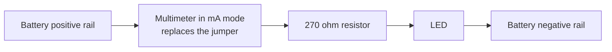

{:class="cover"}

---

By the end of this lesson you will be able to measure current, resistance and continuity safely, and know which measurements need the circuit switched off.

## Overview

Voltage is measured across a part. Current and resistance are different, and getting the method wrong can blow the meter's fuse. In this lesson we measure the night light's LED current, check resistor values, and use the continuity beeper to find broken connections.

Which socket and dial setting for which job:

| To measure | Red probe socket | Dial | Circuit |
|---|---|---|---|
| Voltage | V | DCV | On, probes across the part |
| Current | mA | DCA (mA) | On, meter placed in the loop |
| Resistance | V (ohm) | Ohm | Off, part ideally removed |
| Continuity | V (ohm) | Beeper symbol | Off |
{:class="table table-single"}

## Measuring current: the meter joins the loop

Current is the flow *through* the loop, so the meter has to become part of the loop. You break the circuit and let the current run through the meter.

1. Switch off or disconnect the battery.
2. Move the red probe to the **mA** socket (or 10A for large currents, but start with mA). The black probe stays in COM.
3. Turn the dial to **DCA** or **mA** with the straight line symbol.
4. Remove the jumper that goes from the resistor to the positive rail. Touch the red probe to the rail side and the black probe to the resistor side, so current flows through the meter.
5. Connect the battery. The reading should be about 9 mA, the same number we calculated.

**The big mistake:** never put the meter across a battery, or measure voltage, while the meter is set up for current. A current meter has almost zero resistance inside, so across a battery it is a short circuit. Most meters have a fuse that pops, and a few have none at all, so the battery and meter can get hot. Always switch the dial and move the red lead back to the voltage socket after measuring current.

Here is the current measurement as a picture. The meter replaces the jumper, so every milliamp passes through it:



## Measuring resistance: power off

To measure resistance, the meter sends out its own tiny current. That means:

- **The circuit must be switched off**, and ideally the part removed from the circuit.
- Dial on the ohm setting (the omega symbol). Pick a range above the expected value.
- Probes across the resistor. It does not matter which way round.

Try it on the 270 ohm resistor. Real resistors are within 5 percent (gold band) or 1 percent, so 270 might show 262 to 283. If you leave the resistor in a circuit with other parts, the reading is also affected by the parts in parallel, so take it out first.

## Continuity: the beeper

The diode and sound symbol is the **continuity** setting. When there is a low resistance path, roughly under 50 ohm (it varies between meters), the meter beeps. Use it to:

- Check a jumper wire is not broken inside the insulation.
- Find out which breadboard holes are joined.
- Check a switch does close when you press it.

## The calculation to compare

When you measure current and voltage you can work out resistance, and compare it with the meter's resistance reading:

```python
# Run on your computer or the Pico
# Work out resistance from measured voltage and current
measured_volts = 2.45      # across the resistor, from lesson 5
measured_milliamps = 9.1   # from the meter in current mode

ohms = measured_volts / (measured_milliamps / 1000)
print(f"Resistance from V and I: {ohms:.0f} ohm")
print("Resistance from the meter should be close to 270 ohm")
```

Output:

```text
Resistance from V and I: 269 ohm
Resistance from the meter should be close to 270 ohm
```

**Why this matters:** when a robot misbehaves, you can check the current it draws against what you expect. A motor drawing far more current than it should is a clear sign something is stuck or short.

**Common mistakes:**

- Forgetting to move the red probe back from the mA socket.
- Measuring resistance with the power on. This gives a garbage reading, and could damage the meter.
- Using the 200 ohm range for a 10k resistor and seeing OL. Try a higher range.

> **Teachers**: the current socket is the one learners damage. Before the lesson, check that each meter has a working fuse, and have learners say out loud where the red lead goes before every measurement. Spare fuses for the meters in your kit are worth buying. Do not let learners measure resistance on a powered circuit, or measure mains of any kind.

## Try it Yourself

1. Measure the current through the LED with a 270 ohm resistor, then a 1k resistor. Do the readings match your Ohm's law predictions?
2. Measure each resistor in your kit and write the value on its bag.
3. Challenge: measure the resistance of the LDR in the light, then covered with your hand. Write both numbers down. We will use them in lesson 8.

## Common Issues

- **Problem**: The meter reads 0.00 mA when the circuit is on.
- **Solution**: Check the red probe is in the mA socket and the fuse is not blown.
- **Why**: A meter with a blown fuse acts as an open circuit in current mode.

- **Problem**: Resistance readings change when I touch the legs.
- **Solution**: Hold the probes only by their insulated handles.
- **Why**: Your body is a resistor too, usually several hundred kilo ohms, which adds in parallel on high value resistors.

## Check your understanding


? To measure the current through the LED, where does the meter go?
- [ ] Across the LED, in parallel
- [x] In the loop, so the current flows through it
- [ ] Across the battery
> Current is the flow through the loop, so you break the loop and let it pass through the meter.

? Why must the circuit be off when you measure resistance?
- [x] The meter sends its own tiny current, and a powered circuit gives garbage readings
- [ ] Resistance only exists when the power is off
- [ ] The meter has no ohm range when the battery is connected
> The meter measures resistance by sending its own tiny current, so other power sources spoil the reading and may damage it.

? What does the continuity beeper tell you?
- [ ] The battery is full
- [x] There is a low resistance path between the probes
- [ ] The resistor is 270 ohm
> It beeps when the resistance between the probes is low, which is how you check wires, switches and breadboard rows.

