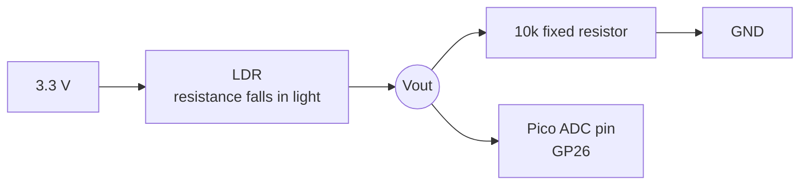

{:class="cover"}

---

By the end of this lesson you will be able to calculate the output of a voltage divider and build one that turns light into a voltage.

## Overview

A voltage divider is two resistors in series that turn a bigger voltage into a smaller, useful one. It is the simplest sensor circuit there is, and it is how our night light will tell light from dark. Almost every analog sensor you meet, from light to temperature to joystick position, uses this trick.

## How it works

Put two resistors in series across a supply, and take the voltage from the middle point:

```text
Supply (Vin)
    |
   [R1]
    |---- Vout   (the middle point)
   [R2]
    |
   GND
```

The voltage at the middle is:

```text
Vout = Vin x R2 / (R1 + R2)
```

If R1 and R2 are equal, Vout is half of Vin. If R2 is bigger than R1, Vout is closer to Vin. If R2 is smaller, Vout is closer to 0 V. The ratio is what matters, not the actual values.

## Divider 1: the potentiometer

A potentiometer is a divider with a moving middle. It has three pins: the outer two connect to the supply and ground, and the middle pin (the wiper) gives Vout. Turning the knob slides the wiper, changing the ratio.

Build it: 10k pot on the breadboard, outer pins to the + and - rails, the wiper pin free. Measure from the wiper to ground with your meter and turn the knob. You should sweep from 0 V to the supply voltage.

Follow the voltage from the supply to the Pico pin:



## Divider 2: the LDR

A **light dependent resistor** changes its resistance with light: roughly 1k in bright light, 10k in a normal room, and 200k or more in the dark (very rough, as parts differ a lot). Exact numbers vary between parts, so measure yours (you did that in lesson 6).

For the night light, we put the LDR on top (R1) and a fixed 10k resistor underneath (R2), with a 3.3 V supply:

```text
3.3 V ---[LDR]---+---[10k]--- GND
                 |
               Vout
```

In bright light the LDR has a small resistance, so Vout is high. In the dark the LDR resistance is huge, so Vout drops close to 0 V. The voltage tells us how much light there is.

```python
# Run on your computer or the Pico
# Voltage divider: LDR on top, fixed 10k on the bottom, 3.3 V supply

def divider(vin, r_top, r_bottom):
    return vin * r_bottom / (r_top + r_bottom)

vin = 3.3
fixed = 10_000

conditions = [
    ("bright sun",   1_000),
    ("room light",  10_000),
    ("dusk",        50_000),
    ("dark room",  500_000),
]

for name, ldr in conditions:
    vout = divider(vin, ldr, fixed)
    raw = int(vout / vin * 65535)   # what the Pico's read_u16() would give
    print(f"{name:<11} LDR={ldr:>7} ohm  Vout={vout:.2f} V  raw={raw}")
```

Output:

```text
bright sun  LDR=   1000 ohm  Vout=3.00 V  raw=59577
room light  LDR=  10000 ohm  Vout=1.65 V  raw=32767
dusk        LDR=  50000 ohm  Vout=0.55 V  raw=10922
dark room   LDR= 500000 ohm  Vout=0.06 V  raw=1285
```

The last column is the number the Pico will report, which we use from lesson 13.

**Picking the fixed resistor:** the best sensitivity is when the fixed resistor is about the same as the LDR's resistance in the middle of the range you care about. Our 10k is a good choice for a room.

**Why this matters:** you now know how to turn "how much light" into "how many volts". The Pico can read voltages, so this is the bridge between the real world and your code.

**Common mistakes:**

- Connecting the divider's output to something that draws a lot of current. The extra load acts like a resistor in parallel with R2 and changes the answer. The Pico's ADC draws almost nothing, so it is safe.
- Swapping the LDR and the fixed resistor. Then Vout goes up in the dark, which is the opposite behaviour. Sometimes handy, but be sure you know which you built.

> **Teachers**: LDRs from different kits behave very differently, so tell learners to use their own meter readings from lesson 6 rather than the numbers in the text. A dark corner or a cardboard tube over the LDR gives a repeatable "dark" for the whole class.

## Try it Yourself

1. Build the LDR divider on your breadboard with the battery pack as the supply and measure Vout in light, shade, and with your hand over it. Compare with the script, changing `vin` to 4.5. Use only the meter here: never connect a divider powered from the 4.5 V pack to a Pico pin.
2. Swap the fixed resistor for 1k and for 100k. How does the sweep between bright and dark change?
3. Challenge: swap the LDR and the 10k, and predict what Vout does in the dark before measuring.

## Common Issues

- **Problem**: Vout barely changes whatever the light.
- **Solution**: Check the fixed resistor value against your LDR's measured range.
- **Why**: If the fixed resistor is much smaller or larger than the LDR range, Vout sits near one end.

- **Problem**: Vout is stuck at the supply voltage.
- **Solution**: The bottom leg is not connected to ground. Check the 10k is in the circuit.
- **Why**: With no path to ground, no current flows, and the middle point rises to the supply.

## Check your understanding


? With the LDR on top and a 10k resistor below, what does Vout do when it gets darker?
- [x] It falls towards 0 V
- [ ] It rises towards the supply
- [ ] It stays the same
> In the dark the LDR resistance is huge, so most of the supply is dropped across it and Vout falls.

? A divider has two equal resistors on 3.3 V. What is Vout?
- [ ] 3.3 V
- [x] 1.65 V
- [ ] 0 V
> If R1 and R2 are equal, Vout is half of Vin.

? Why swap an LDR and the fixed resistor?
- [ ] It makes the circuit safer
- [ ] It makes the LDR faster
- [x] It reverses the behaviour, so Vout rises in the dark
> With the LDR on the bottom, the voltage rises in the dark, which is the opposite of the night light's default.

