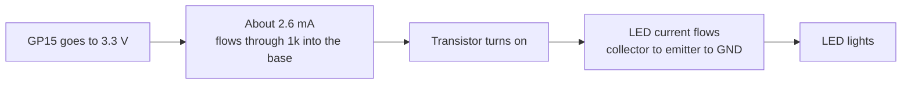

{:class="cover"}

---

By the end of this lesson you will be able to switch an LED with an NPN transistor and choose the base resistor.

## Overview

A microcontroller pin can only supply a few milliamps. Motors, bright LEDs and relays need much more. A transistor is an electronic switch: a tiny current into one pin controls a much bigger current through the other two. It is the part that lets the Pico control the real world, and it is how our night light's LED will be driven.

## The three legs

An NPN transistor (2N2222 or BC547) has:

- **Base (B)**: the control input.
- **Collector (C)**: where the load current comes in.
- **Emitter (E)**: where the current leaves, connected to ground.

Rule of thumb: when about 0.7 V appears between the base and the emitter, and a little current flows into the base, the transistor lets a much larger current flow from the collector to the emitter. The ratio is the **gain (hFE)**, often 100 or more. Remove the base current and the switch turns off.

Here is the chain of events when the code sets GP15 high:



## The circuit

```text
        supply (+)
           |
        [resistor]    (sets the LED current)
           |
          LED (long leg towards the resistor)
           |
        collector
Pin --[1k]--base       NPN transistor
        emitter
           |
          GND
```

The 1k **base resistor** is essential. Without it, the pin would push as much current as it can into the base, because a base-emitter junction behaves like a diode. This could damage the Pico or the transistor.

## Choosing the base resistor

Say the LED needs 20 mA, and the transistor's minimum gain is 100. Base current needed is 20 mA / 100 = 0.2 mA. Aim for ten times that to make sure the transistor is fully on (saturated): 2 mA.

```text
R base = (Pin voltage - 0.7) / base current = (3.3 - 0.7) / 0.002 = 1300 ohm
```

Use 1k (the next standard value down), which gives about 2.6 mA. That is more than the 2 mA we aimed for, so the transistor is firmly on, and still well inside what a Pico pin can drive.

```python
# Run on your computer or the Pico
# Base resistor for a transistor switch
pin_volts = 3.3
vbe = 0.7            # voltage across base-emitter when on
load_ma = 20
hfe_min = 100        # from the datasheet, use the minimum
overdrive = 10       # drive harder than the minimum, to be sure it is fully on

base_ma = load_ma / hfe_min * overdrive
r_base = (pin_volts - vbe) / (base_ma / 1000)
print(f"Base current needed: {base_ma:.1f} mA")
print(f"Base resistor: {r_base:.0f} ohm (use 1k)")
print(f"With 1k the base current is {(pin_volts - vbe) / 1000 * 1000:.1f} mA")
```

Output:

```text
Base current needed: 2.0 mA
Base resistor: 1300 ohm (use 1k)
With 1k the base current is 2.6 mA
```

> **Teachers**: transistor pinouts are the usual stumbling block, and a wrongly wired transistor can get hot. Check each learner's wiring before power goes on, and keep a labelled example photo or diagram of the exact part in your kit. If a transistor feels warm, unplug the USB cable straight away.

## Try it on the Pico

In our circuit the LED has a 150 ohm resistor on 3.3 V, so it only draws about 7 mA ((3.3 - 2.0 - about 0.2) / 150), far less than the 20 mA we designed for. The 1k base resistor therefore has plenty of margin, and the same driver can switch a bigger load later.

Build: GP15 (physical pin 20) to a 1k resistor to the transistor's base. Emitter to GND (physical pin 23). Collector to the LED's cathode (short leg). LED's anode through a 150 ohm resistor to the Pico's **3V3(OUT)** (physical pin 36). Check your pinout with the datasheet before wiring.

```python
# MicroPython on the Pico
# Blink an LED through a transistor on GP15
from machine import Pin
from time import sleep

switch = Pin(15, Pin.OUT)     # drives the transistor base via 1k

while True:
    switch.value(1)    # transistor on, LED lights
    sleep(0.5)
    switch.value(0)    # transistor off, LED dark
    sleep(0.5)
```

Because the transistor does the heavy lifting, the same circuit could switch a 5 V buzzer or a small relay by changing only the load.

**Why this matters:** motors will need this idea in a bigger form, a motor driver. We look at that in the Motors and motor drivers course.

**Common mistakes:**

- Wrong pinout. Swap the legs to match the datasheet.
- Forgetting the common ground. The Pico GND and the emitter must be connected.
- Leaving out the base resistor.

## Try it Yourself

1. Change the sleep times and make the LED blink faster.
2. Replace the 1k base resistor with 10k. Does the LED still shine as brightly? Use the calculation to guess first.
3. Challenge: use PWM on GP15 (`PWM(Pin(15))`, then `duty_u16(32768)`) to dim the LED to half brightness.

## Common Issues

- **Problem**: The LED is always on, or always off.
- **Solution**: Check the transistor's pin order against the datasheet.
- **Why**: With the collector and emitter swapped, a transistor behaves badly.

- **Problem**: The LED is dim.
- **Solution**: Check the 3V3 supply, resistor value and base resistor. The base resistor may be too large.
- **Why**: Too little base current means the transistor is only partly on.

## Check your understanding


? Why must there be a resistor between the Pico pin and the transistor base?
- [ ] It makes the LED brighter
- [ ] The Pico needs it to boot
- [x] The base behaves like a diode and would draw too much current from the pin
> Without a base resistor the pin would push as much current as it can into the base, which could damage the Pico or the transistor.

? A 20 mA load, a minimum gain (hFE) of 100 and a 10 times overdrive. What base current do you aim for?
- [x] 2 mA
- [ ] 0.2 mA
- [ ] 20 mA
> 20 mA / 100 = 0.2 mA, times 10 to make sure the transistor is fully on gives 2 mA.

? The LED is always off. Which check comes first?
- [ ] The colour of the LED
- [x] The transistor's pin order against its datasheet
- [ ] The length of the jumper wires
> Swapped collector and emitter legs are the most common fault with transistor circuits.

