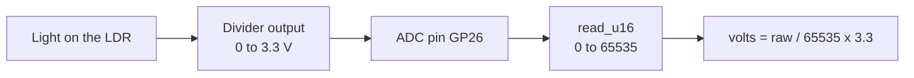

{:class="cover"}

---

By the end of this lesson you will be able to respect the Pico's 3.3 V and current limits, and read a voltage divider with the ADC.

## Overview

Everything so far has run from a battery. Now we bring in the brain. The Pico can read voltages and switch pins, but it has rules: voltage levels, current limits and a particular way of reading analog values. In this lesson we learn them, and then read our LDR divider with the Pico's ADC.

## 3.3 V logic

The Pico's pins work at 3.3 V. A pin outputting a 1 sits at 3.3 V, and 0 sits at 0 V. As an input, anything above about 2 V reads as 1, and anything below about 0.8 V reads as 0. In between the pin is undefined, so avoid it.

**Never apply more than 3.3 V to a GPIO pin.** The pins are not 5 V tolerant. If you have a 5 V sensor output, use a voltage divider (lesson 8!) or a level shifter to bring it down. For example, a 1k resistor on top and a 2k at the bottom turn a 5 V signal into about 3.3 V (5 x 2 / 3 = 3.33 V). This only works for a signal going into the Pico, not for powering things.

## GPIO current limits

A GPIO pin is not a power supply. By default each pin can drive about 4 mA comfortably, and can be set up to about 12 mA, with an overall limit for the whole chip. As a rule: keep each pin to a few milliamps and use a transistor for anything bigger. That is exactly why our night light's LED goes through a transistor, with the pin driving only the 2.6 mA base current from lesson 11.

From light in the room to a number in your code:



## Reading analog voltages: the ADC

The Pico has an **ADC** (analog to digital converter) that turns a voltage into a number. Three pins can do it:

- **GP26** (ADC0, physical pin 31)
- **GP27** (ADC1, physical pin 32)
- **GP28** (ADC2, physical pin 34)

The ADC is 12-bit, so it has 4096 steps from 0 V to 3.3 V. MicroPython's `read_u16()` scales that to 0 to 65535, so your code is the same on every board. The conversion is:

```text
voltage = reading / 65535 x 3.3
```

Neat detail: the ADC has its own reference and ground, **ADC_VREF** (physical pin 35) and **AGND** (physical pin 33). For the best accuracy, use AGND for sensor grounds when you can.

## Test with a potentiometer first

Wire a 10k pot: one outer pin to **3V3(OUT)** (physical pin 36), the other outer pin to **GND** (physical pin 38), and the wiper to **GP26** (physical pin 31). 

```python
# MicroPython on the Pico
# Read a voltage divider on GP26 (ADC0) and print it
from machine import ADC
from time import sleep

sensor = ADC(26)        # GP26 = ADC0

while True:
    raw = sensor.read_u16()              # 0 to 65535
    volts = raw / 65535 * 3.3
    print(f"raw={raw:>5}  volts={volts:.2f}")
    sleep(0.25)
```

Turn the knob and watch it sweep from 0.00 to about 3.30. Seeing the voltage you measured with your multimeter appear on screen is a real moment: the circuit and the code are talking.

## Smoothing the noise

Analog readings wobble a little. Average several samples for a calmer number:

```python
# MicroPython on the Pico
# Average 16 ADC samples to reduce noise
from machine import ADC
from time import sleep_ms

sensor = ADC(26)

def read_volts(samples=16):
    total = 0
    for _ in range(samples):
        total += sensor.read_u16()
    return total / samples / 65535 * 3.3

while True:
    print(f"{read_volts():.2f} V")
    sleep_ms(250)
```

## Swap in the LDR

Replace the pot with the LDR divider from lesson 8: **3V3(OUT) to LDR, LDR to the junction, junction to the 10k, 10k to GND**, and from the junction a wire to **GP26**. Run the same program. Cover the LDR and the number drops. Shine your phone torch on it and it climbs. That is the sensor stage of the night light, working.

**Why this matters:** every analog sensor, from a battery monitor to a line follower, uses this same read-volts pattern.

**Common mistakes:**

- Feeding more than 3.3 V into GP26. Keep the divider on 3V3(OUT), not on the 4.5 V pack.
- Using a pin that is not ADC capable. Only GP26, GP27 and GP28 work.
- Forgetting the 10k to ground. The reading floats and wanders.

> **Teachers**: a wrong wire can feed the Pico more than 3.3 V on a pin, so make 3V3(OUT) the only supply for the divider and have learners show you the wiring before plugging in the USB cable. Thonny works on most school machines, but installing it or the Pico drivers may need an administrator, so check this before the lesson.

## Try it Yourself

1. Run the pot version and note the minimum and maximum readings you can reach.
2. Compare the printed voltage with your multimeter at the same moment. How close is it?
3. Challenge: print "dark" when the voltage is below 1 V, and "bright" otherwise.

## Common Issues

- **Problem**: The reading jumps between very different values.
- **Solution**: Check the junction wire to GP26 is firmly in, and use the averaging program.
- **Why**: A loose connection leaves the pin floating, which picks up noise.

- **Problem**: The reading is always 0 or always 65535.
- **Solution**: Check which end of the divider is connected to 3V3 and which to GND.
- **Why**: A missing top or bottom half pins the middle to one extreme.

## Check your understanding


? Which pins can read an analogue voltage on the Pico?
- [ ] Any GPIO pin
- [x] GP26, GP27 and GP28
- [ ] Only GP0
> Only GP26 (ADC0), GP27 (ADC1) and GP28 (ADC2) connect to the ADC.

? What does `read_u16()` return for 3.3 V at the pin?
- [ ] About 4095
- [x] About 65535
- [ ] About 3.3
> MicroPython scales the 12-bit ADC to 0 to 65535, so full scale is 65535.

? You have a 5 V sensor output. What do you do before connecting it to a GPIO pin?
- [ ] Nothing, GPIO pins are 5 V tolerant
- [x] Bring it down to 3.3 V with a divider or level shifter
- [ ] Connect it to GND
> The pins are not 5 V tolerant, so more than 3.3 V can damage them.

