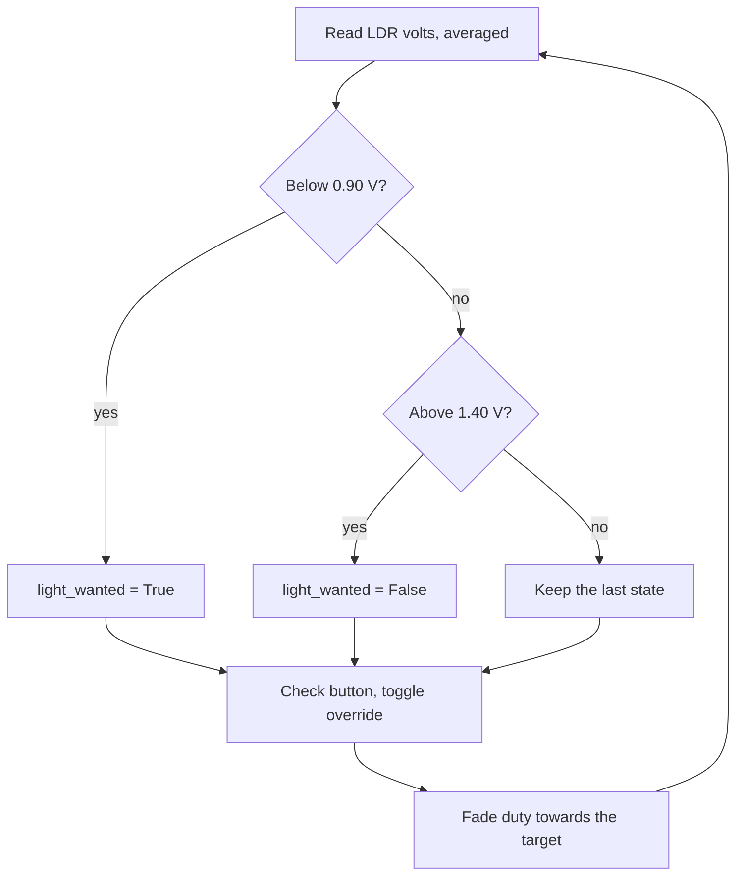

{:class="cover"}

---

By the end of this lesson you will be able to build and tune a complete night light that senses light, switches an LED through a transistor, and has a button override.

## Overview

This is the moment everything comes together. Over the course we built the pieces: an LED and resistor, a voltage divider that senses light, a transistor switch and a button. Now the Pico connects them. When the room gets dark, the LED fades up. When the light returns, it fades down. A button lets you force the light on whenever you like.

## What you need

- Breadboard and jumper wires
- Raspberry Pi Pico with headers
- LDR and one 10k resistor (the divider)
- NPN transistor (2N2222 or BC547), one 1k resistor (base), one 150 ohm resistor (LED)
- One LED (red or yellow is easiest from 3.3 V)
- Push button
- USB cable

All power comes from the Pico over USB. No battery is needed this time, so there is no ground to worry about.

## The plan

```text
Light sensor:   3V3(OUT) -- LDR --+-- 10k -- GND
                                  |
                                 GP26 (ADC0)

LED driver:     GP15 -- 1k -- base
                collector -- LED cathode
                LED anode -- 150 ohm -- 3V3(OUT)
                emitter -- GND

Button:         GP14 -- button -- GND   (internal pull-up)
```

| Part | Pico pin | Physical pin |
|---|---|---|
| LDR divider middle | GP26 | 31 |
| Transistor base (via 1k) | GP15 | 20 |
| Button | GP14 | 19 |
| 3V3(OUT) rail | 3V3(OUT) | 36 |
| GND rail | GND | 38 |
{:class="table table-single"}

These pins keep clear of GP0 to GP7, so you can add the motor driver from the robotics course later.

## Build it step by step

1. Place the Pico across the breadboard's centre gap (or at one end) so pins have free holes. Connect pin 36 to the red rail and pin 38 to the blue rail with jumpers.
2. Build the LDR divider: LDR from the red rail to a free row, 10k from that row to the blue rail, and a jumper from the row to GP26 (pin 31).
3. Build the LED driver: place the transistor, check the pinout in its datasheet, and connect the emitter to the blue rail. Wire GP15 through the 1k resistor to the base. Connect the collector to the LED's short leg. Connect the LED's long leg through the 150 ohm resistor to the red rail.
4. Add the button between GP14 (pin 19) and the blue rail.
5. Check everything with your multimeter before plugging in: no continuity between the red and blue rails.

Test each stage in turn. Use the lesson 13 program to check the LDR, and the lesson 11 blink program to check the LED. Only then load the full program.

The main loop in `main.py` follows this flow every 20 milliseconds:



> **Teachers**: allow a full session for this build, ideally 60 minutes, and let learners test each stage on its own before loading the full program. Keep a known-good working circuit or a photo to compare against, and have learners swap boards with a neighbour to debug someone else's wiring. Nothing here runs from a battery, so it is safe on a USB port.

## Why hysteresis?

If we say "LED on when the voltage is below 1.1 V", then at dusk, when the light hovers right at that level, the electrical noise on the reading makes the light flicker on and off. The fix is **hysteresis**: two thresholds. The light switches on below a low threshold, and only switches off above a higher one, so there is a gap in which nothing changes.

Try it as a simulation on your computer first:

```python
# Run on your computer or the Pico
# Why hysteresis matters: a light level hovering right at the threshold
import random

random.seed(7)  # same "random" numbers every run, so your output matches

def flips_naive(readings, threshold):
    """LED on whenever the reading is below one single threshold."""
    state = False
    flips = 0
    for v in readings:
        new_state = v < threshold
        if new_state != state:
            flips += 1
            state = new_state
    return flips

def flips_hysteresis(readings, on_below, off_above):
    """LED turns on below on_below, and only turns off above off_above."""
    state = False
    flips = 0
    for v in readings:
        if not state and v < on_below:
            state = True
            flips += 1
        elif state and v > off_above:
            state = False
            flips += 1
    return flips

# Dusk: the true voltage sits at 1.10 V, plus about 0.05 V of noise
readings = [1.10 + random.uniform(-0.05, 0.05) for _ in range(200)]

print("naive (one threshold at 1.10 V):", flips_naive(readings, 1.10), "flickers")
print("hysteresis (on < 0.90, off > 1.40):", flips_hysteresis(readings, 0.90, 1.40), "flickers")
```

Output:

```text
naive (one threshold at 1.10 V): 86 flickers
hysteresis (on < 0.90, off > 1.40): 0 flickers
```

86 flickers in 200 readings against none. That is the difference between a night light and a strobe.

## The code

Save this as `main.py` on the Pico, so it runs whenever the Pico powers up.

```python
# MicroPython on the Pico: light-sensing night light
# LDR divider on GP26 (ADC0), LED via transistor on GP15 (PWM), button on GP14
from machine import Pin, ADC, PWM
from time import sleep_ms, ticks_ms, ticks_diff

# --- Pins ---
ldr = ADC(26)                          # divider middle point
led = PWM(Pin(15))                     # drives the transistor base
led.freq(1000)                         # 1 kHz is too fast to see flicker
button = Pin(14, Pin.IN, Pin.PULL_UP)  # 0 when pressed

# --- Settings you can tune ---
TURN_ON_BELOW = 0.90    # volts: darker than this, the light comes on
TURN_OFF_ABOVE = 1.40   # volts: brighter than this, the light goes off
FADE_STEP = 1500        # how fast the brightness changes each loop (out of 65535)
FULL_BRIGHTNESS = 65535
SAMPLES = 16            # readings averaged to calm the noise

# --- State ---
light_wanted = False    # does the sensor want the light on?
override = False        # has the button forced it on?
duty = 0                # current brightness
was_pressed = False
last_press = ticks_ms()

def read_volts():
    total = 0
    for _ in range(SAMPLES):
        total += ldr.read_u16()
    return total / SAMPLES / 65535 * 3.3

while True:
    volts = read_volts()

    # Hysteresis: two thresholds, with a gap where nothing changes
    if not light_wanted and volts < TURN_ON_BELOW:
        light_wanted = True
    elif light_wanted and volts > TURN_OFF_ABOVE:
        light_wanted = False

    # Button toggles the override, ignoring contact bounce
    pressed = button.value() == 0
    if pressed and not was_pressed and ticks_diff(ticks_ms(), last_press) > 50:
        override = not override
        last_press = ticks_ms()
        print("Override", "ON" if override else "OFF")
    was_pressed = pressed

    # Decide the target brightness, then fade towards it
    target = FULL_BRIGHTNESS if (light_wanted or override) else 0
    if duty < target:
        duty = min(duty + FADE_STEP, target)
    elif duty > target:
        duty = max(duty - FADE_STEP, target)
    led.duty_u16(duty)

    sleep_ms(20)
```

How it works, step by step:

1. `read_volts()` averages 16 readings of the LDR divider into one calm number.
2. The two `if` lines are the hysteresis. `light_wanted` only changes when the voltage leaves the gap between 0.90 V and 1.40 V.
3. The button flips `override`, which forces the light on regardless of the sensor.
4. The light does not jump to its target. Each loop it moves a small step closer, so it fades smoothly in about half a second.
5. `led.duty_u16()` sets how much of each PWM cycle the transistor is on, which sets the brightness.

## Tuning

Run the lesson 13 program first and note the LDR voltage in your room with the lights on, and with them off. Set `TURN_ON_BELOW` a little above the dark number and `TURN_OFF_ABOVE` a little below the bright number, leaving a good gap between them. Your LDR is not exactly like ours, so these numbers are yours to find.

## Try it Yourself

1. Change the two thresholds until the light behaves the way you like in your room.
2. Make the fade slower by lowering `FADE_STEP`. Try 500.
3. Challenge: instead of fully on, make the LED brightness follow the darkness. Hint: map the voltage between your two thresholds to a duty between full and zero.
4. Challenge: add a second LED on GP13 that lights when the override is active.

## Common Issues

- **Problem**: The LED never turns on.
- **Solution**: Test the LED stage alone with the lesson 11 blink program, then print `volts` in the main loop to see whether the sensor reads low enough.
- **Why**: It splits the problem in half, so you know whether the sensor or the driver is at fault.

- **Problem**: The LED is on in the light and off in the dark.
- **Solution**: Swap the LDR and the 10k resistor, or invert the logic in the code.
- **Why**: With the LDR on the bottom, the voltage rises in the dark.

- **Problem**: The LED flickers at dusk.
- **Solution**: Widen the gap between the two thresholds, and check you have kept the averaging.
- **Why**: The noise is larger than the gap.

- **Problem**: The button does nothing.
- **Solution**: Confirm that one leg is on GP14 and the diagonal leg is on GND.
- **Why**: Legs on the same side of the button are always joined.

## Where to go from here

You have built a real sensing and control system: a sensor (voltage divider), a decision (hysteresis), and an actuator (transistor and LED). That is the same loop every robot runs. Swap the LDR for a different sensor, or swap the LED for a motor driver, and it is the same idea at a bigger scale.

## Check your understanding


? Why does the program use two thresholds, 0.90 V and 1.40 V?
- [ ] To make the LED brighter
- [ ] Because the ADC has two ranges
- [x] So noise near dusk does not make the LED flicker
> Hysteresis leaves a gap in which nothing changes, so the light does not strobe at dusk.

? Which pin does the LED driver use, and what does it switch?
- [x] GP15, through a 1k resistor into the transistor base
- [ ] GP26, directly into the LED
- [ ] GP14, which also drives the button
> GP15 drives the base via the 1k resistor, and the transistor switches the LED current.

? The LED is on in the light and off in the dark. What is the likely cause?
- [x] The LDR and the 10k are swapped
- [ ] The button is stuck
- [ ] The base resistor is too large
> With the LDR at the bottom, the voltage rises in the dark, so the behaviour flips.

