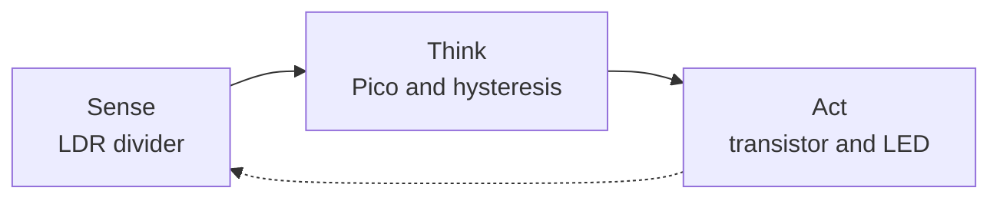

{:class="cover"}

---

By the end of this lesson you will be able to recap the main ideas of the course and choose what to learn next.

## Overview

Well done, makers. You started with a battery and an LED, and finished with a Pico watching the light level and switching a lamp for you. Let's recap what you have in your toolbox, and look at where to go next.

Every stage of the night light follows the same sense, think, act loop:

## What you learned

- **Voltage, current and resistance** are the push, the flow and the narrowing of the pipe.
- **Ohm's law** (V = I x R) lets you work out any one from the other two, including the resistor for an LED.
- **Breadboards** connect holes in rows, with power rails along the edges, and some rails are split.
- **Multimeters** measure voltage across a part, current through it, and resistance with the power off.
- **Series and parallel** circuits share current or voltage, and make the voltage divider possible.
- **Voltage dividers** turn a changing resistance into a changing voltage, which is how an LDR senses light.
- **Datasheets** give you the numbers that keep parts alive, and colour bands decode a resistor value.
- **Pull resistors** stop inputs from floating, and debouncing stops one press from counting five times.
- **Transistors** let a small signal switch a bigger load.
- **Power** needs the right supply, a regulator where needed, a common ground, and motors need their own.
- **The Pico** runs at 3.3 V, has limited current per pin, and reads analog voltages on GP26, GP27 and GP28.

## Your night light checklist

- LDR divider read on GP26
- LED switched through a transistor on GP15
- Button override on GP14
- Hysteresis stops flicker at dusk

If it all works, you have just built a miniature robot: sense, think, act.

> **Teachers**: this makes a good end-of-unit assessment. Ask learners to demonstrate the night light, explain each stage using the sense, think, act model, and show one calculation (the LED resistor or the divider) from memory.

## What's Next

Keep the momentum going with one of these:

- [Learn MicroPython - The basics](/learn/micropython/) for the programming side of the Pico
- [Raspberry Pi Pico with MicroPython - GPIO Mastery](/learn/micropython_gpio/) for deeper work with pins, PWM, ADC, I2C and more
- [Robotics 101](/learn/robotics_101/) to see how sensors, controllers and motors form a complete robot
- [Motors and motor drivers](/learn/motors_and_drivers/) for the next step in controlling bigger loads, building on the transistor and power lessons here

## Try it Yourself

1. Redesign the night light to use a different LED colour, and recalculate the resistor.
2. Keep your breadboard layout. Next time you need a sensor, you already know the pattern.
3. Challenge: build a "night plant monitor" that does the opposite, lighting an LED when it is bright.

## Common Issues

- **Problem**: I want to go further but the next course feels big.
- **Solution**: Take the GPIO course one lesson at a time and keep your night light on the desk.
- **Why**: Everything there uses ideas from this course, and it is easier to learn with a circuit in front of you.

## Check your understanding


? What is the voltage divider's job in the night light?
- [ ] Powering the LED
- [ ] Debouncing the button
- [x] Turning a changing resistance into a changing voltage the Pico can read
> The LDR and fixed resistor convert the amount of light into a voltage for the ADC.

? A new circuit has two supplies, a Pico on USB and a battery pack for a load. What must you remember?
- [ ] Join the positives
- [ ] Use a bigger resistor
- [x] Join the grounds
> Separate positive supplies, shared ground.

? Which course builds on the transistor and power lessons for bigger loads?
- [x] Motors and motor drivers
- [ ] Robotics 101
- [ ] Learn MicroPython - The basics
> Motors need their own supply and a driver, which that course covers.

