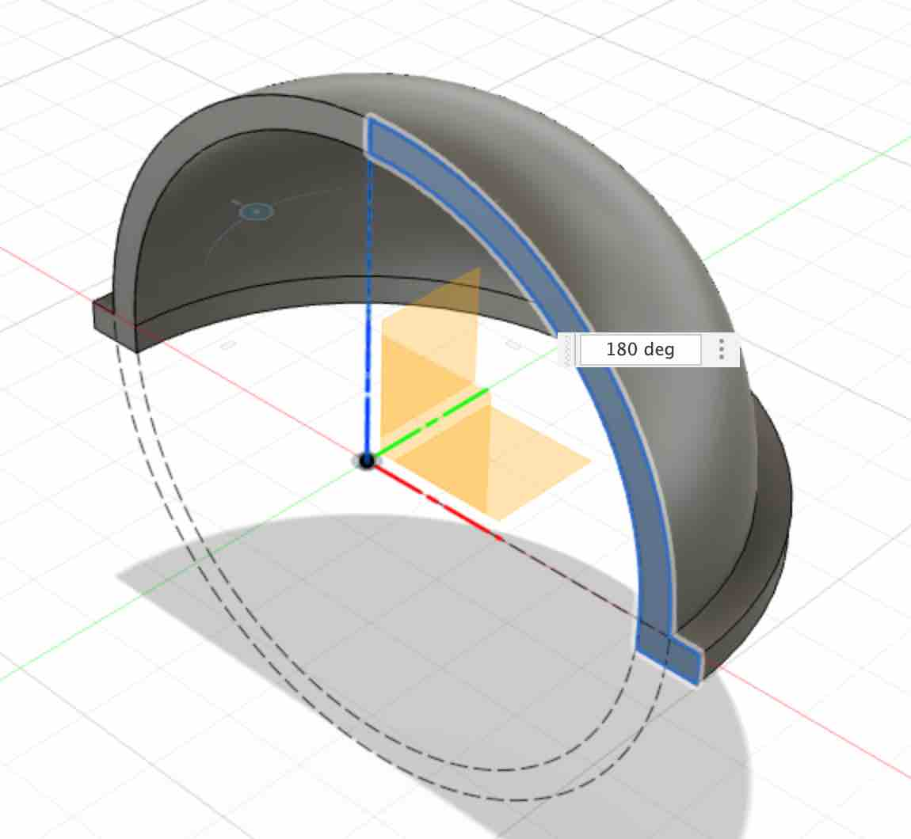

* **Select the profile** - Click within the newly created profile to select it

{:class="img-fluid w-50"}

---

* **Revolve the profile** - Click the Revolve Tool from the 'CREATE' Menu

{:class="img-fluid w-50"}

* **Select the Axis** - Select the Blue `Z` Axis and you will see the new shape appear.

{:class="img-fluid w-50"}

* **Set the rotation** - Set the rotation to 180° so the shape looks like the quarter of a hollow sphere.

{:class="img-fluid w-50"}

---

## Check your understanding


? What does the **Revolve** tool do?
- [ ] Pushes a sketch straight up into a solid
- [x] Spins a sketch profile around an axis to make a round solid
- [ ] Rotates the camera around the model
> Revolve is how we turn a flat curved profile into the domed eyelid.

? What does pressing `x` do to a selected sketch line?
- [x] Toggles it between a normal line and a construction line
- [ ] Deletes it
- [ ] Mirrors it
> Construction lines help you position things but aren't used to make solid shapes.

? What does it mean when a sketch line turns black?
- [ ] It has an error
- [x] It's fully defined and locked in place
- [ ] It's a construction line

