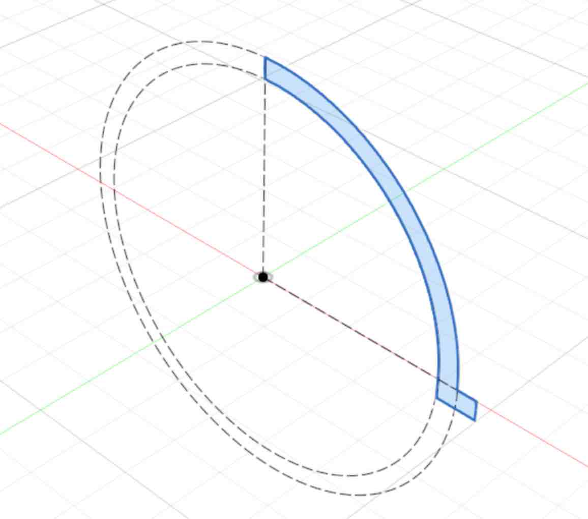
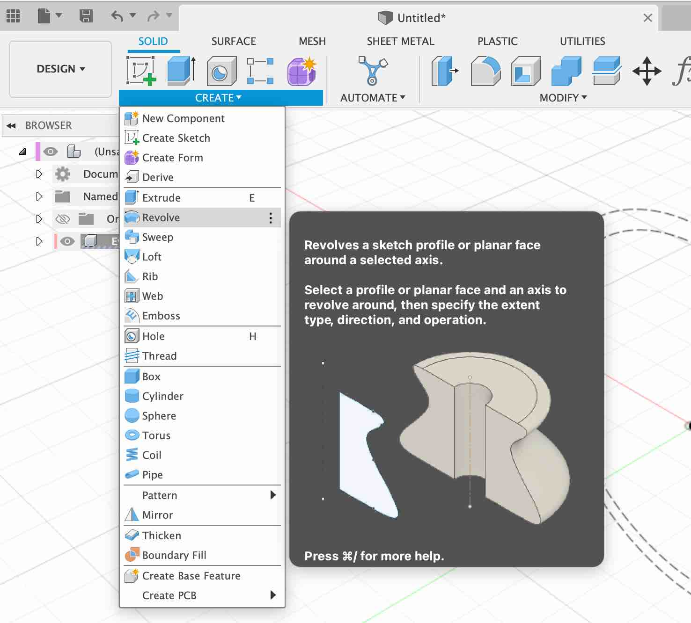
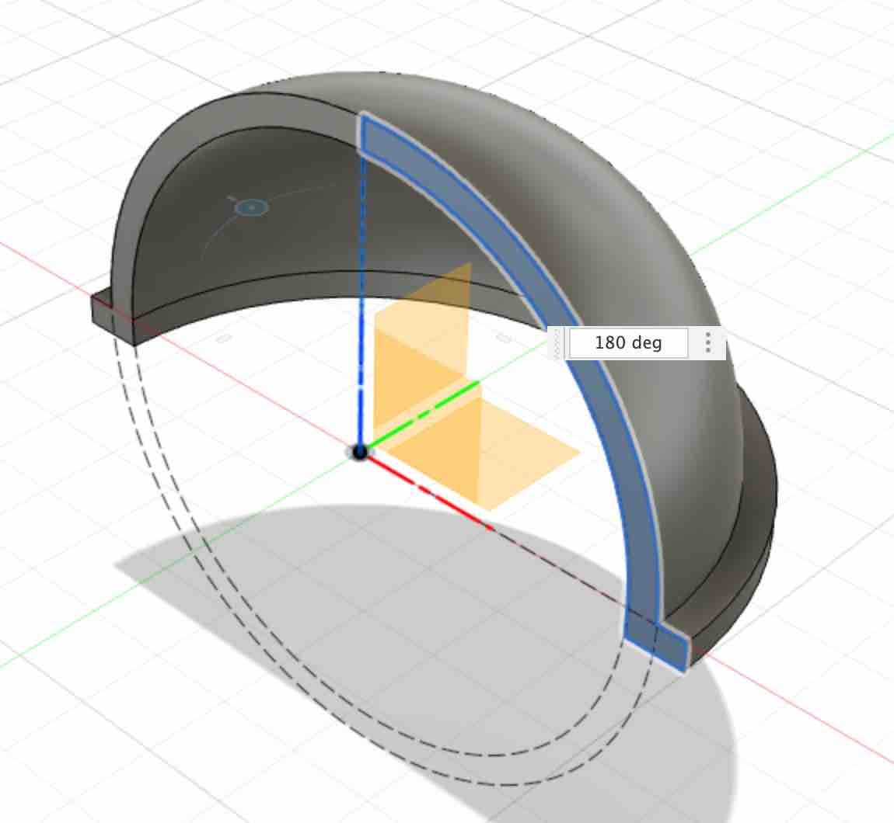
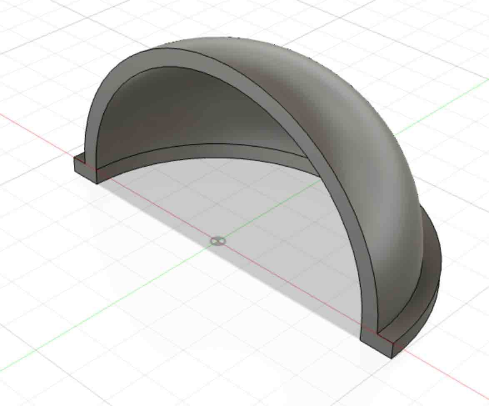

{:class="cover"}

---

By the end of this lesson you will be able to turn a flat sketch profile into a curved 3D eyelid with the Revolve tool.

Revolve is the heart of this design. Instead of modelling a dome by pushing and pulling blocks, we draw its cross-section once and let Fusion 360 spin it around an axis, like a potter's wheel. The two circles from lesson 2 become the inside and outside of a hollow shell, which is exactly what an eyelid is.

* **Select the profile** - Click within the newly created profile to select it

{:class="img-fluid w-50"}

---

* **Revolve the profile** - Click the Revolve Tool from the 'CREATE' Menu

{:class="img-fluid w-50"}

* **Select the Axis** - Select the Blue `Z` Axis and you will see the new shape appear.

{:class="img-fluid w-50"}

* **Set the rotation** - Set the rotation to 180° so the shape looks like the quarter of a hollow sphere.

{:class="img-fluid w-50"}

---

## Try it Yourself

1. Revolve the profile by 90 degrees instead of 180, then undo (`Ctrl+Z`) and go back to 180.
2. Edit the Revolve feature in the timeline and change the angle to watch the eyelid update.
3. Challenge: revolve a full 360 degrees and describe the shape you get.

## Common Issues

- **Problem**: The Revolve tool will not let you pick a profile.
- **Solution**: Click inside the closed shape, not on its edge, so the profile highlights.
- **Why**: Revolve works on closed profiles, so Fusion needs to know which area to spin.

- **Problem**: The shape sweeps the wrong way.
- **Solution**: Check you picked the blue Z axis, then try the opposite angle.
- **Why**: The direction depends on the axis and the sign of the angle.

## Check your understanding


? What does the **Revolve** tool do?
- [ ] Pushes a sketch straight up into a solid
- [x] Spins a sketch profile around an axis to make a round solid
- [ ] Rotates the camera around the model
> Revolve is how we turn a flat curved profile into the domed eyelid.

? What does pressing `x` do to a selected sketch line?
- [x] Toggles it between a normal line and a construction line
- [ ] Deletes it
- [ ] Mirrors it
> Construction lines help you position things but aren't used to make solid shapes.

? What does it mean when a sketch line turns black?
- [ ] It has an error
- [x] It's fully defined and locked in place
- [ ] It's a construction line

