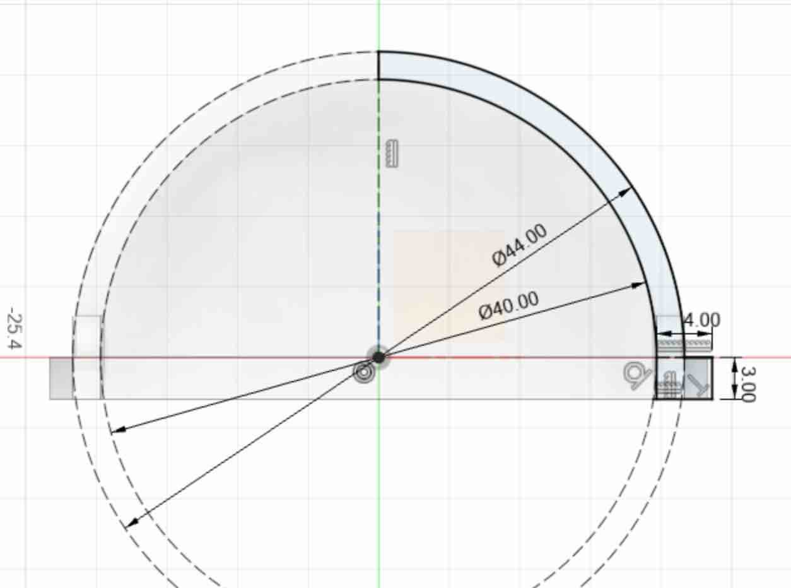
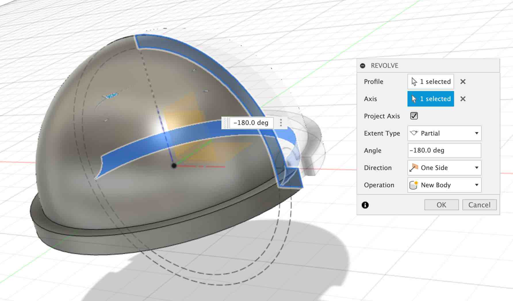
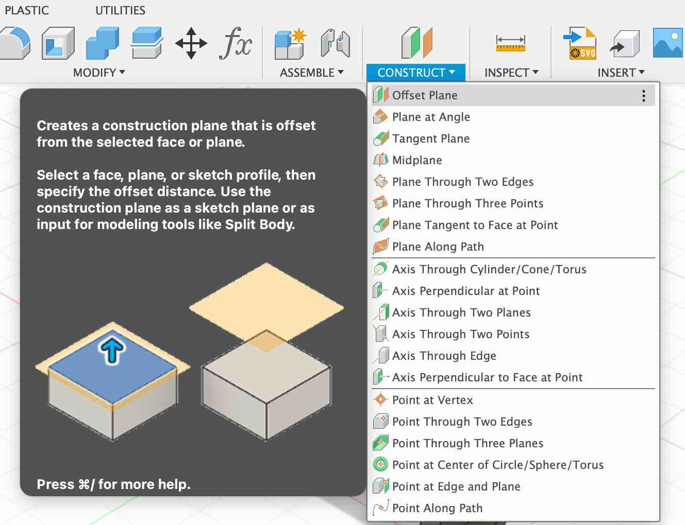
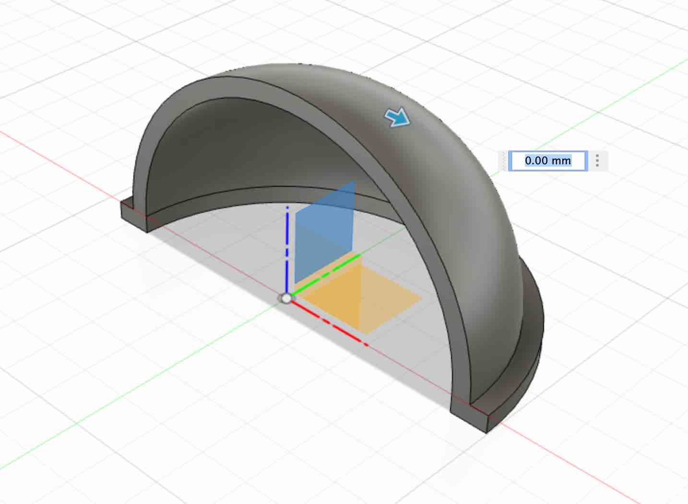
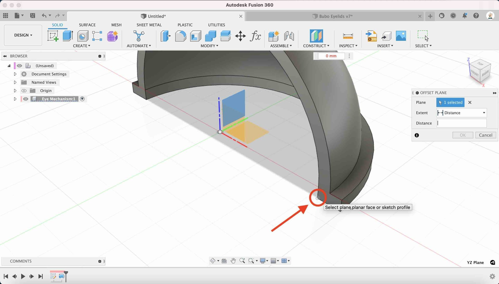
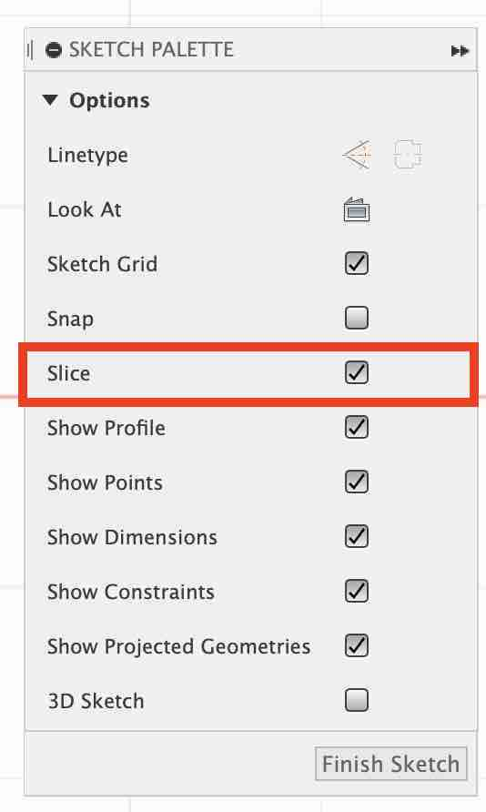
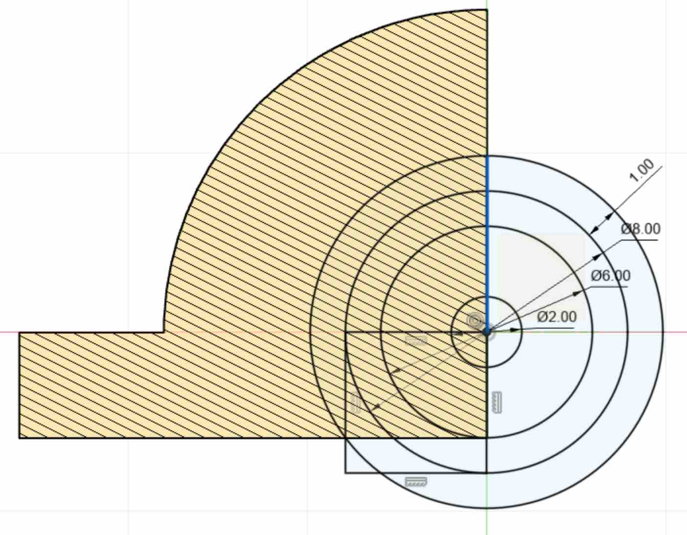

{:class="cover"}

---

By the end of this lesson you will be able to repeat a sketch-and-revolve workflow to create the lower eyelid and its hinge profile.

## Picking up the pace

This next step is similar to creating the profile for the upper eyelid. Now that you have the hang of how to do that, we will pick up the pace a little and show the profiles needed, and just the operations to perform.

---

## Lower Eyelid sketch

* **Create a new sketch** - on the XY Plane (the bottom plane), draw out 2 circles using the same dimension as before

  * 44mm for the outer circle
  * 40mm for the inner circle

This is the same sketch you created in [Lesson 2](02_create_sketch.html#create-a-sketch). 

---

{:class="img-fluid w-50"}

---

* **Rotate - 180** - Similar to Lesson 2, but this time we will use the revolve tool to rotate the profile -180.

{:class="img-fluid w-100"}

---

## Create the hinges

Let's create the hinges similar to in [lesson 4](04_create_hinges.html).

---

* **Create new Sketch** - Create a new sketch on the edge of the eyelid by clicking the `CONSTRUCT` Menu and selecting the `offset plane` option.

{:class="img-fluid w-50"}

---

* **Select the `YZ` plane** - select the `YZ` plane, this is the one that is facing the right side of our model.

{:class="img-fluid w-50"}

---

* **Click on the point side the eyelid** - Click on the point that's highlighted in the image below. The new plane should then be offset by `20mm` from the `YZ` plane.

{:class="img-fluid w-100"}

---

* **Create the hinge profile** - Select the newly created offset plane and click on the `Create Sketch` button to create a new sketch on this plane.

---

* **Slice** - Click on the `Slice` option from the `Sketch Palette`. Slice will remove the parts of the model that are between the camera and the selected sketch profile. This allows us to see inside of the model.

{:class="img-fluid w-50"}

---

* **Create Four circles** - Using the circle creation mode (press `c`), create four circles:

  * one that is 2mm
  * one that is 6mm
  * one that is 8mm
  * one that is 10mm

---

* **Create a square** - Use the rectangle drawing mode by pressing `r`. Start the rectangle at the origin, and drag it until the bottom line touches the bottom of the circle, and the leftmost side touches the left side of the circle. You can also use the Tangent tool to ensure the line and circles are aligned.

{:class="img-fluid w-50"}

---

* **Finish Sketch** - Click the `Finish Sketch` button

---

## Try it Yourself

1. Look at the upper and lower sketches side by side and list what is the same and what is different.
2. Hide the Upper Eyelid (click the eye icon in the browser) and look at the lower eyelid on its own.
3. Challenge: write down the steps for the lower eyelid from memory, then check them against this lesson.

## Common Issues

- **Problem**: The lower profile revolves into the upper eyelid.
- **Solution**: Check you sketched on the XY plane and revolved by -180, not 180.
- **Why**: The sign of the angle sets which way the shape sweeps around the axis.

## Check your understanding


? Which plane is the lower eyelid sketch drawn on?
- [x] XY
- [ ] YZ
- [ ] The offset plane
> We start on the XY plane, then use an offset plane for the hinge.

? How many circles does the lower hinge profile have?
- [x] Four: 2mm, 6mm, 8mm and 10mm
- [ ] Three
- [ ] Two
> The extra 10mm circle lets it fit over the upper hinge.

? What do we revolve the lower profile by?
- [x] -180 degrees
- [ ] 90 degrees
- [ ] 360 degrees
> The lower eyelid sweeps the other way round.

