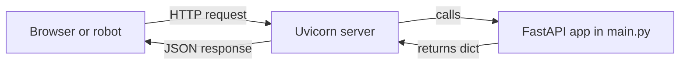

{:class="cover"}

---

By the end of this lesson you will be able to create a virtual environment, install FastAPI, and run a tiny robot API that answers in your browser.

## Why a virtual environment?

Let's build somewhere safe to work. A virtual environment is a private folder of Python packages for one project. Without it, every project shares one pile of packages, and upgrading FastAPI for this course could break something else on your computer.

Make a project folder and a virtual environment inside it:

```bash
$ mkdir robot-api
$ cd robot-api
$ python3 -m venv .venv
$ source .venv/bin/activate
```

On Windows, the last line is `.venv\Scripts\activate`. When it works, your prompt starts with `(.venv)`. Run the activate line again whenever you open a new terminal.

## Installing FastAPI

```bash
$ pip install "fastapi[standard]"
```

The quotes matter in some shells, because they stop `[` and `]` being treated as special characters. The `[standard]` extra installs FastAPI plus the tools we need: the `fastapi` command, the Uvicorn server, `httpx` for testing and `email-validator` for checking email addresses. Check what you got:

```bash
$ pip list | grep -i -E "fastapi|pydantic|uvicorn|starlette"
```

When this course was tested the versions were FastAPI 0.165.0, Pydantic 2.14.4, Starlette 1.10.0 and Uvicorn 0.54.0. We will add two more packages for passwords and tokens in lesson 4.

## Your first robot API

Create a file called `main.py` in the `robot-api` folder:

```python
from fastapi import FastAPI

app = FastAPI(title="Robot Telemetry API")


@app.get("/")
def status():
    """Say hello and report that the robot API is up."""
    return {"robot": "pico-bot", "status": "online"}


@app.get("/ping")
def ping():
    return {"pong": True}
```

Three things are happening here. `app = FastAPI(...)` creates the application. `@app.get("/")` says "when someone sends a GET request to the root address, run the function underneath". The function returns a dictionary, and FastAPI turns it into JSON.

## Running it: fastapi dev and uvicorn

```bash
$ fastapi dev main.py
```

You should see lines like these:

```
 Starting FastAPI in development mode

 Using import string: main:app

 Server started at http://127.0.0.1:8000
    Documentation at http://127.0.0.1:8000/docs
```

Open `http://127.0.0.1:8000/` and you will see `{"robot":"pico-bot","status":"online"}`. Open `http://127.0.0.1:8000/docs` for the interactive documentation FastAPI wrote for you. Click a route, choose **Try it out**, then **Execute**.

`fastapi dev` is for development only. It watches your files and restarts the server when you save, and it only listens on your own computer. Behind the scenes it starts Uvicorn, the program that actually speaks HTTP. You can start Uvicorn yourself, which is what you will see in many tutorials:

```bash
$ uvicorn main:app --reload
```

`main:app` means "in the file `main.py`, use the object called `app`". Stop the server with Ctrl+C.



> **Teachers**: Installing packages needs internet access and permission to write to the learner's folder. On locked-down school computers, `python3 -m venv` or `pip` may be blocked, and a school firewall may stop port 8000. Test the setup on one machine first. If it is blocked, run the course in a Raspberry Pi, a cloud workspace or a Codespace instead.

## Try it Yourself

1. Add a third route, `/leds`, that returns `{"red": false, "green": false, "blue": false}`. Save the file and reload the page without restarting the server.
2. Change the `title` of the app and watch it change at `/docs`.
3. Start the server a second way, with `uvicorn main:app --port 8010`, and visit the new port.
4. Challenge: add a route `/robot/name` that returns your own robot's name and a made-up battery percentage.

## Common Issues

- **Problem**: `fastapi: command not found`
- **Solution**: Activate the virtual environment (`source .venv/bin/activate`) and check that `pip install "fastapi[standard]"` finished without errors.
- **Why**: The `fastapi` command is installed inside `.venv`, so it only exists while the environment is active.

- **Problem**: `Error: [Errno 98] address already in use`
- **Solution**: Another server is on port 8000. Stop it, or choose another port with `fastapi dev main.py --port 8001`.
- **Why**: Only one program can listen on a port at a time.

- **Problem**: `Could not import module "main"`
- **Solution**: Run the command from the folder that holds `main.py`, and check the file is not called `main.py.txt`.
- **Why**: The command looks for `main.py` in the current folder.

## Check your understanding


? Why do we create a virtual environment for each project?
- [ ] It makes Python run faster
- [x] It keeps each project's packages separate so upgrades do not break other projects
- [ ] It is required for FastAPI to start
> A virtual environment is a private set of packages for one project, so changing one project cannot break another.

? What does `uvicorn main:app` mean?
- [ ] Run the function `main` from the module `app`
- [x] Import the file `main.py` and serve the object called `app` inside it
- [ ] Download an app called main
> The part before the colon is the module (file) and the part after it is the variable holding the FastAPI object.

? Which command is meant for development, because it restarts when you save?
- [x] `fastapi dev main.py`
- [ ] `python main.py`
- [ ] `pip install fastapi`
> `fastapi dev` turns on auto-reload and only listens on your own computer.

