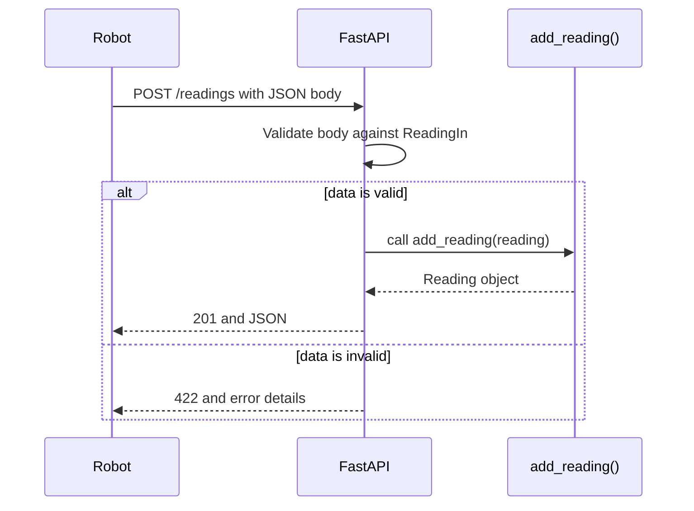

{:class="cover"}

---

By the end of this lesson you will be able to write routes that accept JSON bodies, path parameters and query parameters, and let FastAPI reject bad data for you.

## The shape of a request

A robot talks to an API with HTTP requests. Each one has a **method** (what to do) and a **path** (where to do it):

| Method | Path | Meaning for our robot |
|---|---|---|
| GET | `/readings` | Show me the latest readings |
| GET | `/readings/3` | Show me reading number 3 |
| POST | `/readings` | Here is a new reading, please store it |
{:class="table table-single"}

Data can arrive in three places: in the **path** (`/readings/3`), in the **query string** (`/readings?limit=5`) and in the **body** (a JSON document). FastAPI works out which is which from your function's signature.

## The Pico's data, as a model

Let's describe a reading with a Pydantic model. If you have not met Pydantic, the [Pydantic course](/learn/pydantic/) explains it properly, but all you need today is that a model is a class listing the fields and types you expect.

```python
from datetime import datetime, timezone
from typing import Annotated

from fastapi import FastAPI, HTTPException, Path, Query
from pydantic import BaseModel, Field

app = FastAPI(title="Robot Telemetry API")


class ReadingIn(BaseModel):
    """What the robot sends us."""
    sensor: str = Field(min_length=1, max_length=40, examples=["temperature"])
    value: float


class Reading(ReadingIn):
    """What we store and send back: the robot's data plus an id and a timestamp."""
    id: int
    taken_at: datetime


readings: list[Reading] = []  # lives in memory, so it is wiped on every restart


@app.get("/")
def status():
    return {"robot": "pico-bot", "status": "online", "readings": len(readings)}


@app.post("/readings", status_code=201, response_model=Reading)
def add_reading(reading: ReadingIn):
    new = Reading(
        id=len(readings) + 1,
        taken_at=datetime.now(timezone.utc),
        **reading.model_dump(),
    )
    readings.append(new)
    return new


@app.get("/readings", response_model=list[Reading])
def list_readings(
    sensor: Annotated[str | None, Query(max_length=40)] = None,
    limit: Annotated[int, Query(ge=1, le=100)] = 10,
):
    """Newest first. Filter with ?sensor=temperature and cap with ?limit=5."""
    found = [r for r in readings if sensor is None or r.sensor == sensor]
    return list(reversed(found))[:limit]


@app.get("/readings/{reading_id}", response_model=Reading)
def get_reading(reading_id: Annotated[int, Path(ge=1)]):
    for r in readings:
        if r.id == reading_id:
            return r
    raise HTTPException(status_code=404, detail="No reading with that id")
```

Save this over `main.py`. With `fastapi dev main.py` still running, it reloads by itself.

## What each part does

**Body: `reading: ReadingIn`.** Because the argument is a Pydantic model, FastAPI reads the JSON body, checks every field and hands you a ready-made object. We call `reading.model_dump()` (Pydantic v2) to turn it back into a dictionary. In older tutorials you will see `.dict()`, which is deprecated.

**Query parameters with `Annotated`.** `Annotated[int, Query(ge=1, le=100)]` means "an integer, taken from the query string, at least 1 and at most 100". The `= 10` after it is the default. This `Annotated` style is the current way to add rules to parameters.

**Path parameter.** `{reading_id}` in the path becomes the function argument of the same name, converted to an `int`.

**Response model.** `response_model=Reading` tells FastAPI to send back only the fields in `Reading`, and to document them in `/docs`.

## Trying it for real

Here is what we got when we ran every route against this exact file:

```
POST /readings {"sensor":"temperature","value":21.5}
201 {"sensor": "temperature", "value": 21.5, "id": 1, "taken_at": "2026-11-24T11:45:01.582684Z"}

GET /readings/99
404 {"detail": "No reading with that id"}

GET /readings?limit=500
422 {"detail": [{"type": "less_than_equal", "loc": ["query", "limit"], "msg": "Input should be less than or equal to 100", "input": "500", "ctx": {"le": 100}}]}

POST /readings {"sensor":"temperature","value":"hot"}
422 {"detail": [{"type": "float_parsing", "loc": ["body", "value"], "msg": "Input should be a valid number, unable to parse string as a number", "input": "hot"}]}
```

Status code 422 means "I understood the request, but the data is not valid". The `loc` field says exactly where the problem is, which is a gift when you are debugging a robot that sends wrong data. You can try all of this at `/docs`, or with `curl`:

```bash
$ curl -X POST http://127.0.0.1:8000/readings \
    -H "Content-Type: application/json" \
    -d '{"sensor": "temperature", "value": 21.5}'
```



Notice that your function never runs when validation fails. You do not have to write a single `if` to protect it.

The readings live in a Python list, so they vanish when the server restarts. We will fix that with a database in lesson 5.

## Try it Yourself

1. Post three readings, two `temperature` and one `distance`, using `/docs`. Then call `GET /readings?sensor=distance`.
2. Add a `unit: str = "C"` field to `ReadingIn`, then post a reading with and without it.
3. Add a rule so `value` must be between -50 and 150 using `Field(ge=-50, le=150)`.
4. Challenge: add `GET /readings/latest/{sensor}` that returns only the newest reading for one sensor. Think about where in the file it must go.

## Common Issues

- **Problem**: A POST returns `422` saying `Field required` for `body`.
- **Solution**: Send the header `Content-Type: application/json` and valid JSON. In `curl`, wrap the JSON in single quotes.
- **Why**: Without that header FastAPI does not know the body is JSON, so it sees no body at all.

- **Problem**: `GET /readings/latest` returns 422 about `reading_id`.
- **Solution**: Define fixed paths such as `/readings/latest` before routes with parameters like `/readings/{reading_id}`.
- **Why**: FastAPI tries routes in the order you wrote them, and `latest` would be matched as a `reading_id` that is not a number.

- **Problem**: The readings disappear after saving the file.
- **Solution**: This is expected for now. Wait for lesson 5, where we store them in SQLite.
- **Why**: `fastapi dev` restarts the process on every save, and a list in memory dies with the process.

## Check your understanding


? Where does FastAPI find `limit` in `GET /readings?limit=5`?
- [ ] In the JSON body
- [x] In the query string
- [ ] In the path
> Anything after the `?` is the query string, and a plain parameter in your function signature is read from there.

? What does a `422` response tell the robot?
- [ ] The server crashed
- [x] The request was understood but the data failed validation
- [ ] The route does not exist
> Validation failures return 422 with a `detail` list that says which field was wrong. A missing route is a 404.

? Which Pydantic v2 method turns a model into a dictionary?
- [ ] `.dict()`
- [x] `.model_dump()`
- [ ] `.to_json()`
> `.dict()` is the old Pydantic v1 name and is deprecated. `model_dump()` is the current method.

