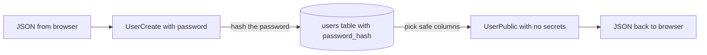

{:class="cover"}

---

By the end of this lesson you will be able to design separate input and output models, create a database when the app starts, and share a database connection with a dependency.

## Different models for different jobs

It is tempting to use one `User` model everywhere. That is how passwords leak. Instead we use a small model for each job:

- `UserCreate`: what someone sends to register. It has a `password`.
- `UserPublic`: what we send back. It has no password and no hash.

The database row holds the hash. The hash never appears in a model that is sent out. If a field is not in the response model, FastAPI cannot leak it.



## The files

From this lesson on we split the app into small files, so each does one job. Put them all in the `robot-api` folder.

**`models.py`** holds every Pydantic model:

```python
from datetime import datetime

from pydantic import BaseModel, EmailStr, Field


class ReadingIn(BaseModel):
    """What the robot sends us."""
    sensor: str = Field(min_length=1, max_length=40, examples=["temperature"])
    value: float


class Reading(ReadingIn):
    """What we store and send back."""
    id: int
    taken_at: datetime


class UserCreate(BaseModel):
    """What someone sends to register. The password only ever lives here."""
    username: str = Field(min_length=3, max_length=30, pattern=r"^[a-z0-9_]+$")
    email: EmailStr
    password: str = Field(min_length=8, max_length=128)


class UserPublic(BaseModel):
    """What we are happy to send back. Notice: no password, no hash."""
    id: int
    username: str
    email: EmailStr
    role: str
```
{: .no-snakie }

`Field` adds rules: a username of 3 to 30 characters using only lowercase letters, digits and underscores; a password of 8 to 128 characters. `EmailStr` checks that the email looks real, and needs the `email-validator` package, which `fastapi[standard]` already installed. Use an address like `kev@example.com` when testing, because `email-validator` rejects reserved test domains such as `.test`.

**`db.py`** creates the tables and hands out connections:

```python
import sqlite3
from collections.abc import Iterator
from pathlib import Path
from typing import Annotated

from fastapi import Depends

DB_PATH = Path("robot.db")

SCHEMA = """
CREATE TABLE IF NOT EXISTS users (
    id            INTEGER PRIMARY KEY AUTOINCREMENT,
    username      TEXT NOT NULL UNIQUE,
    email         TEXT NOT NULL,
    password_hash TEXT NOT NULL,
    role          TEXT NOT NULL DEFAULT 'user'
);
CREATE TABLE IF NOT EXISTS readings (
    id       INTEGER PRIMARY KEY AUTOINCREMENT,
    sensor   TEXT NOT NULL,
    value    REAL NOT NULL,
    taken_at TEXT NOT NULL
);
"""


def init_db() -> None:
    """Create the tables if they are not there yet."""
    with sqlite3.connect(DB_PATH) as conn:
        conn.executescript(SCHEMA)


def get_db() -> Iterator[sqlite3.Connection]:
    """A FastAPI dependency: one connection per request, always closed."""
    conn = sqlite3.connect(DB_PATH, check_same_thread=False)
    conn.row_factory = sqlite3.Row
    try:
        yield conn
        conn.commit()
    finally:
        conn.close()


DB = Annotated[sqlite3.Connection, Depends(get_db)]
```

Two ideas to notice. `init_db()` uses `CREATE TABLE IF NOT EXISTS`, so running it twice is harmless. And `get_db` is a **dependency with `yield`**: FastAPI runs the code before `yield` to open a connection, passes it to your route, then runs the `finally` part to close it, even if the route raised an error. `DB = Annotated[sqlite3.Connection, Depends(get_db)]` is a handy shortcut, so any route can simply write `db: DB`. We pass `check_same_thread=False` because FastAPI may set up the connection and run the route on different worker threads.

**`readings.py`** is the previous lesson's routes, now an `APIRouter` that stores readings in SQLite. Values go in through `?` placeholders, never by pasting strings into the SQL:

```python
from datetime import datetime, timezone
from typing import Annotated

from fastapi import APIRouter, HTTPException, Path, Query

from db import DB
from models import Reading, ReadingIn

router = APIRouter(prefix="/readings", tags=["readings"])


@router.post("", status_code=201, response_model=Reading)
def add_reading(reading: ReadingIn, db: DB):
    taken_at = datetime.now(timezone.utc)
    cursor = db.execute(
        "INSERT INTO readings (sensor, value, taken_at) VALUES (?, ?, ?)",
        (reading.sensor, reading.value, taken_at.isoformat()),
    )
    return Reading(id=cursor.lastrowid, taken_at=taken_at, **reading.model_dump())


@router.get("", response_model=list[Reading])
def list_readings(
    db: DB,
    sensor: Annotated[str | None, Query(max_length=40)] = None,
    limit: Annotated[int, Query(ge=1, le=100)] = 10,
):
    if sensor is None:
        rows = db.execute(
            "SELECT * FROM readings ORDER BY id DESC LIMIT ?", (limit,)
        ).fetchall()
    else:
        rows = db.execute(
            "SELECT * FROM readings WHERE sensor = ? ORDER BY id DESC LIMIT ?",
            (sensor, limit),
        ).fetchall()
    return [Reading(**row) for row in rows]


@router.get("/{reading_id}", response_model=Reading)
def get_reading(reading_id: Annotated[int, Path(ge=1)], db: DB):
    row = db.execute("SELECT * FROM readings WHERE id = ?", (reading_id,)).fetchone()
    if row is None:
        raise HTTPException(status_code=404, detail="No reading with that id")
    return Reading(**row)
```

**`main.py`** now has a **lifespan handler**:

```python
from contextlib import asynccontextmanager

from fastapi import FastAPI

import readings
from db import init_db


@asynccontextmanager
async def lifespan(app: FastAPI):
    # Runs once at start-up, before the first request.
    init_db()
    yield
    # Anything after the yield runs at shutdown (close pools, stop motors...).


app = FastAPI(title="Robot Telemetry API", lifespan=lifespan)
app.include_router(readings.router)


@app.get("/")
def status():
    return {"robot": "pico-bot", "status": "online"}
```

Code before `yield` runs once at start-up, and code after it runs at shutdown. This replaces the old `@app.on_event("startup")` decorator, which is deprecated. It is also the right place to open and close things that live as long as the app, such as the serial port to a real robot.

## Run it

Start `fastapi dev main.py` and post a reading from `/docs`. A file called `robot.db` appears next to `main.py`. Stop the server, start it again, and `GET /readings` still has your data. These are the responses we got from the same file:

```
POST /readings  {"sensor":"temperature","value":21.5}
201 {"sensor": "temperature", "value": 21.5, "id": 1, "taken_at": "2026-11-24T11:45:02.174651Z"}
GET /readings/9
404 {"detail": "No reading with that id"}
```

Remember `robot.db` when you use Git: add it to `.gitignore`, because it will soon hold password hashes.

## Try it Yourself

1. Try registering-style validation on its own: in a Python shell, run `from models import UserCreate` then `UserCreate(username="Kev!", email="kev@example.com", password="x")` and read the error list.
2. Open `robot.db` with the `sqlite3` command line (`sqlite3 robot.db "SELECT * FROM readings"`) and compare it to what the API returns.
3. Add a `unit` column to the `readings` table and the models. What happens to an existing `robot.db`? (Hint: `CREATE TABLE IF NOT EXISTS` will not change a table that already exists.)
4. Challenge: print "robot API starting" before the `yield` and "robot API stopping" after it. Which lines appear when you press Ctrl+C?

## Common Issues

- **Problem**: `ImportError: email-validator is not installed`
- **Solution**: Run `pip install email-validator`, or reinstall with `pip install "fastapi[standard]"`.
- **Why**: `EmailStr` relies on that package, and it is an optional dependency of Pydantic.

- **Problem**: `sqlite3.OperationalError: no such table: readings`
- **Solution**: Check `lifespan=lifespan` is passed to `FastAPI(...)`, and that you are running from the folder where `robot.db` should live.
- **Why**: `init_db()` only runs through the lifespan handler, and `robot.db` is created in the folder you start the server from.

- **Problem**: `ProgrammingError: SQLite objects created in a thread can only be used in that same thread`
- **Solution**: Pass `check_same_thread=False` when connecting, as `db.py` does.
- **Why**: FastAPI runs normal `def` routes in a thread pool, so a connection can move between threads.

## Check your understanding


? Why do we have both `UserCreate` and `UserPublic`?
- [ ] Pydantic only allows two models per file
- [x] The input model carries the password, and the output model leaves it out so it cannot leak
- [ ] So the database has two tables
> Fields missing from the response model are never sent back, which is the simplest protection against leaking a password hash.

? When does the code before `yield` in a lifespan handler run?
- [ ] On every request
- [x] Once, when the app starts
- [ ] Only when the app crashes
> The part before `yield` is start-up and the part after it is shutdown. This replaces the deprecated `on_event`.

? What does the `finally` block in `get_db` guarantee?
- [ ] The query is faster
- [x] The connection is closed even if the route raised an error
- [ ] The data is encrypted
> Code after `yield` in a dependency always runs, so the connection never leaks.

