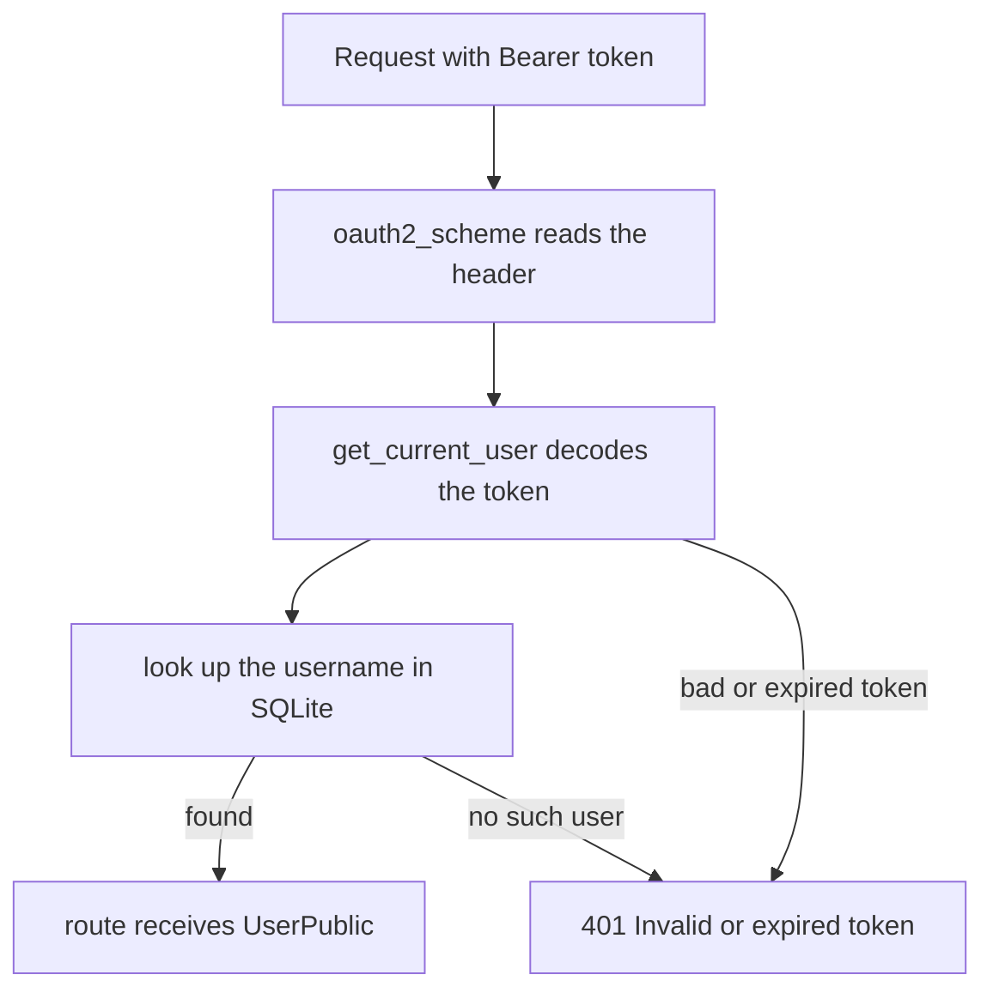

{:class="cover"}

---

By the end of this lesson you will be able to register a user, log in to get a token, and write a dependency that turns a token into the current user.

## Four small pieces

Let's add authentication to the robot API. Each piece is a short file, and together they make a complete login system:

1. `security.py` hashes passwords and creates and reads tokens
2. `auth.py` has the `/register` and `/token` routes
3. `deps.py` has the dependency that finds the logged-in user
4. `main.py` plugs the router in

Add `Token` to the end of `models.py`:

```python
class Token(BaseModel):
    """What /token sends back after a successful login."""
    access_token: str
    token_type: str
```
{: .no-snakie }

## security.py

```python
import os
from datetime import datetime, timedelta, timezone

import jwt
from pwdlib import PasswordHash

# Read the signing key from the environment so it never lives in the code.
# The fallback is for local development only.
SECRET_KEY = os.environ.get("ROBOT_SECRET", "dev-only-secret-change-me-before-deploying")
ALGORITHM = "HS256"
TOKEN_MINUTES = 30

hasher = PasswordHash.recommended()
# A real hash of a throwaway password. We check against it when the username
# does not exist, so a wrong username takes as long as a wrong password.
DUMMY_HASH = hasher.hash("not-a-real-password")


def hash_password(password: str) -> str:
    return hasher.hash(password)


def verify_password(password: str, password_hash: str) -> bool:
    return hasher.verify(password, password_hash)


def create_access_token(username: str) -> str:
    expires = datetime.now(timezone.utc) + timedelta(minutes=TOKEN_MINUTES)
    return jwt.encode({"sub": username, "exp": expires}, SECRET_KEY, algorithm=ALGORITHM)


def decode_access_token(token: str) -> str | None:
    """Return the username inside a valid token, or None if it is bad or expired."""
    try:
        payload = jwt.decode(token, SECRET_KEY, algorithms=[ALGORITHM])
    except jwt.InvalidTokenError:
        return None
    return payload.get("sub")
```
{: .no-snakie }

Everything from lesson 4 is here, wrapped in functions. Notice `DUMMY_HASH`. If a username does not exist, we still check the password against a fake hash. Without that, a wrong username would answer faster than a wrong password, and an attacker could tell which usernames exist by timing the responses.

The secret comes from an environment variable. Set one before you start the server:

```bash
$ export ROBOT_SECRET="$(python3 -c 'import secrets; print(secrets.token_urlsafe(32))')"
```

On Windows PowerShell use `$env:ROBOT_SECRET = "..."` with any long random text. If you skip this step, the development fallback in the file is used, so never deploy it that way. Lesson 9 makes the app refuse to start without a real secret.

## auth.py

```python
import sqlite3
from typing import Annotated

from fastapi import APIRouter, Depends, HTTPException
from fastapi.security import OAuth2PasswordRequestForm

from db import DB
from models import Token, UserCreate, UserPublic
from security import DUMMY_HASH, create_access_token, hash_password, verify_password

router = APIRouter(tags=["auth"])


@router.post("/register", status_code=201, response_model=UserPublic)
def register(user: UserCreate, db: DB):
    # The very first account becomes the admin. Everyone after is a normal user.
    is_first = db.execute("SELECT COUNT(*) FROM users").fetchone()[0] == 0
    role = "admin" if is_first else "user"
    try:
        cursor = db.execute(
            "INSERT INTO users (username, email, password_hash, role) VALUES (?, ?, ?, ?)",
            (user.username, user.email, hash_password(user.password), role),
        )
    except sqlite3.IntegrityError:
        raise HTTPException(status_code=409, detail="That username is already taken")
    return UserPublic(id=cursor.lastrowid, username=user.username, email=user.email, role=role)


@router.post("/token", response_model=Token)
def login(form: Annotated[OAuth2PasswordRequestForm, Depends()], db: DB):
    row = db.execute("SELECT * FROM users WHERE username = ?", (form.username,)).fetchone()
    # Always run one hash check, even for an unknown user.
    password_ok = verify_password(form.password, row["password_hash"] if row else DUMMY_HASH)
    if row is None or not password_ok:
        raise HTTPException(
            status_code=401,
            detail="Wrong username or password",
            headers={"WWW-Authenticate": "Bearer"},
        )
    return Token(access_token=create_access_token(row["username"]), token_type="bearer")
```

Registering stores a hash, never the password. The very first account becomes the `admin`, which is a simple rule for a hobby project. Registering a username twice triggers `sqlite3.IntegrityError` because of the `UNIQUE` constraint, and we turn that into a friendly `409 Conflict`.

For login, `OAuth2PasswordRequestForm` reads a **form** (not JSON) with fields named `username` and `password`. That is the OAuth2 standard, and it is what makes the **Authorize** button in `/docs` work. The form needs the `python-multipart` package, already included in `fastapi[standard]`.

## deps.py

```python
from typing import Annotated

from fastapi import Depends, HTTPException
from fastapi.security import OAuth2PasswordBearer

from db import DB
from models import UserPublic
from security import decode_access_token

# tokenUrl tells the /docs page where to send the login form.
oauth2_scheme = OAuth2PasswordBearer(tokenUrl="token")


def get_current_user(token: Annotated[str, Depends(oauth2_scheme)], db: DB) -> UserPublic:
    username = decode_access_token(token)
    row = None
    if username is not None:
        row = db.execute("SELECT * FROM users WHERE username = ?", (username,)).fetchone()
    if row is None:
        raise HTTPException(
            status_code=401,
            detail="Invalid or expired token",
            headers={"WWW-Authenticate": "Bearer"},
        )
    return UserPublic(**row)  # the extra password_hash column is simply ignored


CurrentUser = Annotated[UserPublic, Depends(get_current_user)]


def require_admin(user: CurrentUser) -> UserPublic:
    if user.role != "admin":
        raise HTTPException(status_code=403, detail="Admins only")
    return user


AdminUser = Annotated[UserPublic, Depends(require_admin)]
```

This is the heart of it. `OAuth2PasswordBearer` looks for an `Authorization: Bearer <token>` header, and returns a 401 if it is missing. `get_current_user` then decodes the token and looks the user up. We end with `CurrentUser`, a shortcut so any route can ask for the logged-in user with `user: CurrentUser`. A dependency can depend on other dependencies: `get_current_user` itself uses `DB`.



## main.py

```python
from contextlib import asynccontextmanager

from fastapi import FastAPI

import auth
import readings
from db import init_db
from deps import CurrentUser
from models import UserPublic


@asynccontextmanager
async def lifespan(app: FastAPI):
    init_db()
    yield


app = FastAPI(title="Robot Telemetry API", lifespan=lifespan)
app.include_router(auth.router)
app.include_router(readings.router)


@app.get("/")
def status():
    return {"robot": "pico-bot", "status": "online"}


@app.get("/users/me", response_model=UserPublic)
def whoami(user: CurrentUser):
    return user
```

## Watch it work

We registered two users and logged in. Real responses from this code:

```
POST /register {"username":"kev","email":"kev@example.com","password":"long-enough-pw"}
201 {"id": 1, "username": "kev", "email": "kev@example.com", "role": "admin"}

POST /register  (same username again)
409 {"detail": "That username is already taken"}

POST /register  (password "short")
422 ... "String should have at least 8 characters" ...

POST /token  (form: username=kev, password=wrong-wrong)
401 {"detail": "Wrong username or password"}

GET /users/me  (no token)
401 {"detail": "Not authenticated"}

GET /users/me  (Authorization: Bearer abc)
401 {"detail": "Invalid or expired token"}

GET /users/me  (with the token from /token)
200 {"id": 1, "username": "kev", "email": "kev@example.com", "role": "admin"}
```

In `/docs`, click **Authorize**, enter your username and password, and every **Try it out** call now carries your token.

## Try it Yourself

1. Register a user in `/docs`, log in with **Authorize**, and call `GET /users/me`.
2. Look inside `robot.db` with `sqlite3 robot.db "SELECT username, password_hash, role FROM users"`. Can you read anyone's password?
3. Change `TOKEN_MINUTES` to 1, log in, wait two minutes and call `/users/me` again. What happens?
4. Challenge: stop users registering a password that contains their own username, using a Pydantic `model_validator` on `UserCreate`.

## Common Issues

- **Problem**: `/token` returns `422` saying `Field required` for `username`.
- **Solution**: Send form data (`-d "username=kev&password=..."` in `curl`, or `data=` in `httpx`), not JSON.
- **Why**: The OAuth2 password flow is defined as a form post, not a JSON body.

- **Problem**: Every token stops working after you restart the server.
- **Solution**: Set `ROBOT_SECRET` to the same value each time you start the app.
- **Why**: Tokens are signed with the secret, and a different secret means a different signature.

- **Problem**: `409 That username is already taken` when you did not expect it.
- **Solution**: Choose another username, or delete `robot.db` while developing to start fresh.
- **Why**: The `UNIQUE` column rule in the database refuses a second user with the same name.

## Check your understanding


? Why does `/token` check a dummy hash when the username does not exist?
- [ ] To save database space
- [x] So a wrong username takes about as long as a wrong password, and cannot be used to discover usernames
- [ ] Because SQLite requires it
> Without the dummy check, unknown users would be rejected instantly, which leaks which usernames exist.

? What does `user: CurrentUser` in a route signature do?
- [ ] Creates a new user
- [x] Runs the dependency chain that reads the token and looks up the logged-in user, or returns 401
- [ ] Logs the user out
> `CurrentUser` is `Annotated[UserPublic, Depends(get_current_user)]`, so FastAPI runs `get_current_user` first.

? What format does `/token` expect for the username and password?
- [ ] A JSON body
- [x] Form data
- [ ] Query parameters
> `OAuth2PasswordRequestForm` reads form fields, which is how the OAuth2 password flow is defined.

