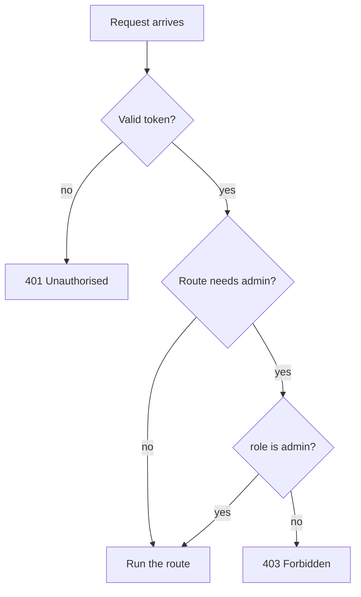

{:class="cover"}

---

By the end of this lesson you will be able to protect routes with a dependency, let users update only the fields they send, and restrict some routes to admins.

## Who may do what?

Now the fun part. We have users and tokens, so let's decide who can touch the robot:

| Route | Who can call it |
|---|---|
| `GET /readings`, `GET /leds` | Anyone, so the public dashboard works |
| `POST /readings`, `PUT /leds/{colour}` | Any logged-in user |
| `GET /users/me`, `PATCH /users/me` | The logged-in user, about themselves |
| `GET /users`, `DELETE /users/{id}` | Admins only |
{:class="table table-single"}

Notice how little code this needs. A route is protected simply by asking for `CurrentUser` or `AdminUser` in its arguments.

## Protecting readings

In `readings.py`, add one import and one argument. Everything else stays as it was:

```python
from deps import CurrentUser   # new import, next to "from db import DB"

@router.post("", status_code=201, response_model=Reading)
def add_reading(reading: ReadingIn, db: DB, user: CurrentUser):   # user is new
    ...                                                            # body unchanged
```
{: .no-snakie }

Without a valid token, the robot now gets `401 Not authenticated`, and the function body never runs.

## LEDs: reading is public, writing is not

Add `LedCommand` to `models.py`, together with `UserUpdate`:

```python
class UserUpdate(BaseModel):
    """Every field is optional, so a caller can change just one thing."""
    email: EmailStr | None = None
    password: str | None = Field(default=None, min_length=8, max_length=128)


class LedCommand(BaseModel):
    on: bool
```
{: .no-snakie }

Then create `leds.py`:

```python
from typing import Literal

from fastapi import APIRouter

from deps import CurrentUser
from models import LedCommand

router = APIRouter(prefix="/leds", tags=["leds"])

Colour = Literal["red", "green", "blue"]

# The robot's LED state lives in memory. The robot polls GET /leds and copies it.
led_state: dict[str, bool] = {"red": False, "green": False, "blue": False}


@router.get("")
def read_leds():
    """Public: the robot (or the dashboard) asks what the LEDs should be doing."""
    return led_state


@router.put("/{colour}")
def set_led(colour: Colour, command: LedCommand, user: CurrentUser):
    """Logged-in users only: switch one LED on or off."""
    led_state[colour] = command.on
    return {"colour": colour, "on": command.on, "set_by": user.username}
```

`Colour = Literal["red", "green", "blue"]` means FastAPI will reject `/leds/purple` with a 422 before our function runs. A robot can poll `GET /leds` every few seconds and copy the state to its real pins.

## users.py

```python
from fastapi import APIRouter, HTTPException

from db import DB
from deps import AdminUser, CurrentUser
from models import UserPublic, UserUpdate
from security import hash_password

router = APIRouter(prefix="/users", tags=["users"])


@router.get("/me", response_model=UserPublic)
def read_me(user: CurrentUser):
    return user


@router.patch("/me", response_model=UserPublic)
def update_me(update: UserUpdate, user: CurrentUser, db: DB):
    # exclude_unset keeps only the fields the caller actually sent, and we
    # also ignore any sent as null, because every column is required.
    sent = update.model_dump(exclude_unset=True)
    changes = {column: value for column, value in sent.items() if value is not None}
    if "password" in changes:
        changes["password_hash"] = hash_password(changes.pop("password"))
    if not changes:
        return user
    # The column names come from our own model fields, never from the caller.
    assignments = ", ".join(f"{column} = ?" for column in changes)
    db.execute(f"UPDATE users SET {assignments} WHERE id = ?", (*changes.values(), user.id))
    row = db.execute("SELECT * FROM users WHERE id = ?", (user.id,)).fetchone()
    return UserPublic(**row)


@router.get("", response_model=list[UserPublic])
def list_users(admin: AdminUser, db: DB):
    rows = db.execute("SELECT * FROM users ORDER BY id").fetchall()
    return [UserPublic(**row) for row in rows]


@router.delete("/{user_id}", status_code=204)
def delete_user(user_id: int, admin: AdminUser, db: DB):
    if user_id == admin.id:
        raise HTTPException(status_code=400, detail="Admins cannot delete themselves")
    cursor = db.execute("DELETE FROM users WHERE id = ?", (user_id,))
    if cursor.rowcount == 0:
        raise HTTPException(status_code=404, detail="No user with that id")
```

Three ideas are worth a slow read:

- **`model_dump(exclude_unset=True)`** returns only the fields the caller actually sent. If someone sends `{}` nothing changes, and if they send only an email, the password is left alone. This is why every `UserUpdate` field is optional.
- **`AdminUser`** is a dependency that depends on `CurrentUser`. A normal user gets `403 Forbidden`, which means "I know who you are, and the answer is no". An invalid token is `401`.
- **The f-string in the SQL** is safe only because the column names come from our own model fields, never from the caller. The values still travel through `?` placeholders.

Finally, wire the new routers into `main.py`. Remove the temporary `/users/me` route from lesson 6 (it now lives in `users.py`):

```python
from contextlib import asynccontextmanager

from fastapi import FastAPI

import auth
import leds
import readings
import users
from db import init_db


@asynccontextmanager
async def lifespan(app: FastAPI):
    init_db()
    yield


app = FastAPI(title="Robot Telemetry API", lifespan=lifespan)
app.include_router(auth.router)
app.include_router(users.router)
app.include_router(readings.router)
app.include_router(leds.router)


@app.get("/")
def status():
    return {"robot": "pico-bot", "status": "online"}
```

## Real responses

We ran this exact code, with `kev` as admin and `robot_one` as a normal user:

```
POST /readings  (no token)                       401 {"detail": "Not authenticated"}
POST /readings  (robot_one's token)              201 {"sensor": "temperature", "value": 21.5, "id": 1, ...}
PUT  /leds/red  {"on": true}  (robot_one)        200 {"colour": "red", "on": true, "set_by": "robot_one"}
PUT  /leds/purple                                422 ... "Input should be 'red', 'green' or 'blue'" ...
GET  /leds                                       200 {"red": true, "green": false, "blue": false}
PATCH /users/me {"email": "nope"}                422 ... "An email address must have an @-sign." ...
GET  /users  (robot_one)                         403 {"detail": "Admins only"}
GET  /users  (kev)                               200 [{"id": 1, ...}, {"id": 2, ...}]
DELETE /users/1  (kev, himself)                  400 {"detail": "Admins cannot delete themselves"}
DELETE /users/2  (kev)                           204
DELETE /users/2  (kev, again)                    404 {"detail": "No user with that id"}
```



A deleted user's token stops working straight away, because `get_current_user` looks the user up on every request. That is the benefit of checking the database instead of trusting the token alone.

> **Teachers**: Because the first account becomes the admin, whoever registers first on a shared class server controls it. Register your own teacher account before learners connect, or run one API per group. Remind learners that their LED commands change one shared robot, so agree whose turn it is.

## Try it Yourself

1. Log in as the admin in `/docs`, register a second user, and use `GET /users` to list both. Then try the same call as the second user.
2. Add a `GET /users/me/readings` route. Hint: add a `user_id` column to `readings` and fill it in `add_reading`.
3. Add a `PUT /leds` route that sets all three LEDs at once, using a model with three booleans.
4. Challenge: add a `POST /users/{user_id}/promote` route, admin only, that sets another user's role to `admin`.

## Common Issues

- **Problem**: A normal user gets `403` when you expected `401`, or the other way round.
- **Solution**: Use 401 for "you are not logged in or your token is bad" and 403 for "you are logged in but not allowed".
- **Why**: The codes tell the caller what to fix: log in again, or ask for permission.

- **Problem**: `PATCH /users/me` with `{"email": null}` seems to do nothing.
- **Solution**: Send a real value, or leave the field out.
- **Why**: `exclude_unset` keeps fields that were sent even when the value is `None`, so `update_me` filters out nulls. Without that line, the `NOT NULL` column would make SQLite refuse the update, and the caller would see a 500 error.

- **Problem**: `GET /users/me` returns 404 or an error about `user_id`.
- **Solution**: Make sure `/me` is declared before any `/{user_id}` route that uses the same method.
- **Why**: FastAPI tries routes in the order they are written, so the first match wins.

## Check your understanding


? What status code means "you are logged in, but you are not allowed to do this"?
- [ ] 401
- [x] 403
- [ ] 404
> 401 means we do not know who you are. 403 means we know, and the answer is no.

? What does `model_dump(exclude_unset=True)` return?
- [ ] Every field, including defaults
- [x] Only the fields that were actually sent in the request
- [ ] Only the fields that failed validation
> That is what lets one `UserUpdate` model change just an email, just a password, or both.

? How do we make a route admin-only?
- [x] Add `admin: AdminUser` to its arguments
- [ ] Give the route a secret URL
- [ ] Check the role in the browser
> `AdminUser` depends on `CurrentUser` and raises 403 unless the role is `admin`.

