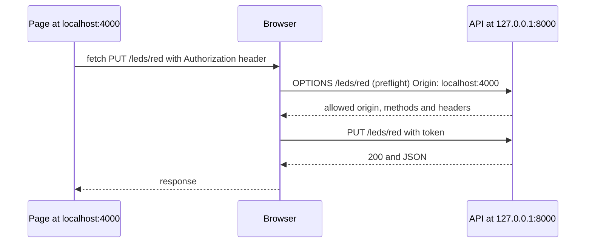

{:class="cover"}

---

By the end of this lesson you will be able to explain CORS, allow only your own site to call the API, and write a static page that logs in and controls the robot.

## Two servers, one project

A Jekyll site is a folder of ready-made HTML files. It has no server code, so it cannot check a password. That is what our API is for. During development you will run two things:

| What | Command | Address |
|---|---|---|
| Robot API | `fastapi dev main.py` | `http://127.0.0.1:8000` |
| Static site | `jekyll serve`, or the Docker setup from the [Jekyll course](/learn/jekyll/) | `http://localhost:4000` |
{:class="table table-single"}

The page on port 4000 now makes requests to port 8000. Browsers treat a different port as a different **origin**, and refuse to let one origin read responses from another unless the second one says it is happy. That permission system is **CORS** (Cross-Origin Resource Sharing).



## Turning CORS on, narrowly

Add the middleware to `main.py`. We list our own site and nobody else:

```python
from contextlib import asynccontextmanager

from fastapi import FastAPI
from fastapi.middleware.cors import CORSMiddleware

import auth
import leds
import readings
import users
from db import init_db


@asynccontextmanager
async def lifespan(app: FastAPI):
    init_db()
    yield


app = FastAPI(title="Robot Telemetry API", lifespan=lifespan)

# Only these web pages may call the API from a browser. 4000 is where
# `jekyll serve` puts your site while you develop it.
app.add_middleware(
    CORSMiddleware,
    allow_origins=["http://localhost:4000", "http://127.0.0.1:4000"],
    allow_methods=["GET", "POST", "PUT", "PATCH", "DELETE"],
    allow_headers=["Authorization", "Content-Type"],
)

app.include_router(auth.router)
app.include_router(users.router)
app.include_router(readings.router)
app.include_router(leds.router)


@app.get("/")
def status():
    return {"robot": "pico-bot", "status": "online"}
```

Do not be tempted by `allow_origins=["*"]`. That lets any website on the internet send requests from your visitors' browsers. Our token travels in an `Authorization` header (not a cookie), so we do not need `allow_credentials`. We checked the behaviour with a real preflight request:

```
OPTIONS /leds/red  Origin: http://localhost:4000   ->  200 OK
OPTIONS /leds/red  Origin: http://evil.example     ->  400 Disallowed CORS origin
GET /leds          Origin: http://localhost:4000   ->  access-control-allow-origin: http://localhost:4000
```

CORS only controls what browsers allow. Tools like `curl` and robots ignore it, which is why the token still has to guard the routes.

## A test robot

No hardware? Here is a script that plays the robot. It registers, logs in (with form fields), posts five temperatures and reads the LEDs back. Run it while the API is running:

```python
"""A stand-in for the real robot, so you can test the API without any hardware.

Run it on your computer while `fastapi dev main.py` is running in another terminal.
"""
import random
import time

import httpx

API = "http://127.0.0.1:8000"
USERNAME = "robot_one"
PASSWORD = "beep-boop-1234"

with httpx.Client(base_url=API) as client:
    # Register the robot's own account. 409 just means it already exists.
    client.post("/register", json={
        "username": USERNAME, "email": "robot@example.com", "password": PASSWORD,
    })

    # Log in (the form fields are named username and password) and keep the token.
    login = client.post("/token", data={"username": USERNAME, "password": PASSWORD})
    login.raise_for_status()
    client.headers["Authorization"] = f"Bearer {login.json()['access_token']}"

    for _ in range(5):
        temperature = round(random.uniform(18.0, 26.0), 1)
        client.post("/readings", json={"sensor": "temperature", "value": temperature})
        leds = client.get("/leds").json()
        print(f"sent {temperature} C, LEDs should be {leds}")
        time.sleep(1)
```
{: .no-snakie }

Real output:

```
sent 24.8 C, LEDs should be {'red': False, 'green': False, 'blue': False}
sent 24.8 C, LEDs should be {'red': False, 'green': False, 'blue': False}
sent 21.3 C, LEDs should be {'red': False, 'green': False, 'blue': False}
sent 24.2 C, LEDs should be {'red': False, 'green': False, 'blue': False}
sent 23.3 C, LEDs should be {'red': False, 'green': False, 'blue': False}
```

A Pico W would do the same job with an HTTP library and the same two calls, a POST to `/token` and then a POST to `/readings`. We have not tested that on a Pico here, so follow the MicroPython networking lessons for your firmware version. Make sure the LEDs on your robot follow what `GET /leds` says.

## The dashboard page

Save this as `dashboard.html` in the root of your Jekyll site. A file with no front matter is copied to the site untouched, so it will be served at `/dashboard.html`:

```html
<!DOCTYPE html>
<html lang="en">
<head>
  <meta charset="utf-8">
  <meta name="viewport" content="width=device-width, initial-scale=1">
  <title>Robot Dashboard</title>
</head>
<body>
  <h1>Robot Dashboard</h1>

  <form id="login">
    <input id="username" placeholder="username" autocomplete="username">
    <input id="password" type="password" placeholder="password" autocomplete="current-password">
    <button>Log in</button>
  </form>
  <p id="message"></p>

  <section id="controls" hidden>
    <button data-colour="red">Toggle red</button>
    <button data-colour="green">Toggle green</button>
    <button data-colour="blue">Toggle blue</button>
    <button id="logout">Log out</button>
  </section>

  <h2>Latest readings</h2>
  <ul id="readings"></ul>

  <script>
    const API = "http://127.0.0.1:8000";
    const $ = (id) => document.getElementById(id);

    // The token lives in sessionStorage, so it disappears when the tab closes.
    const getToken = () => sessionStorage.getItem("token");

    function showState() {
      $("controls").hidden = !getToken();
      $("login").hidden = !!getToken();
    }

    async function loadReadings() {
      const response = await fetch(`${API}/readings?limit=5`);
      const items = await response.json();
      $("readings").replaceChildren(...items.map((r) => {
        const li = document.createElement("li");
        li.textContent = `${r.sensor}: ${r.value}`;   // textContent, never innerHTML
        return li;
      }));
    }

    $("login").addEventListener("submit", async (event) => {
      event.preventDefault();
      const body = new URLSearchParams({
        username: $("username").value,
        password: $("password").value,
      });
      const response = await fetch(`${API}/token`, { method: "POST", body });
      if (!response.ok) {
        $("message").textContent = "Login failed. Check your username and password.";
        return;
      }
      sessionStorage.setItem("token", (await response.json()).access_token);
      $("message").textContent = "";
      showState();
    });

    document.querySelectorAll("[data-colour]").forEach((button) => {
      button.addEventListener("click", async () => {
        const colour = button.dataset.colour;
        const current = await (await fetch(`${API}/leds`)).json();
        const response = await fetch(`${API}/leds/${colour}`, {
          method: "PUT",
          headers: {
            "Content-Type": "application/json",
            "Authorization": `Bearer ${getToken()}`,
          },
          body: JSON.stringify({ on: !current[colour] }),
        });
        if (response.status === 401) {          // token expired
          sessionStorage.removeItem("token");
          showState();
          $("message").textContent = "Your session ended. Please log in again.";
        }
      });
    });

    $("logout").addEventListener("click", () => {
      sessionStorage.removeItem("token");
      showState();
    });

    showState();
    loadReadings();
    setInterval(loadReadings, 5000);
  </script>
</body>
</html>
```

A few choices are worth explaining:

- **`textContent`, never `innerHTML`**, when showing data from the API. If someone posted a reading called `<script>...`, `innerHTML` would run it. `textContent` shows it as plain text.
- **The token goes in `sessionStorage`**, so it vanishes when the tab closes. `localStorage` would keep it for weeks.
- **A 401 clears the token** and asks the user to log in again, because tokens expire after 30 minutes.
- The login uses `URLSearchParams`, which sends a form, exactly as `/token` expects.

Open `http://localhost:4000/dashboard.html`, log in as the robot user and click **Toggle red**. Run `fake_robot.py` again and the LED line now says `'red': True`.

> **Teachers**: School firewalls and managed browsers can block unusual ports such as 8000 and 4000. Do a dry run on a learner machine before the lesson. For a lesson where each learner runs their own API, the page and API both live on the same computer, so no network rules are involved. For a shared API on one machine, check the firewall and give learners its IP address (and add that page's origin to the CORS list).

## Try it Yourself

1. Run the API and the dashboard, log in, and toggle all three LEDs. Watch `GET /leds` at `/docs`.
2. Change the page so it shows the reading's time, `r.taken_at`, next to each value.
3. Remove `http://localhost:4000` from `allow_origins`, restart, and reload the page. Read the error in the browser console, then put it back.
4. Challenge: add a "Log out everywhere" idea. What would the API need so tokens could be revoked? (Hint: think about what `get_current_user` already looks up.)

## Common Issues

- **Problem**: The browser console says `blocked by CORS policy: No 'Access-Control-Allow-Origin' header`.
- **Solution**: Add the exact origin of the page, including the port, to `allow_origins`, and restart the API.
- **Why**: `localhost:4000` and `127.0.0.1:4000` count as different origins, as do `http` and `https`.

- **Problem**: The login works in `/docs` but the page says "Login failed".
- **Solution**: Send `URLSearchParams` (or `FormData`), not `JSON.stringify(...)`.
- **Why**: `/token` only reads form fields.

- **Problem**: LED buttons stop working after a while.
- **Solution**: Log in again.
- **Why**: Tokens last 30 minutes and then return 401.

## Check your understanding


? Why does the browser send an `OPTIONS` request before `PUT /leds/red`?
- [ ] To check the server is online
- [x] As a CORS preflight, to ask whether this origin may send that method and header
- [ ] To log in
> Requests with an `Authorization` header or a `PUT` method are preflighted, and the API must answer with what it allows.

? Why is `allow_origins=["*"]` a poor choice for this API?
- [ ] It is not valid syntax
- [x] Any website could then make requests to the API from a visitor's browser
- [ ] It slows the server down
> Listing only your own site keeps other pages from using your visitors' browsers to call your API.

? Why do we write data with `textContent` and not `innerHTML`?
- [ ] It is faster
- [x] `innerHTML` would run any HTML or script that someone managed to post
- [ ] `innerHTML` does not work in Jekyll
> Data from an API is user input. `textContent` treats it as text only.

