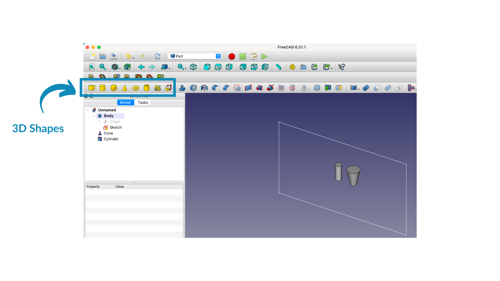
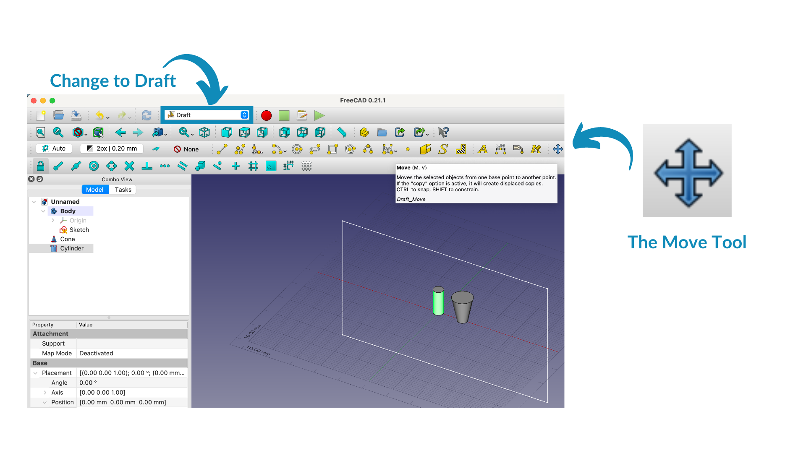

{:class="cover"}

By the end of this lesson you will be able to create a box, cylinder, sphere and cone in the Part workspace, and change their size and position.

> **Teachers**: Remind learners to save their work with Ctrl+S before the end of the session and to name files clearly (for example `house-sam.FCStd`). On shared school computers, agree a folder or a USB stick or cloud drive for saving, and ask learners to send finished files to you in one agreed way.

## Introduction to 3D Shapes in FreeCAD

Almost every robot part, from a chassis to a wheel, starts as a few simple solids stuck together. This lesson introduces the shapes you can make in the Part workbench: boxes, spheres, cylinders and cones.

---

## Tools for Creating Basic Shapes

1. Switch the workspace to `Part` to access the tools for creating basic shapes.
1. Click any of the Yellow 3D shapes on the toolbar to create them.

{:class="img-fluid w-100"}

A new shape appears at the origin (the centre point of the 3D view) with default dimensions. You then set its real size in the Property editor, in the Data tab, so the numbers are exact.

1. **Box (Cube):**
   - Tool: `Create Box`
   - Steps: Click the tool, then select the box in the model tree. Set Length, Width and Height in the property editor.

1. **Cylinder:**
   - Tool: `Create Cylinder`
   - Steps: Click the tool, then set Radius and Height in the property editor.

1. **Sphere:**
   - Tool: `Create Sphere`
   - Steps: Click the tool, then set the Radius in the property editor.

1. **Cone:**
   - Tool: `Create Cone`
   - Steps: Click the tool, then set the two radii (bottom and top) and the Height in the property editor.

Tool names can differ slightly between FreeCAD versions, so hover over the yellow icons to read their names.

---

## Modifying Basic Shapes

- **Moving Objects:**
  - Use the `Move` tool to reposition your shapes within the 3D view. You can also type exact numbers into the Placement property.

  1. Change the workspace to `Draft` to access the `Move` tool.
  1. Click on the move tool, then select the object you want to move.

  {:class="img-fluid w-100"}
- **Rotating Objects:**
  - Select the `Rotate` tool in the Draft workspace to adjust the orientation of shapes around specified axes.
- **Scaling Objects:**
  - With the `Scale` tool in the Draft workspace, you can resize your shapes.

---

## Practical Exercise: Creating a Simple Model

- **Task:** Create a simple house model using boxes for the structure and a cone for the roof.
- **Steps:**
  - Use `Create Box` to form the walls and base.
  - Place a `Create Cone` on top for the roof.
  - Modify dimensions to fit the shapes together cohesively.

---

## Try it Yourself

1. Create a box 40 mm long, 20 mm wide and 10 mm high by typing the numbers into the property editor.
2. Add a cylinder with a radius of 5 mm and move it so it sits on top of the box.
3. Challenge: build a simple robot out of a box body, two cylinder wheels and a sphere head.

---

## Common Issues

- **Problem**: All my shapes are in the same place and overlap.
- **Solution**: Change each shape's Placement position, or use the Draft `Move` tool.
- **Why**: New shapes always start at the origin.

- **Problem**: I cannot find the Part tools.
- **Solution**: Pick `Part` from the workspace selector.
- **Why**: Toolbars only show the tools for the current workspace.

---

## Check your understanding


? Where do you set a box's exact length, width and height?
- [ ] In the navigation cube
- [x] In the Property editor
- [ ] In the Draft workspace
> The Property editor holds each shape's dimensions.

? Which workspace did we use for the Move tool?
- [x] Draft
- [ ] Part
- [ ] TechDraw
> The lesson switches to Draft to find the Move tool.

? Where does a newly created shape appear?
- [ ] Wherever you click
- [x] At the origin
- [ ] Outside the model
> Shapes start at the origin, so you must position them afterwards.


---

## Additional Resources

- [FreeCAD Part Workbench Tools](https://wiki.freecad.org/Part_Workbench)
- [Video Tutorials on Creating Basic Shapes](https://www.youtube.com/results?search_query=freecad+basic+shapes)
