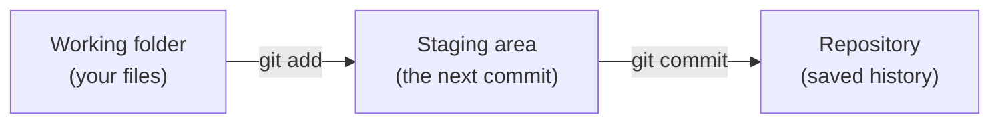

## Saving a snapshot takes two steps

In most programs you just press Save. Git splits saving into two steps:

1. **Stage** the changes you want to save, with `git add`
2. **Commit** them, with `git commit`

That sounds like extra work, but it lets you choose exactly what goes into each snapshot. If you've fixed a bug *and* started a new feature, you can commit the bug fix on its own, with its own message.

---

## The three areas

It helps to picture three places your changes can be:



* **Working folder**: the files you can see and edit
* **Staging area**: the changes you've picked for the next commit (Git also calls this the *index*)
* **Repository**: the history of commits, stored in `.git`

Think of the staging area as a loading bay: you pile up the changes you want, then `git commit` ships them all together as one snapshot.

---

## Your first commit

In your `pico-bot` folder from the last module, stage `main.py`:

```bash
git add main.py
git status
```

```text
On branch main

No commits yet

Changes to be committed:
  (use "git rm --cached <file>..." to unstage)
	new file:   main.py
```

`main.py` has moved to "Changes to be committed". Now commit it with a message:

```bash
git commit -m "Add start-up code that blinks the LED"
```

```text
[main (root-commit) 3f9c2a1] Add start-up code that blinks the LED
 1 file changed, 10 insertions(+)
 create mode 100644 main.py
```

You've made your first commit. The `3f9c2a1` is the start of the commit's unique ID, called a **hash**. Yours will be different. Run `git status` and you'll see `nothing to commit, working tree clean`, which means everything is saved.

---

## The everyday loop

From now on, working with Git is a loop:

1. Edit your files
2. `git status` to see what changed
3. `git add` the changes you want
4. `git commit -m "Say what you did"`

Let's go round it once. Add a motor pin to `main.py`, just under the `led` line:

```python
left_motor = Pin(14, Pin.OUT)
```

Git now sees a change to a tracked file:

```bash
git status --short
```

```text
 M main.py
```

The `M` means modified. Stage it and commit:

```bash
git add main.py
git commit -m "Set up the left motor pin"
```

---

## Adding several files

You don't have to add files one by one:

```bash
git add main.py README.md   # add specific files
git add .                    # add every change in this folder and below
```

`git add .` is handy, but check `git status` first so you don't commit something by accident (module 7 shows how to make Git ignore files you never want to commit).

---

## Writing good commit messages

Your commit messages are the diary of your project. Six months from now, "stuff" or "fixed it" won't help you at all. A good message:

* **Says what the commit does**, written as an instruction: "Add distance sensor", not "Added distance sensor" or "adding sensor"
* **Is short**: aim for about 50 characters on the first line
* **Explains why** if it isn't obvious

Good | Not so good
-----|------------
`Add ultrasonic distance sensor` | `sensor`
`Fix robot turning the wrong way` | `fixed bug`
`Slow motors to 60% to stop wheel slip` | `changes`
{:class="table table-striped"}

For a longer explanation, leave out `-m`. Git opens your editor; write a short first line, a blank line, then as much detail as you like. Save and close the editor to finish the commit.

---

## Commit little and often

A commit should be **one logical change**. Small commits are easier to understand and much easier to undo. A good rule: if you can't describe the commit in one short sentence, it's probably two commits.

---

## Try it yourself

1. Create a `README.md` (if you haven't) and commit it with the message `Add README`.
2. Edit both `main.py` and `README.md`. Then stage and commit **only** `README.md`. Run `git status` to check that `main.py` is still waiting.
3. Commit `main.py` with a good message.

---

## Common issues

- **Problem**: `nothing added to commit but untracked files present`
- **Solution**: Run `git add <file>` before `git commit`.
- **Why**: `git commit` only saves what's in the staging area.

- **Problem**: `Author identity unknown *** Please tell me who you are.`
- **Solution**: Set your name and email with `git config --global user.name` and `user.email` (see module 2).
- **Why**: Every commit has to record who made it.

- **Problem**: You ran `git commit` without `-m` and an editor opened
- **Solution**: Type your message on the first line, save and close the editor. In Vim, press `Esc` then type `:wq` and press Enter.
- **Why**: Without `-m`, Git asks for the message in your editor.

---

## Check your understanding


? You edited `main.py` and ran `git commit -m "Update"` straight away. Git says `no changes added to commit`. Why?
- [ ] The commit message is too short
- [x] You didn't stage the change with `git add` first
- [ ] `main.py` is not in a repository
> Changes go into a commit only after you stage them with `git add`.

? Which commit message is best?
- [ ] `fixed stuff`
- [ ] `Changes to main.py`
- [x] `Stop robot when obstacle is closer than 10cm`
> It says exactly what the commit does, so anyone reading the history understands it.

? What is the staging area for?
- [x] Choosing exactly which changes go into the next commit
- [ ] Backing up your files online
- [ ] Storing deleted files
> You can stage some changes and leave others for a later commit.


---
